# Diagram Gallery

## D01 · Flowchart — theme colors

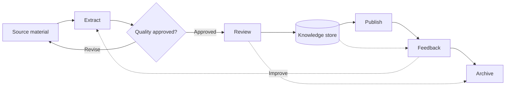

## D02 · Flowchart — fixed colors

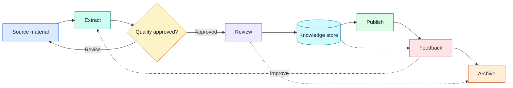

## D03 · Flowchart — Mermaid init

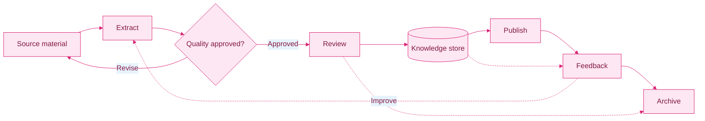

## D04 · Flowchart — 96-node stress test

```mermaid
flowchart TB
  subgraph Collect[Collection]
    direction LR
    Collect0[Receive 1-1]
    Collect1[Validate 1-2]
    Collect0 --> Collect1
    Collect2[Queue 1-3]
    Collect1 --> Collect2
    Collect3[Transform 1-4]
    Collect2 --> Collect3
    Collect4[Enrich 1-5]
    Collect3 --> Collect4
    Collect5{Checks passed?}
    Collect4 --> Collect5
    Collect6[Route 1-7]
    Collect5 --> Collect6
    Collect7[Process 1-8]
    Collect6 --> Collect7
    Collect8[Aggregate 1-9]
    Collect7 --> Collect8
    Collect9[Confirm 1-10]
    Collect8 --> Collect9
    Collect10[(Persist)]
    Collect9 --> Collect10
    Collect11[Complete 1-12]
    Collect10 --> Collect11
    Collect5 -.->|Return for revision| Collect2
    Collect6 --> Collect9
  end
  subgraph Prepare[Preprocessing]
    direction LR
    Prepare0[Receive 2-1]
    Prepare1[Validate 2-2]
    Prepare0 --> Prepare1
    Prepare2[Queue 2-3]
    Prepare1 --> Prepare2
    Prepare3[Transform 2-4]
    Prepare2 --> Prepare3
    Prepare4[Enrich 2-5]
    Prepare3 --> Prepare4
    Prepare5{Checks passed?}
    Prepare4 --> Prepare5
    Prepare6[Route 2-7]
    Prepare5 --> Prepare6
    Prepare7[Process 2-8]
    Prepare6 --> Prepare7
    Prepare8[Aggregate 2-9]
    Prepare7 --> Prepare8
    Prepare9[Confirm 2-10]
    Prepare8 --> Prepare9
    Prepare10[(Persist)]
    Prepare9 --> Prepare10
    Prepare11[Complete 2-12]
    Prepare10 --> Prepare11
    Prepare5 -.->|Return for revision| Prepare2
    Prepare6 --> Prepare9
  end
  Collect11 --> Prepare0
  subgraph Model[Modeling]
    direction LR
    Model0[Receive 3-1]
    Model1[Validate 3-2]
    Model0 --> Model1
    Model2[Queue 3-3]
    Model1 --> Model2
    Model3[Transform 3-4]
    Model2 --> Model3
    Model4[Enrich 3-5]
    Model3 --> Model4
    Model5{Checks passed?}
    Model4 --> Model5
    Model6[Route 3-7]
    Model5 --> Model6
    Model7[Process 3-8]
    Model6 --> Model7
    Model8[Aggregate 3-9]
    Model7 --> Model8
    Model9[Confirm 3-10]
    Model8 --> Model9
    Model10[(Persist)]
    Model9 --> Model10
    Model11[Complete 3-12]
    Model10 --> Model11
    Model5 -.->|Return for revision| Model2
    Model6 --> Model9
  end
  Prepare11 --> Model0
  subgraph Search[Indexing]
    direction LR
    Search0[Receive 4-1]
    Search1[Validate 4-2]
    Search0 --> Search1
    Search2[Queue 4-3]
    Search1 --> Search2
    Search3[Transform 4-4]
    Search2 --> Search3
    Search4[Enrich 4-5]
    Search3 --> Search4
    Search5{Checks passed?}
    Search4 --> Search5
    Search6[Route 4-7]
    Search5 --> Search6
    Search7[Process 4-8]
    Search6 --> Search7
    Search8[Aggregate 4-9]
    Search7 --> Search8
    Search9[Confirm 4-10]
    Search8 --> Search9
    Search10[(Persist)]
    Search9 --> Search10
    Search11[Complete 4-12]
    Search10 --> Search11
    Search5 -.->|Return for revision| Search2
    Search6 --> Search9
  end
  Model11 --> Search0
  subgraph Compose[Collaboration]
    direction LR
    Compose0[Receive 5-1]
    Compose1[Validate 5-2]
    Compose0 --> Compose1
    Compose2[Queue 5-3]
    Compose1 --> Compose2
    Compose3[Transform 5-4]
    Compose2 --> Compose3
    Compose4[Enrich 5-5]
    Compose3 --> Compose4
    Compose5{Checks passed?}
    Compose4 --> Compose5
    Compose6[Route 5-7]
    Compose5 --> Compose6
    Compose7[Process 5-8]
    Compose6 --> Compose7
    Compose8[Aggregate 5-9]
    Compose7 --> Compose8
    Compose9[Confirm 5-10]
    Compose8 --> Compose9
    Compose10[(Persist)]
    Compose9 --> Compose10
    Compose11[Complete 5-12]
    Compose10 --> Compose11
    Compose5 -.->|Return for revision| Compose2
    Compose6 --> Compose9
  end
  Search11 --> Compose0
  subgraph Publish[Delivery]
    direction LR
    Publish0[Receive 6-1]
    Publish1[Validate 6-2]
    Publish0 --> Publish1
    Publish2[Queue 6-3]
    Publish1 --> Publish2
    Publish3[Transform 6-4]
    Publish2 --> Publish3
    Publish4[Enrich 6-5]
    Publish3 --> Publish4
    Publish5{Checks passed?}
    Publish4 --> Publish5
    Publish6[Route 6-7]
    Publish5 --> Publish6
    Publish7[Process 6-8]
    Publish6 --> Publish7
    Publish8[Aggregate 6-9]
    Publish7 --> Publish8
    Publish9[Confirm 6-10]
    Publish8 --> Publish9
    Publish10[(Persist)]
    Publish9 --> Publish10
    Publish11[Complete 6-12]
    Publish10 --> Publish11
    Publish5 -.->|Return for revision| Publish2
    Publish6 --> Publish9
  end
  Compose11 --> Publish0
  subgraph Observe[Observability]
    direction LR
    Observe0[Receive 7-1]
    Observe1[Validate 7-2]
    Observe0 --> Observe1
    Observe2[Queue 7-3]
    Observe1 --> Observe2
    Observe3[Transform 7-4]
    Observe2 --> Observe3
    Observe4[Enrich 7-5]
    Observe3 --> Observe4
    Observe5{Checks passed?}
    Observe4 --> Observe5
    Observe6[Route 7-7]
    Observe5 --> Observe6
    Observe7[Process 7-8]
    Observe6 --> Observe7
    Observe8[Aggregate 7-9]
    Observe7 --> Observe8
    Observe9[Confirm 7-10]
    Observe8 --> Observe9
    Observe10[(Persist)]
    Observe9 --> Observe10
    Observe11[Complete 7-12]
    Observe10 --> Observe11
    Observe5 -.->|Return for revision| Observe2
    Observe6 --> Observe9
  end
  Publish11 --> Observe0
  subgraph Archive[Recovery]
    direction LR
    Archive0[Receive 8-1]
    Archive1[Validate 8-2]
    Archive0 --> Archive1
    Archive2[Queue 8-3]
    Archive1 --> Archive2
    Archive3[Transform 8-4]
    Archive2 --> Archive3
    Archive4[Enrich 8-5]
    Archive3 --> Archive4
    Archive5{Checks passed?}
    Archive4 --> Archive5
    Archive6[Route 8-7]
    Archive5 --> Archive6
    Archive7[Process 8-8]
    Archive6 --> Archive7
    Archive8[Aggregate 8-9]
    Archive7 --> Archive8
    Archive9[Confirm 8-10]
    Archive8 --> Archive9
    Archive10[(Persist)]
    Archive9 --> Archive10
    Archive11[Complete 8-12]
    Archive10 --> Archive11
    Archive5 -.->|Return for revision| Archive2
    Archive6 --> Archive9
  end
  Observe11 --> Archive0
  Collect10 -.-> Archive0
  Model10 -.-> Search3
  Search10 -.-> Compose2
  Observe8 -.-> Prepare1
  Observe9 -.-> Model1
  Publish5 -.-> Compose4
  Archive11 -.-> Collect0
```

## F01 · Publishing Approval Pipeline

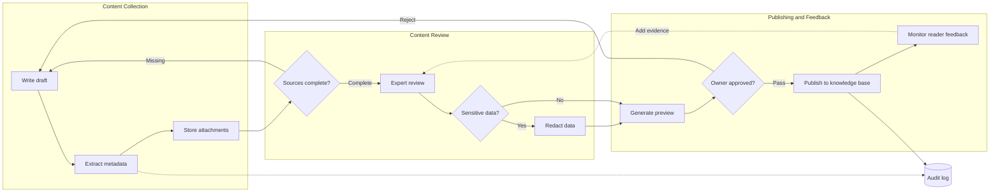

## F02 · Order Status Colors

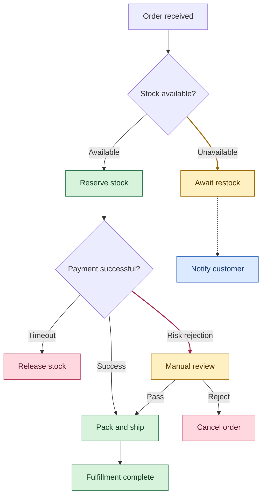

## F03 · Data Processing Shapes

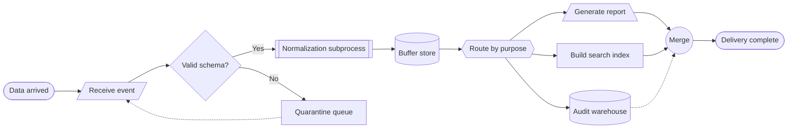

## F04 · Cross-Team Event Topology

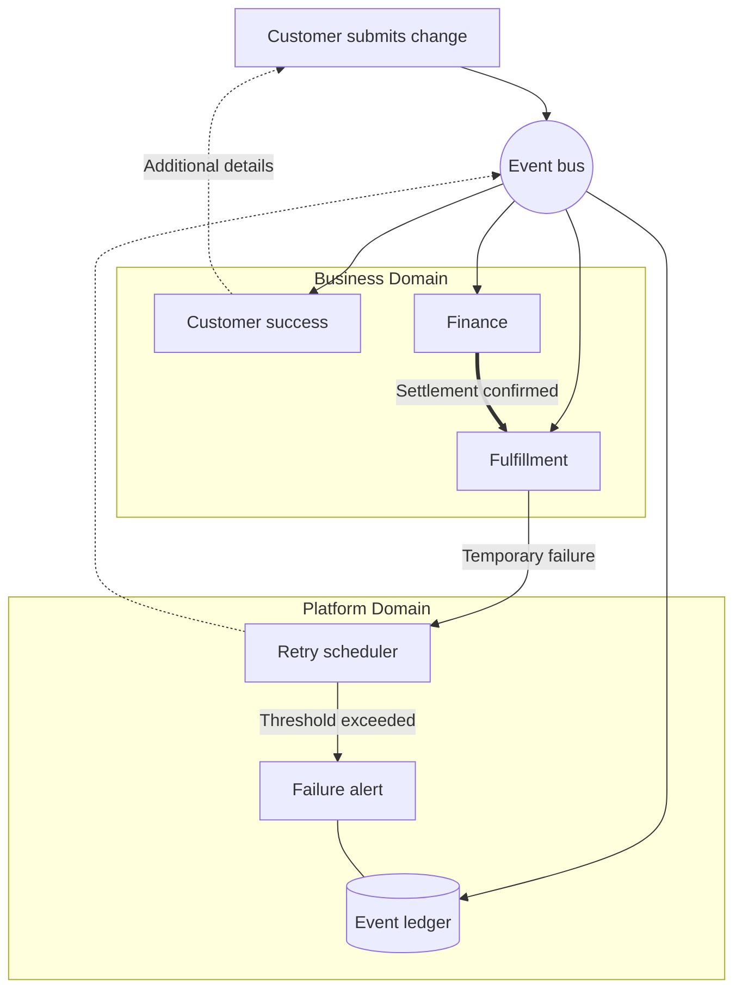

## F05 · Payment and Recovery Sequence

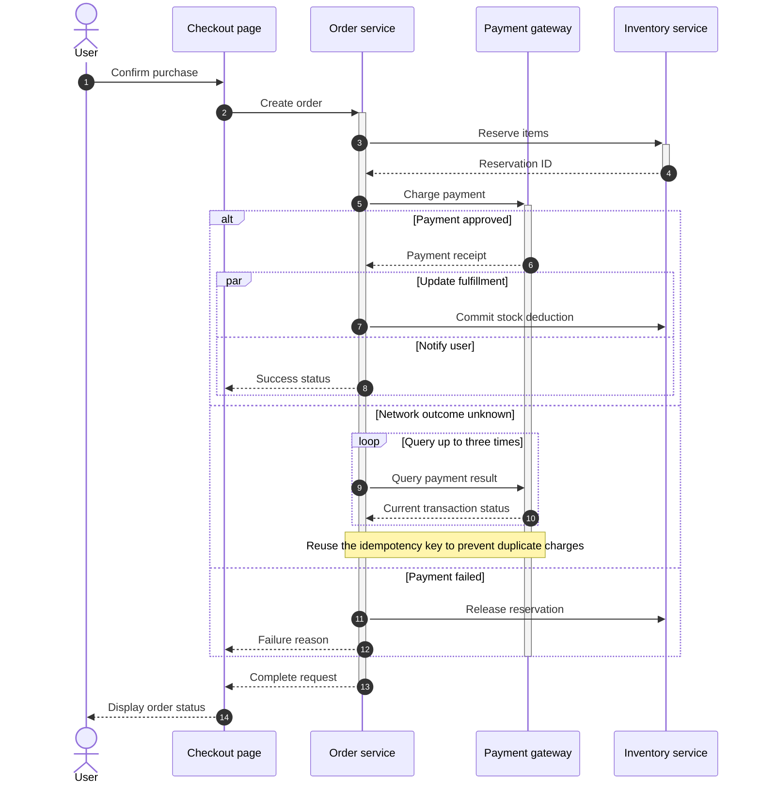

## F06 · Composable Document Model

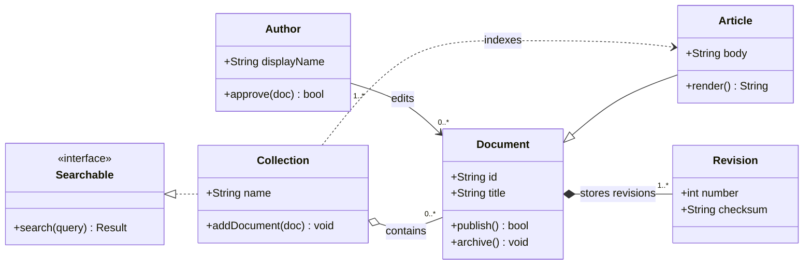

## F07 · Nested Sync Lifecycle

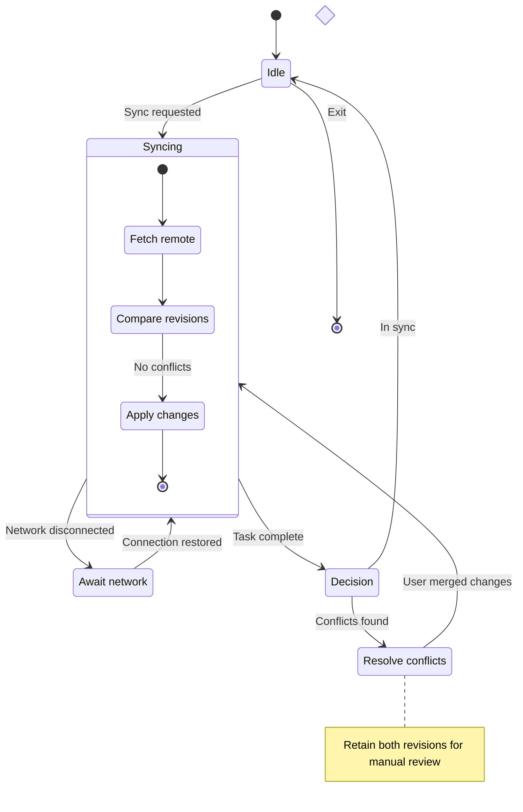

## F08 · Legacy Ticket State Machine

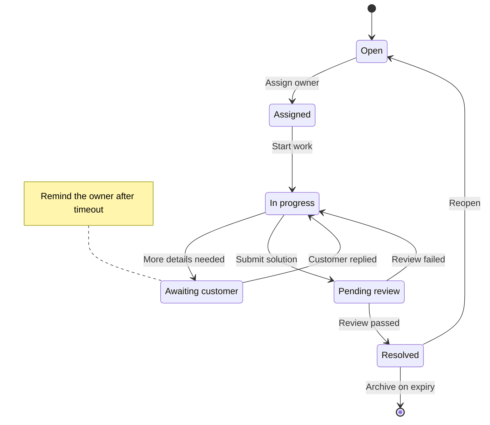

## F09 · Multi-Tenant Content Model

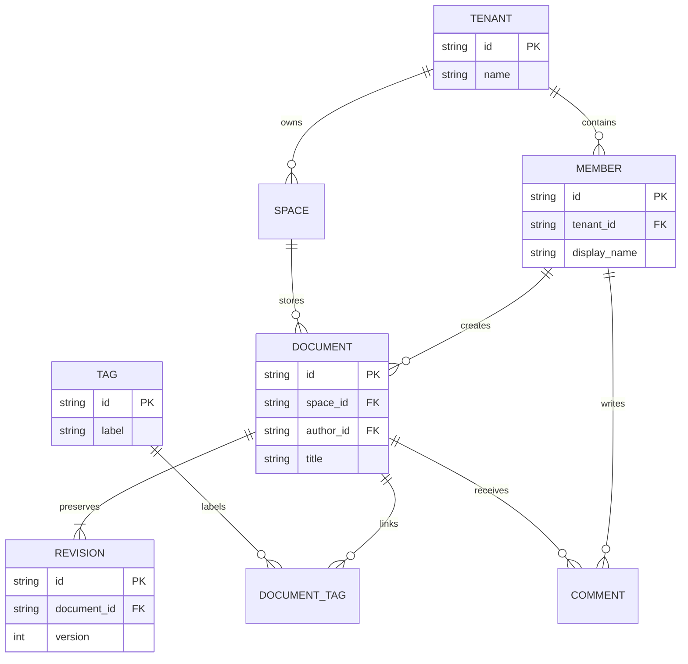

## F10 · Cross-Platform Release Plan

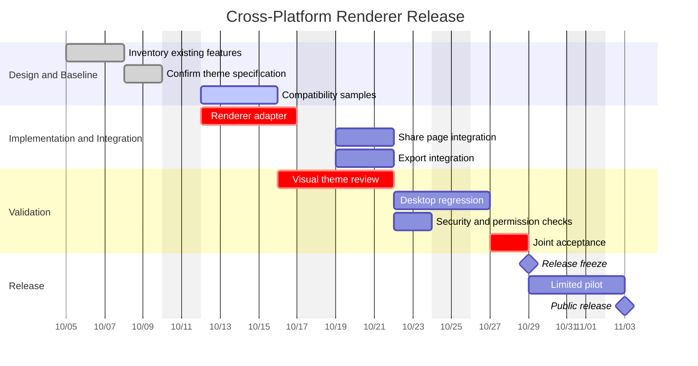

## F11 · Release Branches and Hotfixes

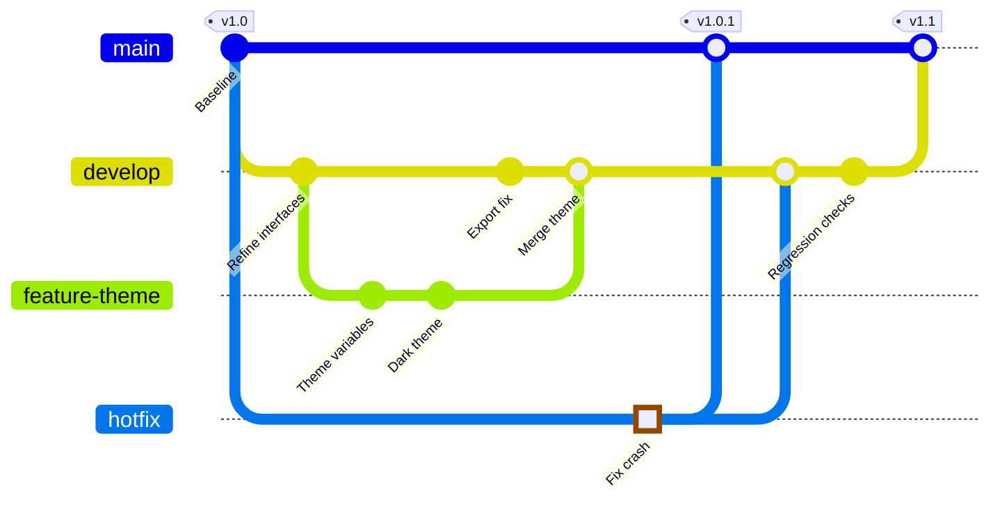

## F12 · Theme Review Mind Map

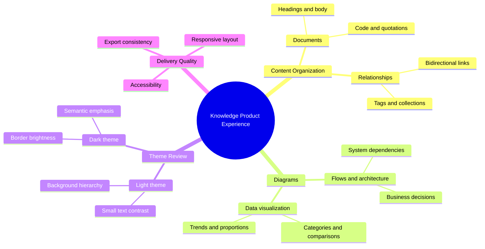

## F13 · New Member Journey

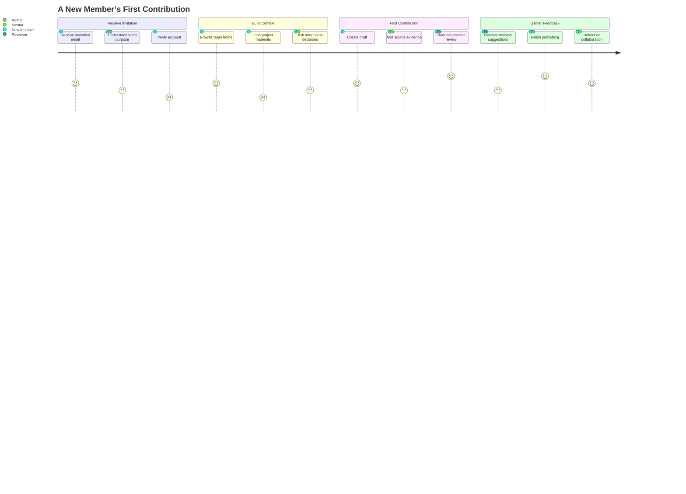

## F14 · Renderer Evolution Timeline

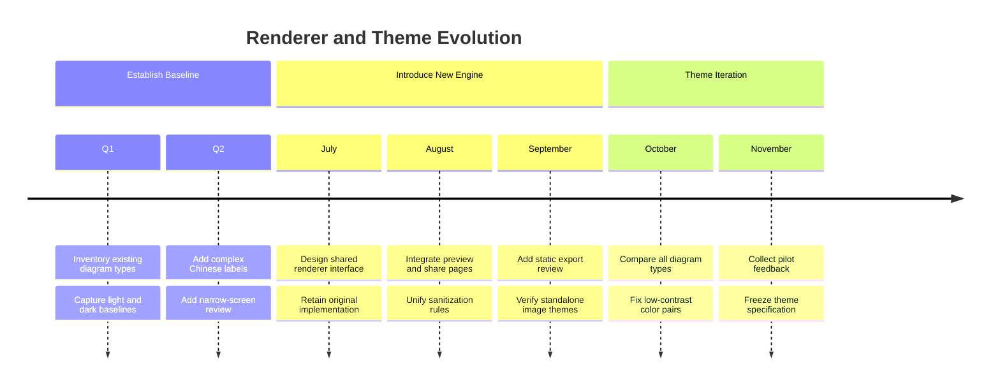

## F15 · Safety and Export Requirements

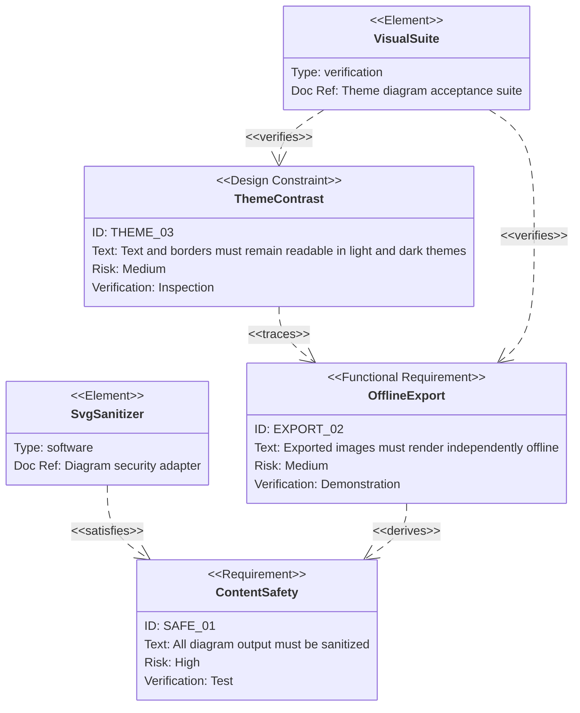

## A01 · Knowledge Asset Storage

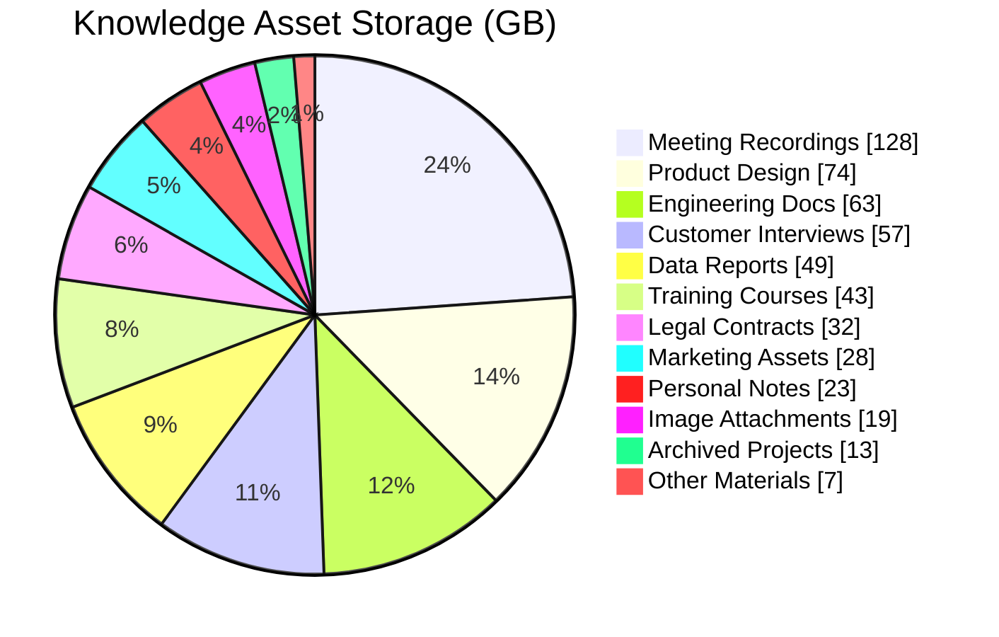

## A02 · Investment Priorities

```mermaid
quadrantChart
    title Next Quarter Investment Portfolio
    x-axis Low Implementation Cost --> High Implementation Cost
    y-axis Low User Value --> High User Value
    quadrant-1 Strategic Investment
    quadrant-2 Ship First
    quadrant-3 Quick Improvements
    quadrant-4 Defer for Review
    Full-Text Search: [0.28, 0.86]
    Offline Sync: [0.82, 0.91]
    Bulk Import: [0.36, 0.73]
    Collaboration: [0.91, 0.80]
    Dark Theme: [0.18, 0.62]
    Shortcut Guide: [0.14, 0.35]
    Export Templates: [0.42, 0.44]
    Custom Scripts: [0.76, 0.38]
    Attachment Deduplication: [0.62, 0.65]
    Startup Animation: [0.68, 0.17]
    Spell Check: [0.31, 0.56]
    Plugin Sandbox: [0.87, 0.58]
```

## A03 · Subscription Revenue and Targets

```mermaid
---
config:
  xyChart:
    showDataLabel: true
---
xychart
    title "Subscription Revenue and Targets (CNY 10k)"
    x-axis ["Jan", "Feb", "Mar", "Apr", "May", "Jun"]
    y-axis "Revenue (CNY 10k)" 0 --> 180
    bar "Personal Plans" [48, 56, 71, 83, 96, 112]
    bar "Team Plans" [32, 41, 53, 69, 88, 106]
    line "Baseline Target" [70, 82, 94, 106, 118, 130]
    line "Stretch Target" [90, 105, 120, 135, 150, 165]
```

## A04 · Service Latency

```mermaid
---
config:
  xyChart:
    showDataLabel: true
---
xychart horizontal
    title "API Latency Percentiles (ms)"
    x-axis ["Knowledge Search", "File Sync", "Attachment Upload", "Shared Access", "Full Export", "Permission Check"]
    y-axis "Response Time (ms)" 0 --> 500
    bar "Median" [42, 76, 154, 61, 188, 25]
    bar "95th Percentile" [88, 168, 320, 132, 420, 58]
    line "Service Target" [150, 200, 350, 150, 450, 80]
```

## A05 · Conversion Funnel

```mermaid
sankey

"Organic","Content",360
"Referral","Content",240
"Ads","Events",300
"Partners","Events",100
"Content","Trial",380
"Content","Lost",220
"Events","Trial",260
"Events","Lost",140
"Trial","Solo",310
"Trial","Team",250
"Trial","Churn",80
"Solo","Paid",230
"Solo","Free",80
"Team","Paid",190
"Team","Sales",60
```

## A06 · Deployment Capabilities

```mermaid
radar-beta
    title Deployment Capabilities
    axis privacy["Privacy"], offline["Offline"], speed["Startup Speed"], scale["Scalability"]
    axis search["Search Quality"], collab["Collaboration"], cost["Cost Control"], ops["Maintainability"]
    curve local["Local First"]{96, 98, 92, 64, 81, 56, 88, 78}
    curve cloud["Cloud Hosted"]{65, 40, 76, 95, 91, 96, 62, 94}
    curve hybrid["Hybrid"]{88, 84, 85, 86, 90, 83, 76, 72}
    showLegend true
    graticule polygon
    ticks 5
    max 100
    min 0
```

## A07 · Nine-Team Radar

```mermaid
radar-beta
    title Nine-Team Capabilities (Simulated Scores)
    axis quality["Quality"], delivery["Delivery"], service["Service"], security["Security"], research["Research"], documentation["Documentation"]
    curve a["Platform 1"]{95, 72, 65, 96, 75, 82}
    curve b["Platform 2"]{84, 88, 72, 91, 81, 76}
    curve c["Search"]{88, 76, 81, 74, 96, 68}
    curve d["Sync"]{91, 80, 75, 94, 77, 79}
    curve e["Editor"]{86, 92, 88, 73, 85, 84}
    curve f["Mobile"]{79, 86, 91, 78, 82, 77}
    curve g["Design"]{83, 81, 94, 65, 93, 90}
    curve h["Data"]{92, 73, 68, 88, 90, 85}
    curve i["Operations"]{90, 87, 89, 98, 67, 95}
    showLegend true
    graticule circle
    ticks 4
    max 100
    min 0
```

## A08 · Engineering Investment

```mermaid
treemap-beta
"Annual Engineering Investment (Person-Months)"
    "Core Experience"
        "Editor"
            "Input and Cursor": 28
            "Tables and Attachments": 22
            "Diagram Rendering": 17
        "Search"
            "Full-Text Index": 26
            "Semantic Retrieval": 19
    "Platform Engineering"
        "Sync Service": 31
        "Accounts and Permissions": 18
        "Plugin Sandbox": 14
        "Observability": 9
    "Device Support"
        "Desktop": 23
        "Mobile": 16
        "Accessibility": 7
    "Experiments"
        "Knowledge Links": 11
        "Auto Organization": 5
        "Rapid Prototypes": 2
```

## A09 · Release Readiness

```mermaid
venn-beta
    title Release Readiness
    set user["User Value"]
        text u1["Less Rework"]
        text u2["Cross-Device"]
    set engineering["Feasibility"]
        text e1["Proven Sync"]
        text e2["Fast Enough"]
    set business["Viability"]
        text b1["Low Support Cost"]
        text b2["Renewals"]
    union user,engineering["Try"]
        text ue["Local Search"]
    union engineering,business["Scale"]
        text eb["Team Spaces"]
    union user,business["Pay"]
        text ub["Team Knowledge"]
    union user,engineering,business["Ship"]
        text all["Offline Teamwork"]
```

## A10 · Release Sprint

```mermaid
kanban
    backlog[Backlog]
        a[Import and deduplicate archives]@{ ticket: NOTE-241, assigned: 'Lin Zhou', priority: 'Low' }
        b[Add spelling dictionaries]@{ ticket: NOTE-242, assigned: 'Zhou Qing', priority: 'Very Low' }
    ready[Ready]
        c[Merge offline editing conflicts]@{ ticket: NOTE-243, assigned: 'Chen Xing', priority: 'Very High' }
        d[Audit shared-space permissions]@{ ticket: NOTE-244, assigned: 'Lin Zhou', priority: 'High' }
        e[Rank Chinese full-text results]@{ ticket: NOTE-245, assigned: 'Yu An', priority: 'Medium' }
    doing[In Progress]
        f[Fix narrow-window diagram labels]@{ ticket: NOTE-246, assigned: 'Zhou Qing', priority: 'High' }
        g[Upload mobile attachments in background]@{ ticket: NOTE-247, assigned: 'Chen Xing', priority: 'Medium' }
    review[Review]
        h[Rate-limit shared access]@{ ticket: NOTE-248, assigned: 'Yu An', priority: 'Very High' }
        i[Preview printing in dark mode]@{ ticket: NOTE-249, assigned: 'Zhou Qing', priority: 'Low' }
    done[Done]
        j[Show sync retry hints]@{ ticket: NOTE-250, assigned: 'Lin Zhou', priority: 'High' }
        k[Cache attachment thumbnails]@{ ticket: NOTE-251, assigned: 'Chen Xing', priority: 'Medium' }
```

## A11 · TCP Header

```mermaid
---
title: Attachment Sync TCP Header (Without Options)
config:
  packet:
    bitsPerRow: 32
    showBits: true
---
packet
0-15: "Source Port"
16-31: "Destination Port"
32-63: "Sequence Number"
64-95: "Acknowledgment Number"
96-99: "Data Offset"
100-103: "Reserved"
104: "CWR"
105: "ECE"
106: "URG"
107: "ACK"
108: "PSH"
109: "RST"
110: "SYN"
111: "FIN"
112-127: "Receive Window"
128-143: "Checksum"
144-159: "Urgent Pointer"
```

## A12 · Offline Workspace

```mermaid
block
    columns 3
    title["Offline Knowledge Workspace"]:3
    block:input:3
        columns 3
        md["Markdown Files"] voice["Meeting Recordings"] image["Image Attachments"]
    end
    block:processing:2
        columns 2
        parser["Unified Parsing"] index["Incremental Index"]
        block:quality:2
            columns 2
            dedup["Content Deduplication"] links["Backlink Validation"]
        end
    end
    local[("Local Database")]
    block:output:3
        columns 3
        editor["Edit and Review"] search["Full-Text Search"] share["Read-Only Sharing"]
    end
    md --> parser
    voice --> parser
    parser --> index
    index --> local
    local --> search
    links --> editor
    editor --> share
```

## A13 · Local-First Architecture

```mermaid
architecture-beta
    group devices(cloud)[Devices]
    group sync(cloud)[Sync Services]
    group storage(database)[Persistent Storage]
    service desktop(server)[Desktop Client] in devices
    service mobile(server)[Mobile Client] in devices
    service vault(disk)[Local Vault] in devices
    service edge(internet)[Access Gateway] in sync
    service coordinator(server)[Version Coordinator] in sync
    service queue(disk)[Incremental Operation Log] in sync
    service documents(database)[Document Metadata] in storage
    service blobs(disk)[Attachment Store] in storage
    service backup(cloud)[Remote Backup] in storage
    desktop:B --> T:vault
    mobile:R --> L:edge
    desktop:R --> T:edge
    edge:R --> L:coordinator
    coordinator:B --> T:queue
    coordinator:R --> L:documents
    queue:R --> L:blobs
    documents:B --> T:backup
    blobs:B --> R:backup
```

## M01 · C4 System Context

```mermaid
C4Context
  title Cross-organization Knowledge Collaboration
  Enterprise_Boundary(org, "Partner Enterprise") {
    Person(writer, "Knowledge Author", "Research, write and review documents")
    Person(admin, "Workspace Admin", "Manage access and retention policies")
    System(notes, "Knowledge Workbench", "Edit, search and share knowledge")
    SystemDb(index, "Enterprise Knowledge Index", "Full-text and semantic search")
    SystemQueue(audit, "Audit Event Queue", "Record access and changes")
  }
  Person_Ext(guest, "External Reviewer", "Suggest changes through shared links")
  System_Ext(idp, "Organization Identity Service", "Single sign-on")
  System_Ext(mail, "Notification Service", "Send review invitations")
  Rel(writer, notes, "Write and search", "Desktop App")
  Rel(admin, notes, "Manage workspace", "HTTPS")
  Rel(guest, notes, "Review selected documents", "Read-only link")
  Rel(notes, idp, "Verify identity", "OIDC")
  Rel(notes, index, "Update search index")
  Rel(notes, audit, "Record actions")
  Rel(notes, mail, "Dispatch notifications")
  Rel(mail, guest, "Send invitation")
```

## M02 · C4 Containers

```mermaid
C4Container
  title Offline Editor and Sync Service
  Person(user, "Researcher", "Edit documents across devices")
  System_Boundary(platform, "Knowledge Platform") {
    Container(desktop, "Desktop Editor", "Svelte / Tauri", "Offline editing and diagram previews")
    Container(web, "Shared Document Page", "Browser", "Lightweight reading and comments")
    Container(api, "Sync API", "HTTP Service", "Merge revisions and authorize access")
    Container(worker, "Indexing Worker", "Async Worker", "Extract text and update indexes")
    ContainerDb(local, "Local Vault", "File System", "Markdown and attachments")
    ContainerDb(cloud, "Revision Database", "Relational Database", "Revisions and sharing permissions")
    ContainerQueue(queue, "Sync Events", "Message Queue", "Decouple tasks")
  }
  System_Ext(auth, "Identity Provider", "Organization login")
  Rel(user, desktop, "Edit notes")
  Rel(user, web, "Open shared documents")
  Rel(desktop, local, "Read and write files")
  Rel(desktop, api, "Push revisions", "HTTPS")
  Rel(web, api, "Fetch shared content", "HTTPS")
  Rel(api, auth, "Validate token")
  Rel(api, cloud, "Commit revision")
  Rel(api, queue, "Publish indexing event")
  Rel(queue, worker, "Dispatch tasks")
  Rel(worker, cloud, "Write search data")
```

## M03 · C4 Components

```mermaid
C4Component
  title Diagram Rendering Components
  Container(editor, "Document Editor", "Browser UI", "Display Markdown")
  ContainerDb(cache, "Resource Cache", "Memory", "Reuse verified resources")
  Container_Boundary(renderer, "Diagram Rendering Service") {
    Component(parse, "Code Block Detector", "Syntax Scanner", "Select diagram type")
    Component(layout, "Layout Engine", "Pele", "Compute nodes and edges")
    Component(theme, "Theme Resolver", "CSS Variables", "Resolve text, borders and fills")
    Component(clean, "SVG Sanitizer", "DOMPurify", "Remove unsafe content")
    Component(exporter, "Export Component", "SVG / PNG", "Create standalone images")
  }
  System_Ext(share, "Share Page", "Display the same diagrams")
  Rel(editor, parse, "Provide source")
  Rel(parse, layout, "Submit diagram")
  Rel(theme, layout, "Provide theme")
  Rel(layout, clean, "Output SVG")
  Rel(clean, cache, "Cache safe output")
  Rel(clean, exporter, "Create export copy")
  Rel(cache, editor, "Display preview")
  Rel(exporter, share, "Provide portable images")
```

## M04 · C4 Dynamic Interaction

```mermaid
C4Dynamic
  title Revision Editing and Synchronization
  Container(client, "Desktop Editor", "Tauri", "Available offline")
  Container_Boundary(sync, "Sync Service") {
    Component(auth, "Authentication", "Token Validation", "Verify access rights")
    Component(merge, "Revision Merge", "Revision Comparison", "Detect conflicts")
    Component(notify, "Event Publisher", "Async Notifications", "Notify other devices")
  }
  ContainerDb(store, "Revision Store", "Database", "Store documents and revisions")
  Container(other, "Other Device", "Desktop App", "Receive new revisions")
  Rel(client, auth, "Submit local revision", "HTTPS")
  Rel(auth, merge, "Forward authorized request")
  Rel(merge, store, "Read parent revision")
  Rel(store, merge, "Return current revision")
  Rel(merge, store, "Write merged result")
  Rel(merge, notify, "Emit revision saved event")
  Rel(notify, other, "Push revision notification")
  Rel(other, store, "Read latest content")
```

## M05 · C4 Deployment

```mermaid
C4Deployment
  title Dual-region Knowledge Service Deployment
  Deployment_Node(device, "User Device", "macOS / Linux / Windows") {
    Container(app, "Desktop App", "Tauri", "Offline editing")
    ContainerDb(files, "Local Vault", "Markdown", "Private documents")
  }
  Deployment_Node(edge, "Edge Network", "CDN") {
    Container(share, "Share Site", "Static Assets", "Public entry point")
  }
  Deployment_Node(primary, "Primary Region", "Region A") {
    Deployment_Node(compute, "Compute Cluster", "Containers") {
      Container(api, "Sync Service", "HTTP", "Handle revisions and access")
    }
    Deployment_Node(storage, "Persistence Node", "Database Service") {
      ContainerDb(db, "Primary Database", "SQL", "Store document revisions")
    }
  }
  Deployment_Node(backup, "Backup Region", "Region B") {
    ContainerDb(replica, "Read Replica", "SQL", "Disaster recovery")
  }
  Rel(app, files, "Read and write locally")
  Rel(app, api, "Sync revisions", "HTTPS")
  Rel(share, api, "Read shared content")
  Rel(api, db, "Save revision")
  Rel(db, replica, "Async replication")
```

## M06 · Research Agent Collaboration

```mermaid
agentflow-beta TB
  brief["Research Brief and Audience"]@{ shape: input }
  global
    corpus["Existing Sources and Glossary"]@{ shape: refdoc }
  end
  flow research["Research Agent"]
    gather["Gather trusted sources"]@{ shape: task }
    search["Literature Search Tool"]@{ shape: tool }
    evidence["Organize evidence"]@{ shape: task }
    gather --> search --> evidence
    evidence -.- corpus
  end
  flow writing["Writing Agent"]
    outline["Structure the argument"]@{ shape: task }
    draft["Generate Chinese draft"]@{ shape: task }
    outline --> draft
    draft -.- corpus
  end
  flow review["Review Agent"]
    verify["Check citations and conclusions"]@{ shape: task }
    ok["Sufficient evidence?"]@{ shape: decision }
    verify --> ok
  end
  publish["Deliver review draft"]@{ shape: action }
  brief --> research --> writing --> review
  ok -- Pass --> publish
  ok -- More evidence --> gather
```

## M07 · Railroad DSL

```mermaid
railroad-beta
title Knowledge Search Expressions
query = sequence(
  nonterminal("source"),
  optional(sequence(terminal("where"), nonterminal("condition"))),
  optional(sequence(terminal("sort"), nonterminal("field"))),
  optional(sequence(terminal("limit"), nonterminal("integer")))
) ;
source = choice(terminal("notes"), terminal("attachments"), terminal("tasks")) ;
condition = oneOrMore(nonterminal("predicate")) ;
predicate = sequence(
  nonterminal("field"),
  choice(terminal("="), terminal("contains"), terminal(">=")),
  nonterminal("value")
) ;
field = choice(terminal("title"), terminal("tag"), terminal("modified")) ;
value = choice(nonterminal("string"), nonterminal("integer")) ;
integer = oneOrMore(nonterminal("digit")) ;
digit = choice(terminal("0"), terminal("1"), terminal("2")) ;
string = sequence(terminal("quote"), oneOrMore(nonterminal("character")), terminal("quote")) ;
```

## M08 · Railroad EBNF

```mermaid
railroad-ebnf-beta
title "Task Scheduling Grammar"
configuration = task+ ;
task = "task" identifier "{" body "}" ;
body = trigger action [ retry ] [ notify ] ;
trigger = "when" ( "manual" | "daily" | "on-change" ) ;
action = "run" command ( "," command )* ;
retry = "retry" integer [ "backoff" duration ] ;
notify = "notify" channel ( "," channel )* ;
channel = "desktop" | "mail" | "webhook" ;
command = identifier [ "(" arguments ")" ] ;
arguments = value ( "," value )* ;
value = string | integer | "true" | "false" ;
identifier = letter ( letter | digit | "_" )* ;
integer = digit+ ;
duration = integer ( "s" | "m" | "h" ) ;
letter = "a" | "b" | "c" ;
digit = "0" | "1" | "2" | "3" ;
string = "text" ;
```

## M09 · Railroad ABNF

```mermaid
railroad-abnf-beta
title "Revision Sync Protocol"
request = method SP path SP version CRLF headers CRLF body ;
method = "PUSH" / "FETCH" / "MERGE" ;
path = "/vaults/" identifier "/notes/" identifier ;
version = "SYNC/" 1*DIGIT "." 1*DIGIT ;
headers = 1*( header CRLF ) ;
header = revision / authorization / content-type ;
revision = "Revision:" SP identifier ;
authorization = "Authorization:" SP "Bearer" SP token ;
content-type = "Content-Type:" SP "text/markdown" ;
identifier = 1*( ALPHA / DIGIT / "-" ) ;
token = 1*( ALPHA / DIGIT / "_" / "-" ) ;
body = *OCTET ;
```

## M10 · Railroad PEG

```mermaid
railroad-peg-beta
title "Note Formulas and Identifiers"
Program <- Statement+ ;
Statement <- Assignment / Expression ;
Assignment <- Identifier "=" Expression ";" ;
Expression <- Term (("+" / "-") Term)* ;
Term <- Factor (("*" / "/") Factor)* ;
Factor <- Number / Identifier / "(" Expression ")" ;
Identifier <- !Keyword Letter (Letter / Digit)* ;
Keyword <- "let" / "if" / "else" / "sum" ;
Number <- Digit+ ("." Digit+)? ;
Letter <- "a" / "b" / "c" / "_" ;
Digit <- "0" / "1" / "2" / "3" ;
```

## M11 · Project Tree

```mermaid
treeView-beta
  Knowledge Workbench/
    Content Vault/
      Inbox/
        Unsorted Research Notes.md ## Newly captured content
      Projects/
        Theme Improvements/ :::highlight ## Current theme work
          Color Observations.md
          Diagram Acceptance Checklist.md
          References/
            Accessibility Requirements.md
      Archive/
        Last Quarter Research.md
    Rendering Implementation/
      Theme Tokens.css ## Background, text, borders and accents
      Diagram Adapter.ts :::highlight ## Theme integration entry point
      Security Filter.ts
    Validation Assets/
      Light Screenshot.png
      Dark Screenshot.png
      Narrow Screenshot.png
    README.md ## Start here
```

## M12 · Release Swimlanes

```mermaid
swimlane-beta LR
  subgraph Design
    Observe[Collect color observations]
    Draft[Define semantic palette]
    Review{Adequate contrast?}
  end
  subgraph Engineering
    Tokens[Integrate theme tokens]
    Render[Render diagram previews]
    Fix[Fix edge cases]
  end
  subgraph Quality
    Matrix[Verify light and dark]
    Narrow[Verify narrow exports]
    Accept{Accepted?}
  end
  subgraph Release
    Package[Build signed release]
    Ship([Publish update])
  end
  Observe --> Draft --> Review
  Review -->|Pass| Tokens
  Review -->|Adjust| Draft
  Tokens --> Render --> Matrix --> Narrow --> Accept
  Accept -->|Issues found| Fix --> Render
  Accept -->|Pass| Package --> Ship
```

## M13 · Cynefin Decisions

```mermaid
cynefin-beta
  title Diagram Theme Decision Domains
  complex
    "Which semantic colors suit each diagram?"
    "How do users interpret emphasis and warnings?"
    "Test palettes and gather feedback"
  complicated
    "Measure light and dark contrast"
    "Assess accessibility of translucent layers"
    "Check fonts and colors across platforms"
  clear
    "Fix invisible borders"
    "Replace broken color variables"
    "Run the regression checklist"
  chaotic
    "All diagram text disappears in production"
    "Restore a readable theme immediately"
  confusion
    "Theme or layout cause remains unclear"
  complex --> complicated : "Form testable hypotheses"
  complicated --> clear : "Establish clear rules"
  clear --> chaotic : "Miss critical edge cases"
  chaotic --> complex : "Resume exploration after recovery"
```

## M14 · Wardley Evolution

```mermaid
wardley-beta
  title Knowledge Workbench Capability Evolution
  anchor "Research User" [0.96, 0.52]
  component "Reusable Knowledge" [0.84, 0.45]
  component "Collaborative Review" [0.70, 0.30]
  component "Diagramming" [0.67, 0.55]
  component "Full-text Search" [0.51, 0.80]
  component "Theme System" [0.45, 0.35]
  component "File Storage" [0.24, 0.90]
  component "Identity Service" [0.15, 0.88]
  "Research User" -> "Reusable Knowledge"
  "Reusable Knowledge" -> "Collaborative Review"
  "Reusable Knowledge" -> "Diagramming"
  "Reusable Knowledge" -> "Full-text Search"
  "Diagramming" -> "Theme System"
  "Full-text Search" -> "File Storage"
  "Collaborative Review" -> "Identity Service"
  evolve "Collaborative Review" 0.61
  evolve "Theme System" 0.72
  note "Custom to shared themes" [0.33, 0.67]
```

## M15 · Review Event Modeling

```mermaid
eventmodeling
  tf 01 ui DocumentEditor
  tf 02 cmd SubmitReview [[SubmitReview]]
  tf 03 evt ReviewSubmitted [[ReviewSubmitted]]
  tf 04 ui ReviewBoard
  tf 05 cmd RecordComment [[RecordComment]]
  tf 06 evt CommentRecorded [[CommentRecorded]]
  tf 07 cmd AcceptChanges
  tf 08 evt RevisionMerged
  tf 09 ui PublishedDocument
  data SubmitReview {
    documentId: string
    description: 'Document identifier'
    revision: number
    reviewer: string
}
  data ReviewSubmitted {
    documentId: string
    submittedAt: string
}
  data RecordComment {
    paragraphId: string
    comment: string
    example: 'Highlight the key conclusion'
}
  data CommentRecorded {
    commentId: string
    status: string
}
```

## M16 · Workspace Use Cases

```mermaid
usecase-beta
  direction LR
  actor Writer("Knowledge Author")
  actor Reviewer("External Reviewer")@{ type: hollow }
  actor Admin("Workspace Admin")
  systemBoundary "Knowledge Workspace"
    Edit("Edit documents")
    Search("Search sources")
    Share("Create share link")
    Comment("Suggest changes")
    Approve("Accept review feedback")
  end
  systemBoundary "Governance and Operations"
    Permissions("Manage access")
    Archive("Archive revisions")
    Audit("View audit records")
  end
  Writer --> Edit
  Writer --> Search
  Writer --> Share
  Writer --> Approve
  Reviewer --> Comment
  Admin --> Permissions
  Admin --> Archive
  Admin --> Audit
  Share ..> : include Permissions
  Approve ..> : include Comment
```

## M17 · Theme Root Causes

```mermaid
ishikawa-beta
  Diagram themes lack visual hierarchy
  Palette
    Too few accent colors
    Semantic colors not assigned
    Neutral shades too similar
  Mapping Rules
    All nodes use the same fill
    Chart series lack distinction
    Roles and states lack color semantics
  Accessibility
    Low contrast on dark backgrounds
    Thin lines are too faint
    Information conveyed by color alone
  Data Structure
    Multi-series groups are too dense
    Nested regions overlap colors
      Boundaries blend with node backgrounds
      Transparency compounds across layers
  Validation
    Missing cross-diagram samples
    No light and dark comparison
    No narrow-screen validation
```

## M18 · Engine Information

```mermaid
info
```
