# Mermaid / Pele 全图形与主题颜色调校图谱

版本基准：note.md v6.1019.1 / Pele 1.6.0；本文样式验收针对 2026-10-19 仓库未发布修复。已安装的 v6.1019.1 尚不包含该修复。

本文件包含 **50 个图形样例，覆盖本机 Pele 的全部 33 个注册类型**，另覆盖 C4 五种视图、铁路图四种方言、两种状态语法、横向图表及新旧关键词。复杂业务样例用于检查布局、层次和颜色；另有 **96 节点、118 条关系**的压力图。这里的“全”指类型与主要语法变体覆盖，不宣称穷尽所有语法组合或创造复杂度纪录。

**当前源码已修复主题样式丢失和默认配色映射。** 原先 30 例因标题/字重变量导致根样式被整段删除，出现黑块或深色黑字；现在保留颜色别名和字重。普通节点使用表面色，统计系列使用八种分类色；缺少旧主题变量时，Pele 也有独立的明暗默认值。

所有图统一使用 `mermaid` 代码块；note.md 的 Pele 版本会自动交给 Pele 渲染。用富文本 / Rich 模式查看，源码模式可以直接修改样例。切换旧 Mermaid 构建时，部分新语法不能识别，见下面的实测表。

## 建议的调色顺序

1. **先看 [D01](#d01-flowchart) 和 [D02](#d02-flowchart)**：结构完全相同，前者跟随主题，后者显式指定八种语义色，区分“主题没分配颜色”和“引擎不能多色”。
2. **再看 [A01 饼图](#a01-pie)、[A07 九系列雷达](#a07-radar)**：检查八类系列色、颜色循环和相邻分类是否混淆。
3. **看 [F01 多分区流程](#f01-flowchart)、[F05 时序](#f05-sequence)、[F10 甘特](#f10-gantt)**：检查底色层次、实线/虚线、激活区、状态与关键任务。
4. **看 [M01–M05 C4](#m01-c4)、[A13 架构](#a13-architecture)、[A12 块图](#a12-block)**：检查多层边界、图标、关系文字和浅底深字的对比。
5. 最后用 [D04 压力图](#d04-flowchart) 和 360px 窄窗口复核。大图缩小时文字自然会很小，先看分区与连线，再在宽窗口或放大的 SVG 中检查文字。

### 为什么当前 Pele 可能显得单调

历史问题已定位并修复：`--pele-title-weight`、`--pele-heading-weight`、`--pele-bold-weight` 现在精确通过净化，并在 SVG 根冻结为可信字重；`--_fg`、`--_s` 等内部别名得以保留。外部资源与未知变量限制仍然生效。此前 30/50 例根样式丢失的测试保留为回归依据。

以下是**当前 note.md 适配器的实际映射**，不是 Pele 本身只能使用这些颜色：

| Pele 颜色 | 当前取值来源 | 调色观察 |
| --- | --- | --- |
| `--pele-surface` | `--bg-secondary` | 普通节点底色；默认浅色 `#f3f3f3` / 深色 `#303030` |
| `--pele-surface-alt` | `--bg-hover` | 分组/次级底色；默认浅色 `#e6e6e6` / 深色 `#404040` |
| `--pele-accent`、`--pele-series-1` | `--accent-color` | 强调与第一分类；默认浅色 `#2563eb` / 深色 `#93c5fd` |
| `--pele-series-2` … `8` | 独立明暗分类色 | 不再复用 UI 背景色；浅色配反白字、深色配深字，检查 Git / 时间线 / 饼图标签 |
| `--pele-fg`、`--pele-line`、`--pele-border` | `--text-primary`、`--text-secondary`、`--border-color` | 正文、关系线和边界可分别观察 |
| `--pele-bg` | 浅色 `#ffffff` / 深色 `#1e1e1e` | 当前适配器固定取值，并非任意笔记主题背景色 |
| `--pele-critical`、`--pele-error` | 当前固定 `#e45756` | 关键任务/错误色尚无独立主题输入 |

缺少这些旧 UI 变量时，Pele 使用明暗默认值：正文 `#1f1f1f` / `#eeeeee`，连线 `#1f1f1f` / `#cccccc`，边界 `#8a8a8a` / `#888888`。旧 Mermaid 构建保持原有取值行为。系列 2–8 的浅色值为 `#0f766e` / `#b45309` / `#7c3aed` / `#be123c` / `#0e7490` / `#4d7c0f` / `#c2410c`，深色值为 `#2dd4bf` / `#fbbf24` / `#a78bfa` / `#fb7185` / `#22d3ee` / `#a3e635` / `#fb923c`。自定义主题覆盖值仍需自行检查对比度。

桌面预览从文档根元素读取上述 UI 变量；静态导出与分享使用各自的根/容器。调整笔记正文的主题样式，不一定等价于改变这些根元素上的变量。依据：[当前 SVG 适配器](../../src/lib/diagrams/pele-renderer.ts)、[主题读取函数](../../src/share-editor/mermaid-loader.ts)、[桌面注入](../../src/lib/adapters/pele-loader.ts)。

**流程图默认同类节点同色是正常行为。** 多改 `series-*` 不会自动给每个普通流程节点上不同颜色。节点语义区分可用 D02 / F02 的 `classDef`、`style`；分类统计图再用八个系列色检查。

### 配色设计参考

下面是供你挑选的原创参考色板，**不是当前程序已经接入的设置项**。这些色值没有预先通过所有背景和字号的可访问性认证，要用后面的真实图检查文字、边框、虚线与相邻区域。

| 用途 | 浅色方案 | 深色方案 |
| --- | --- | --- |
| 画布 | `#f8fafc` | `#111827` |
| 主文字 | `#172554` | `#e5e7eb` |
| 次文字/连线 | `#475569` | `#94a3b8` |
| 普通节点底色 | `#eff6ff` | `#1e293b` |
| 分组底色 | `#f1f5f9` | `#172033` |
| 边界 | `#94a3b8` | `#64748b` |
| 强调 | `#2563eb` | `#93c5fd` |
| 关键/异常 | `#b91c1c` | `#fda4af` |
| 分类 1–4 | `#2563eb` / `#0f766e` / `#b45309` / `#7c3aed` | `#60a5fa` / `#2dd4bf` / `#fbbf24` / `#a78bfa` |
| 分类 5–8 | `#be123c` / `#0e7490` / `#4d7c0f` / `#c2410c` | `#fb7185` / `#22d3ee` / `#a3e635` / `#fb923c` |

Pele 原生用 CSS 变量调色；不过当前 note.md 会把颜色冻结到 SVG 根元素的内联样式，以保证独立导出。普通父容器上的 `.pele` CSS 不一定能覆盖这些内联值；只改页面外部 CSS，也不能据此证明导出的独立 SVG / PNG / PDF / 分享同步变色。后续要做全链路主题改进，应调整上面的颜色映射并复核导出，而不是只让屏幕预览变色。本文件里的 CSS/颜色文本本身不会执行或修改应用设置。

### 每次换主题都勾一次

- [ ] 普通节点、分组与画布至少有清晰的层次。
- [ ] 标题、正文、小注释、边标签在浅色和深色下都可读。
- [ ] 系列 2 / 3 不再消失在背景里，八类系列彼此可区分。
- [ ] 第九、第十类的颜色循环可理解，不误认为是新颜色。
- [ ] 关键任务与普通任务明显不同；完成、失败不只靠红绿表达。
- [ ] 虚线、细线、箭头、ER 基数、时序激活区没有被背景吞没。
- [ ] 固定色样例与自动主题样例区分开，避免误把固定色不变当成主题失效。
- [ ] 窄窗口、独立 SVG、复制图像、实际 PDF 和新发布分享分别检查，不用屏幕预览替代导出验收。

## 类型与本机版本实测索引

`✓` = 本文件对应样例解析成功；Mermaid 两列**只测解析，不宣称旧引擎的最终 SVG、布局或外观通过**。Pele 列表示修复后应用适配器的 SVG 与主题样式检查通过；完整检查范围和实机边界见文末。源码在不同引擎中的位置、间距和颜色不要求一致。

| 类型 | 样例入口 | Pele 1.6.0 | Mermaid 11.17.2 解析 | mermaid-mini 11.14.0-mdeditor.1 解析 |
| --- | --- | --- | --- | --- |
| 流程图 `flowchart` | [D01](#d01-flowchart) · [D02](#d02-flowchart) · [D03](#d03-flowchart) · [D04](#d04-flowchart) · [F01](#f01-flowchart) · [F02](#f02-flowchart) · [F03](#f03-flowchart) · [F04](#f04-flowchart) | SVG / 样式 ✓ | ✓ | ✓ |
| 时序图 `sequence` | [F05](#f05-sequence) | SVG / 样式 ✓ | ✓ | ✓ |
| 类图 `class` | [F06](#f06-class) | SVG / 样式 ✓ | ✓ | ✓ |
| 状态图 `state` | [F07](#f07-state) · [F08](#f08-state) | SVG / 样式 ✓ | ✓ | ✓ |
| 实体关系图 `er` | [F09](#f09-er) | SVG / 样式 ✓ | ✓ | ✓ |
| 甘特图 `gantt` | [F10](#f10-gantt) | SVG / 样式 ✓ | ✓ | ✓ |
| Git 分支图 `gitGraph` | [F11](#f11-gitgraph) | SVG / 样式 ✓ | ✓ | ✓ |
| 思维导图 `mindmap` | [F12](#f12-mindmap) | SVG / 样式 ✓ | ✓ | ✓ |
| 用户旅程 `journey` | [F13](#f13-journey) | SVG / 样式 ✓ | ✓ | ✓ |
| 时间线 `timeline` | [F14](#f14-timeline) | SVG / 样式 ✓ | ✓ | ✓ |
| 需求图 `requirement` | [F15](#f15-requirement) | SVG / 样式 ✓ | ✓ | ✓ |
| 饼图 `pie` | [A01](#a01-pie) | SVG / 样式 ✓ | ✓ | ✓ |
| 象限图 `quadrantChart` | [A02](#a02-quadrantchart) | SVG / 样式 ✓ | ✓ | ✓ |
| XY 图 `xychart` | [A03](#a03-xychart) · [A04](#a04-xychart) | SVG / 样式 ✓ | ✓ | ✓ |
| 桑基图 `sankey` | [A05](#a05-sankey) | SVG / 样式 ✓ | ✓ | ✓ |
| 雷达图 `radar` | [A06](#a06-radar) · [A07](#a07-radar) | SVG / 样式 ✓ | ✓ | ✓ |
| 矩形树图 `treemap` | [A08](#a08-treemap) | SVG / 样式 ✓ | ✓ | ✓ |
| 维恩图 `venn` | [A09](#a09-venn) | SVG / 样式 ✓ | ✓ | ✓ |
| 看板 `kanban` | [A10](#a10-kanban) | SVG / 样式 ✓ | ✓ | ✓ |
| 数据包 `packet` | [A11](#a11-packet) | SVG / 样式 ✓ | ✓ | ✓ |
| 块图 `block` | [A12](#a12-block) | SVG / 样式 ✓ | ✓ | ✓ |
| 架构图 `architecture` | [A13](#a13-architecture) | SVG / 样式 ✓ | ✓ | ✓ |
| C4 体系 `c4` | [M01](#m01-c4) · [M02](#m02-c4) · [M03](#m03-c4) · [M04](#m04-c4) · [M05](#m05-c4) | SVG / 样式 ✓ | ✓ | ✓ |
| Agent 工作流 `agentflow` | [M06](#m06-agentflow) | SVG / 样式 ✓ | 本例语法未识别：M06 | 本例语法未识别：M06 |
| 语法铁路图 `railroad` | [M07](#m07-railroad) · [M08](#m08-railroad) · [M09](#m09-railroad) · [M10](#m10-railroad) | SVG / 样式 ✓ | ✓ | ✓ |
| 目录树 `treeView` | [M11](#m11-treeview) | SVG / 样式 ✓ | ✓ | ✓ |
| 泳道图 `swimlane` | [M12](#m12-swimlane) | SVG / 样式 ✓ | ✓ | ✓ |
| Cynefin 框架 `cynefin` | [M13](#m13-cynefin) | SVG / 样式 ✓ | ✓ | ✓ |
| Wardley 演进地图 `wardley` | [M14](#m14-wardley) | SVG / 样式 ✓ | ✓ | ✓ |
| 事件建模 `eventmodeling` | [M15](#m15-eventmodeling) | SVG / 样式 ✓ | ✓ | ✓ |
| 用例图 `usecase` | [M16](#m16-usecase) | SVG / 样式 ✓ | 本例语法未识别：M16 | 本例语法未识别：M16 |
| 鱼骨图 `ishikawa` | [M17](#m17-ishikawa) | SVG / 样式 ✓ | ✓ | ✓ |
| 引擎信息 `info` | [M18](#m18-info) | SVG / 样式 ✓ | ✓ | ✓ |

M06 的 `agentflow-beta`、M16 的 `usecase-beta` 在本机两套旧 Mermaid 解析器中未识别；它们在 Pele 中实际通过。这个结果针对本文件的具体源码，不把“旧版本不识别本例”扩张成所有 Mermaid 版本都不支持该类型。ZenUML 等外部插件不在 Pele 这 33 个注册类型里，本文不把它们冒充为当前 note.md 可直接渲染的图。

## 样例阅读约定

大多数主图不写固定颜色，方便观察当前主题。带“固定色”的例子刻意用节点样式覆盖主题，只作对照。D03 使用 Mermaid 初始化颜色指令，Pele 能解析，但不会套用 Mermaid 的 `themeVariables` 颜色。

每图的观察点都是调色时应看的对象。不同图形对 `maxWidth` 的处理不同，窄屏未必全部强制落到 360px 内；超宽、缩放和重排应分别观察。


## D01 flowchart

**同一结构：完全跟随主题**

主题基准，不指定节点颜色。

**跟随主题**：不指定固定色值，用于检查宿主当前配色。

观察：与 D02 逐节点比较填充、边框、文字和虚线；切换明暗主题，分组/连线是否仍清楚；本图不要求自动给每个节点不同颜色。

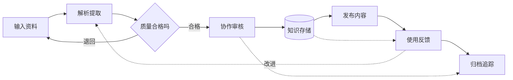

[语法参考](https://pele.run/theming) · [返回类型索引](#类型与本机版本实测索引)


## D02 flowchart

**同一结构：八类显式语义色**

固定色对照，和 D01 的结构完全相同。

**固定色对照**：本例显式指定色值，不用于判断自动明暗主题是否生效。

观察：八种浅色填充配深色正文与高饱和边框；区分渲染器能否多色与当前主题是否分配多色；这里颜色固定，不会随明暗主题切换；用于校准，不作为所有主图的默认写法。

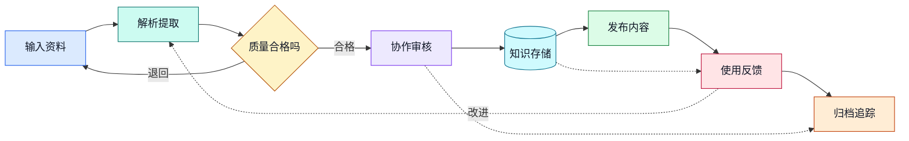

[语法参考](https://pele.run/theming) · [返回类型索引](#类型与本机版本实测索引)


## D03 flowchart

**Mermaid init 颜色指令的兼容性对照**

Pele可以解析，但不套用Mermaid的themeVariables配色。

颜色指令兼容性对照：Mermaid 的显式主题指令不会替代 Pele 的宿主主题映射。

观察：旧 Mermaid 可采用 init 配色；Pele 颜色由 CSS 变量和宿主适配控制；若与 D01 同色，这是有意设置的兼容性对照，并非本图语法失败；不要用本图判断当前 note.md 是否支持 CSS 调色。

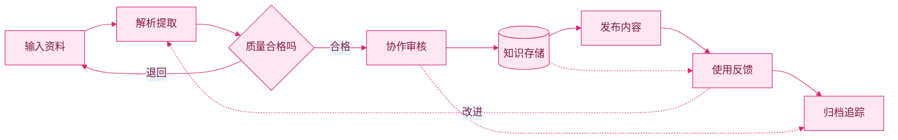

[语法参考](https://pele.run/compatibility) · [返回类型索引](#类型与本机版本实测索引)


## D04 flowchart

**96 节点的知识交付系统压力图**

8分区、96节点、118条关系；宽窄排版和大图压力。

**跟随主题**：不指定固定色值，用于检查宿主当前配色。

观察：每组底色与相邻组的边界是否清楚，长连线是否遮挡正文；窄窗口不强求所有节点同时可读，可用放大/独立预览检查局部；先用 D01-D02 和饼图调色，再用此图检查高密度连线；大图不要只按截图缩略图判断文字对比度。

```mermaid
flowchart TB
  subgraph Collect[采集入口]
    direction LR
    Collect0[接收 1-1]
    Collect1[校验 1-2]
    Collect0 --> Collect1
    Collect2[排队 1-3]
    Collect1 --> Collect2
    Collect3[转换 1-4]
    Collect2 --> Collect3
    Collect4[补充 1-5]
    Collect3 --> Collect4
    Collect5{检查通过吗}
    Collect4 --> Collect5
    Collect6[分流 1-7]
    Collect5 --> Collect6
    Collect7[处理 1-8]
    Collect6 --> Collect7
    Collect8[汇总 1-9]
    Collect7 --> Collect8
    Collect9[确认 1-10]
    Collect8 --> Collect9
    Collect10[(持久化)]
    Collect9 --> Collect10
    Collect11[完成 1-12]
    Collect10 --> Collect11
    Collect5 -.->|退回修正| Collect2
    Collect6 --> Collect9
  end
  subgraph Prepare[预处理]
    direction LR
    Prepare0[接收 2-1]
    Prepare1[校验 2-2]
    Prepare0 --> Prepare1
    Prepare2[排队 2-3]
    Prepare1 --> Prepare2
    Prepare3[转换 2-4]
    Prepare2 --> Prepare3
    Prepare4[补充 2-5]
    Prepare3 --> Prepare4
    Prepare5{检查通过吗}
    Prepare4 --> Prepare5
    Prepare6[分流 2-7]
    Prepare5 --> Prepare6
    Prepare7[处理 2-8]
    Prepare6 --> Prepare7
    Prepare8[汇总 2-9]
    Prepare7 --> Prepare8
    Prepare9[确认 2-10]
    Prepare8 --> Prepare9
    Prepare10[(持久化)]
    Prepare9 --> Prepare10
    Prepare11[完成 2-12]
    Prepare10 --> Prepare11
    Prepare5 -.->|退回修正| Prepare2
    Prepare6 --> Prepare9
  end
  Collect11 --> Prepare0
  subgraph Model[结构建模]
    direction LR
    Model0[接收 3-1]
    Model1[校验 3-2]
    Model0 --> Model1
    Model2[排队 3-3]
    Model1 --> Model2
    Model3[转换 3-4]
    Model2 --> Model3
    Model4[补充 3-5]
    Model3 --> Model4
    Model5{检查通过吗}
    Model4 --> Model5
    Model6[分流 3-7]
    Model5 --> Model6
    Model7[处理 3-8]
    Model6 --> Model7
    Model8[汇总 3-9]
    Model7 --> Model8
    Model9[确认 3-10]
    Model8 --> Model9
    Model10[(持久化)]
    Model9 --> Model10
    Model11[完成 3-12]
    Model10 --> Model11
    Model5 -.->|退回修正| Model2
    Model6 --> Model9
  end
  Prepare11 --> Model0
  subgraph Search[索引检索]
    direction LR
    Search0[接收 4-1]
    Search1[校验 4-2]
    Search0 --> Search1
    Search2[排队 4-3]
    Search1 --> Search2
    Search3[转换 4-4]
    Search2 --> Search3
    Search4[补充 4-5]
    Search3 --> Search4
    Search5{检查通过吗}
    Search4 --> Search5
    Search6[分流 4-7]
    Search5 --> Search6
    Search7[处理 4-8]
    Search6 --> Search7
    Search8[汇总 4-9]
    Search7 --> Search8
    Search9[确认 4-10]
    Search8 --> Search9
    Search10[(持久化)]
    Search9 --> Search10
    Search11[完成 4-12]
    Search10 --> Search11
    Search5 -.->|退回修正| Search2
    Search6 --> Search9
  end
  Model11 --> Search0
  subgraph Compose[协作编排]
    direction LR
    Compose0[接收 5-1]
    Compose1[校验 5-2]
    Compose0 --> Compose1
    Compose2[排队 5-3]
    Compose1 --> Compose2
    Compose3[转换 5-4]
    Compose2 --> Compose3
    Compose4[补充 5-5]
    Compose3 --> Compose4
    Compose5{检查通过吗}
    Compose4 --> Compose5
    Compose6[分流 5-7]
    Compose5 --> Compose6
    Compose7[处理 5-8]
    Compose6 --> Compose7
    Compose8[汇总 5-9]
    Compose7 --> Compose8
    Compose9[确认 5-10]
    Compose8 --> Compose9
    Compose10[(持久化)]
    Compose9 --> Compose10
    Compose11[完成 5-12]
    Compose10 --> Compose11
    Compose5 -.->|退回修正| Compose2
    Compose6 --> Compose9
  end
  Search11 --> Compose0
  subgraph Publish[发布交付]
    direction LR
    Publish0[接收 6-1]
    Publish1[校验 6-2]
    Publish0 --> Publish1
    Publish2[排队 6-3]
    Publish1 --> Publish2
    Publish3[转换 6-4]
    Publish2 --> Publish3
    Publish4[补充 6-5]
    Publish3 --> Publish4
    Publish5{检查通过吗}
    Publish4 --> Publish5
    Publish6[分流 6-7]
    Publish5 --> Publish6
    Publish7[处理 6-8]
    Publish6 --> Publish7
    Publish8[汇总 6-9]
    Publish7 --> Publish8
    Publish9[确认 6-10]
    Publish8 --> Publish9
    Publish10[(持久化)]
    Publish9 --> Publish10
    Publish11[完成 6-12]
    Publish10 --> Publish11
    Publish5 -.->|退回修正| Publish2
    Publish6 --> Publish9
  end
  Compose11 --> Publish0
  subgraph Observe[观测反馈]
    direction LR
    Observe0[接收 7-1]
    Observe1[校验 7-2]
    Observe0 --> Observe1
    Observe2[排队 7-3]
    Observe1 --> Observe2
    Observe3[转换 7-4]
    Observe2 --> Observe3
    Observe4[补充 7-5]
    Observe3 --> Observe4
    Observe5{检查通过吗}
    Observe4 --> Observe5
    Observe6[分流 7-7]
    Observe5 --> Observe6
    Observe7[处理 7-8]
    Observe6 --> Observe7
    Observe8[汇总 7-9]
    Observe7 --> Observe8
    Observe9[确认 7-10]
    Observe8 --> Observe9
    Observe10[(持久化)]
    Observe9 --> Observe10
    Observe11[完成 7-12]
    Observe10 --> Observe11
    Observe5 -.->|退回修正| Observe2
    Observe6 --> Observe9
  end
  Publish11 --> Observe0
  subgraph Archive[存档恢复]
    direction LR
    Archive0[接收 8-1]
    Archive1[校验 8-2]
    Archive0 --> Archive1
    Archive2[排队 8-3]
    Archive1 --> Archive2
    Archive3[转换 8-4]
    Archive2 --> Archive3
    Archive4[补充 8-5]
    Archive3 --> Archive4
    Archive5{检查通过吗}
    Archive4 --> Archive5
    Archive6[分流 8-7]
    Archive5 --> Archive6
    Archive7[处理 8-8]
    Archive6 --> Archive7
    Archive8[汇总 8-9]
    Archive7 --> Archive8
    Archive9[确认 8-10]
    Archive8 --> Archive9
    Archive10[(持久化)]
    Archive9 --> Archive10
    Archive11[完成 8-12]
    Archive10 --> Archive11
    Archive5 -.->|退回修正| Archive2
    Archive6 --> Archive9
  end
  Observe11 --> Archive0
  Collect10 -.-> Archive0
  Model10 -.-> Search3
  Search10 -.-> Compose2
  Observe8 -.-> Prepare1
  Observe9 -.-> Model1
  Publish5 -.-> Compose4
  Archive11 -.-> Collect0
```

[语法参考](https://mermaid.js.org/syntax/flowchart.html) · [返回类型索引](#类型与本机版本实测索引)


## F01 flowchart

**知识发布审批流水线**

分区、决策、回流与虚线依赖。

**跟随主题**：不指定固定色值，用于检查宿主当前配色。

观察：分组底色与节点底色是否分层；判断菱形、普通节点和数据库轮廓的辨识度；实线、虚线、箭头和中文标签对比度。

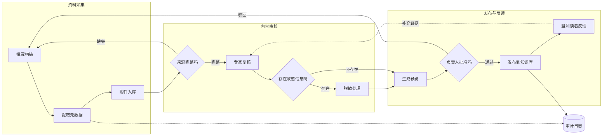

[语法参考](https://mermaid.js.org/syntax/flowchart.html) · [返回类型索引](#类型与本机版本实测索引)


## F02 flowchart

**订单异常的显式语义配色对照**

固定色：classDef、style、linkStyle。

**固定色对照**：本例显式指定色值，不用于判断自动明暗主题是否生效。

观察：固定语义色与随主题变化的默认节点对照；深色主题下显式文字色、填充色和箭头可读性；不要把本例的固定色误判成主题自动配色。

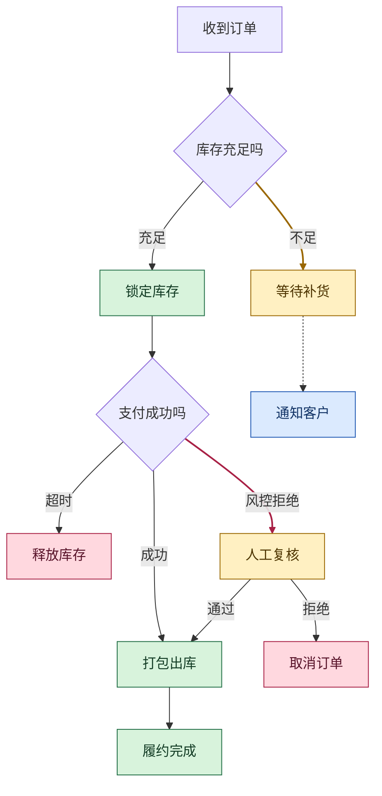

[语法参考](https://mermaid.js.org/syntax/flowchart.html) · [返回类型索引](#类型与本机版本实测索引)


## F03 flowchart

**数据加工节点形状图谱**

经典形状、汇聚与分流。

**跟随主题**：不指定固定色值，用于检查宿主当前配色。

观察：圆角、菱形、子流程、圆柱、六边形与圆形轮廓；相同填充色下是否仍可凭形状区分职责；斜边节点内文字与边界距离。

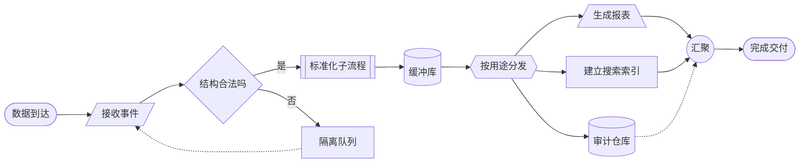

[语法参考](https://mermaid.js.org/syntax/flowchart.html) · [返回类型索引](#类型与本机版本实测索引)


## F04 flowchart

**跨团队事件通知拓扑**

graph 别名与多种边。

**跟随主题**：不指定固定色值，用于检查宿主当前配色。

观察：graph 别名与标准 flowchart 的主题一致性；粗线、虚线、无箭头连线层级；跨分组连接穿越背景时的对比。

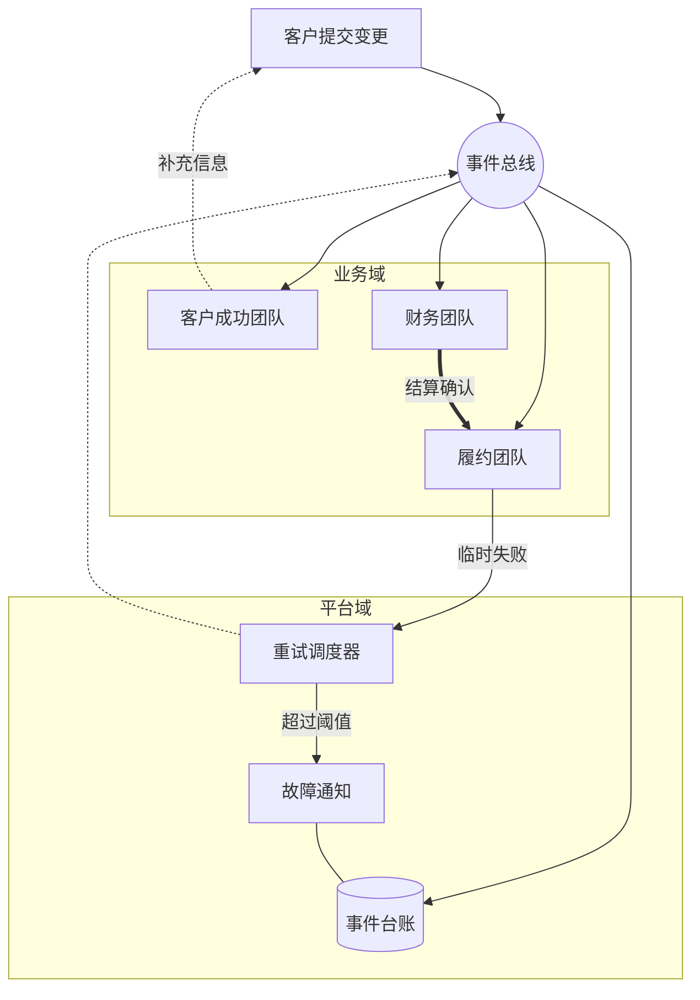

[语法参考](https://mermaid.js.org/syntax/flowchart.html) · [返回类型索引](#类型与本机版本实测索引)


## F05 sequence

**多方支付与退款时序**

激活、分支、循环、并行与注释。

**跟随主题**：不指定固定色值，用于检查宿主当前配色。

观察：参与者、激活条、消息线与返回虚线的对比；alt/loop/par 背景与注释块是否分层；长中文消息是否遮挡生命线。

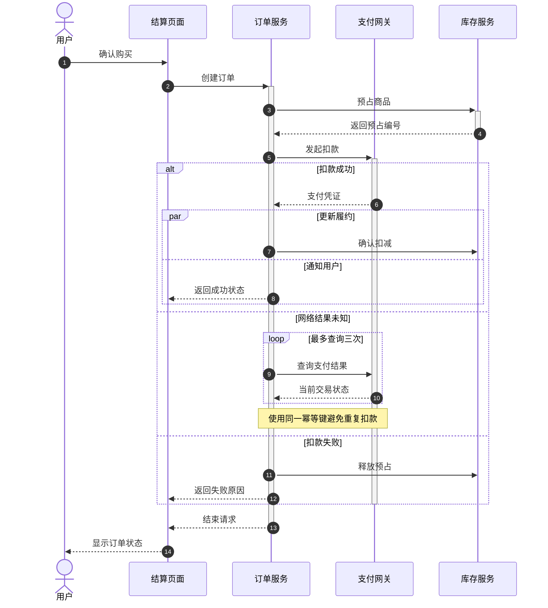

[语法参考](https://mermaid.js.org/syntax/sequenceDiagram.html) · [返回类型索引](#类型与本机版本实测索引)


## F06 class

**可组合的知识文档模型**

泛化、组合、聚合与接口。

**跟随主题**：不指定固定色值，用于检查宿主当前配色。

观察：类名与成员区域层级；继承、实现、组合、聚合端点区别；多重性和关系说明文字可读性。

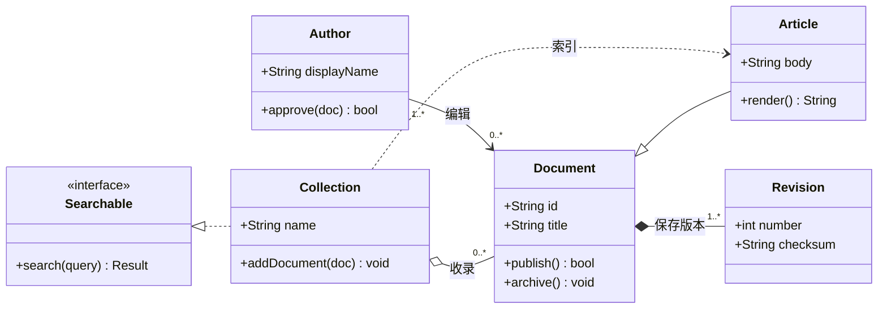

[语法参考](https://mermaid.js.org/syntax/classDiagram.html) · [返回类型索引](#类型与本机版本实测索引)


## F07 state

**带复合状态的同步生命周期**

stateDiagram-v2 复合状态与选择。

**跟随主题**：不指定固定色值，用于检查宿主当前配色。

观察：复合状态的外框和内部节点分层；起止节点、选择节点与普通状态区分；注释背景与画布、嵌套区域的对比。

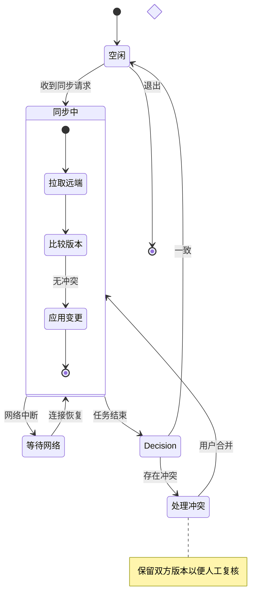

[语法参考](https://mermaid.js.org/syntax/stateDiagram.html) · [返回类型索引](#类型与本机版本实测索引)


## F08 state

**旧版状态语法的工单流转**

legacy stateDiagram 兼容对照。

**跟随主题**：不指定固定色值，用于检查宿主当前配色。

观察：legacy 与 v2 的状态配色一致性；循环回边和转移标签可辨识度；浅色、深色画布上的开始与结束圆点。

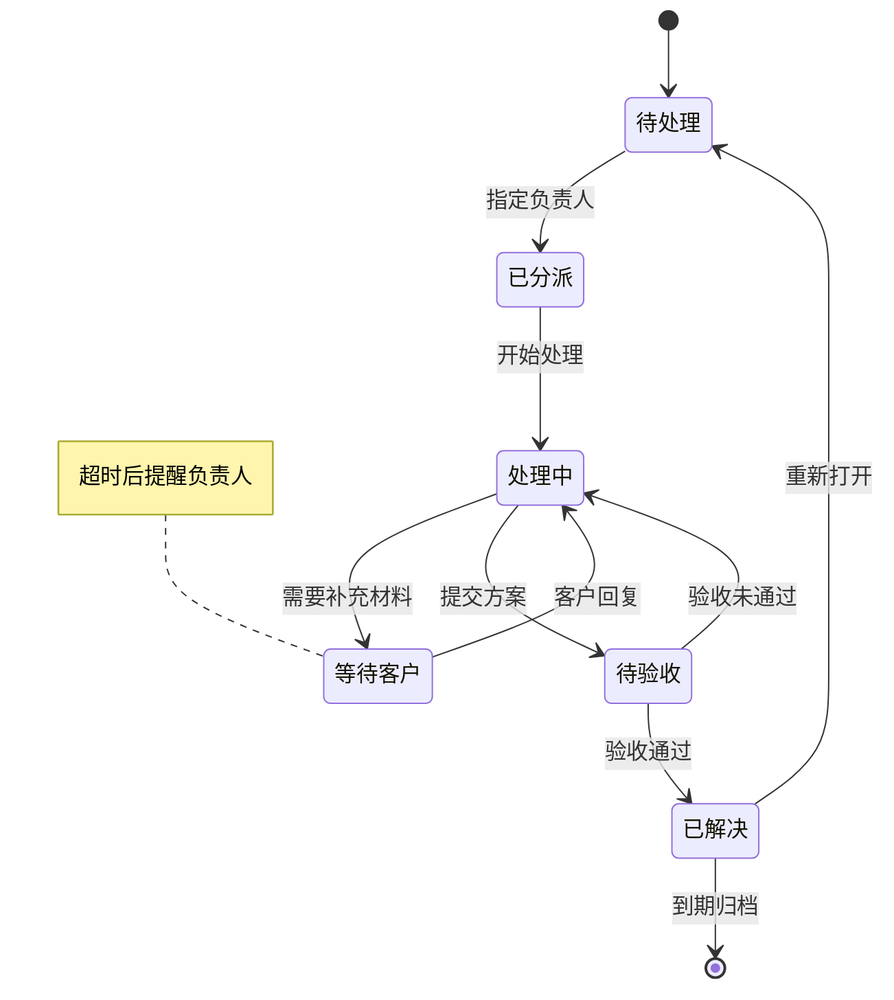

[语法参考](https://mermaid.js.org/syntax/stateDiagram.html) · [返回类型索引](#类型与本机版本实测索引)


## F09 er

**多租户内容协作实体模型**

必选、可选与多对多关系。

**跟随主题**：不指定固定色值，用于检查宿主当前配色。

观察：实体标题、属性行和主外键文字层级；乌鸦脚、圆圈、竖线在浅深背景的识别；多关系密集交汇时边线可读性。

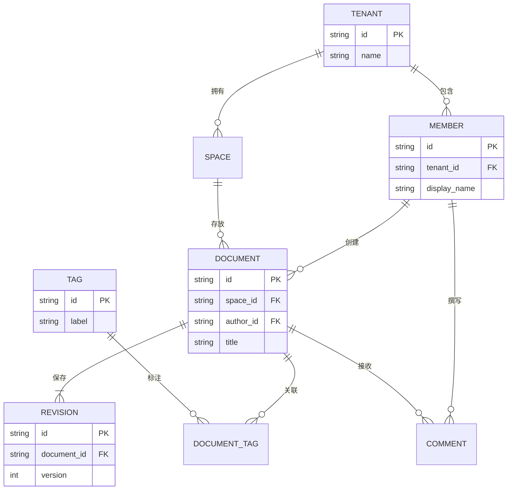

[语法参考](https://mermaid.js.org/syntax/entityRelationshipDiagram.html) · [返回类型索引](#类型与本机版本实测索引)


## F10 gantt

**跨平台发布的阶段依赖计划**

分组、里程碑、完成与关键路径。

**跟随主题**：不指定固定色值，用于检查宿主当前配色。

观察：done/active/crit 三种状态的差异；分组交替底色、网格线和任务文字对比；里程碑与窄任务条的可见度。

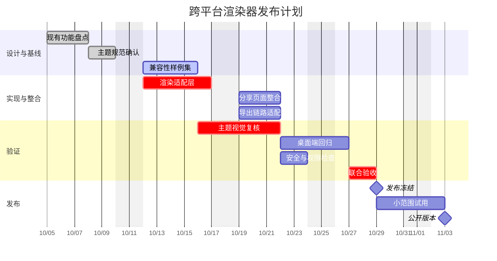

[语法参考](https://mermaid.js.org/syntax/gantt.html) · [返回类型索引](#类型与本机版本实测索引)


## F11 gitGraph

**发布分支与紧急修复历史**

分支、合并、标签与高亮提交。

**跟随主题**：不指定固定色值，用于检查宿主当前配色。

观察：不同分支颜色是否足以追踪；提交点、标签、高亮提交的区分；跨分支合并线与名称标签对比。

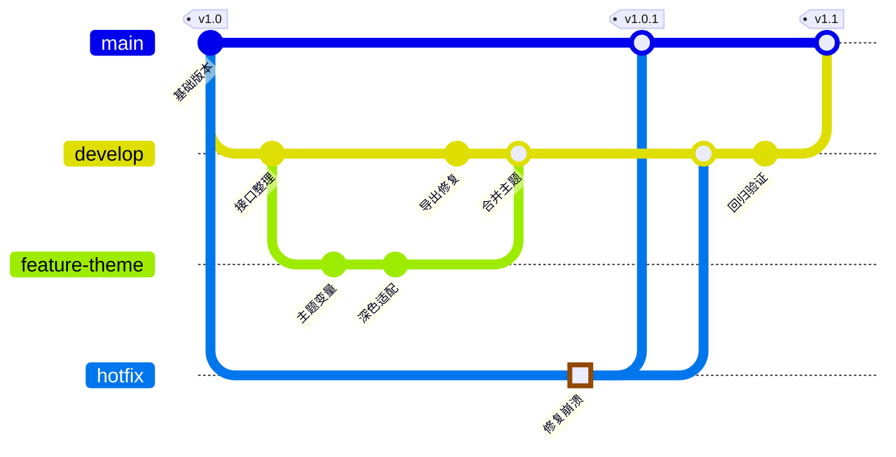

[语法参考](https://mermaid.js.org/syntax/gitgraph.html) · [返回类型索引](#类型与本机版本实测索引)


## F12 mindmap

**知识产品的主题验收脑图**

多层级与多种节点形状。

**跟随主题**：不指定固定色值，用于检查宿主当前配色。

观察：不同一级分支是否自动分色；层级逐深时填充与文字对比是否稳定；中心圆形、分支色和细连接线的关系。

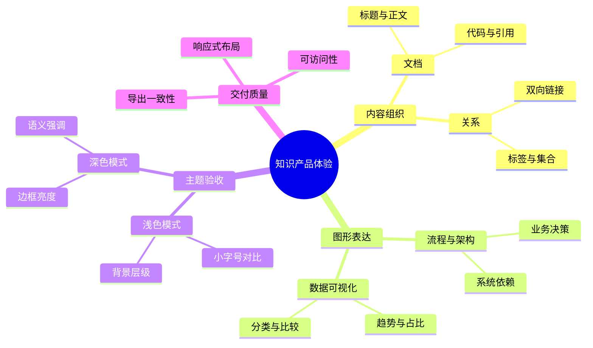

[语法参考](https://mermaid.js.org/syntax/mindmap.html) · [返回类型索引](#类型与本机版本实测索引)


## F13 journey

**新成员从邀请到协作的用户旅程**

多阶段、多角色与满意度。

**跟随主题**：不指定固定色值，用于检查宿主当前配色。

观察：角色圆点、阶段背景和任务块的配色；满意度表情与连线在主题切换后的可读性；同一任务多角色标记是否清晰。

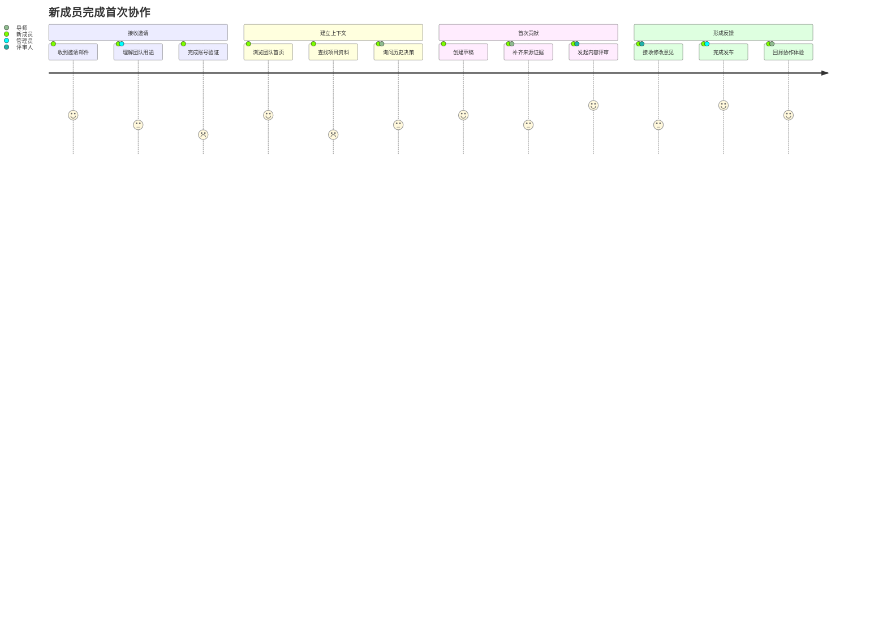

[语法参考](https://mermaid.js.org/syntax/userJourney.html) · [返回类型索引](#类型与本机版本实测索引)


## F14 timeline

**渲染器演进与交付事件轴**

分区、单期多事件与长中文标签。

**跟随主题**：不指定固定色值，用于检查宿主当前配色。

观察：分区和不同时间节点是否有明确色阶；多事件连线、时间标签与正文的层级；背景色在长文本区域中的可读性。

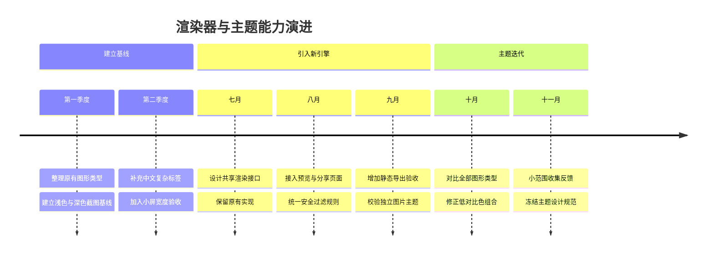

[语法参考](https://mermaid.js.org/syntax/timeline.html) · [返回类型索引](#类型与本机版本实测索引)


## F15 requirement

**文档安全与导出需求追踪**

需求、设计约束、元素与验证关系。

**跟随主题**：不指定固定色值，用于检查宿主当前配色。

观察：不同需求类别标题与正文区分；risk/验证方法等元数据的阅读层级；satisfies/derives/verifies 等虚线关系和箭头对比。

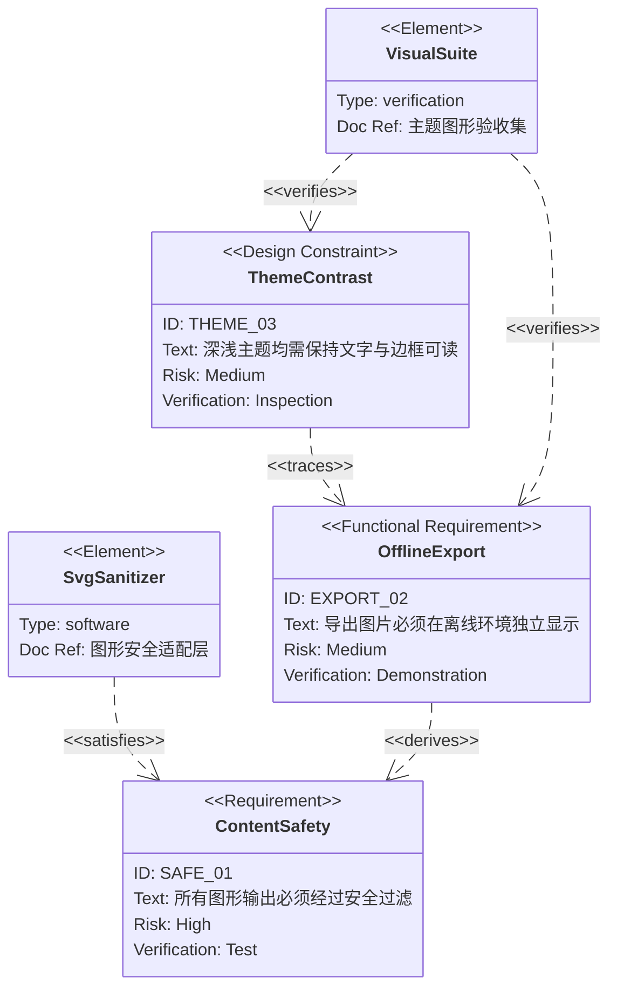

[语法参考](https://mermaid.js.org/syntax/requirementDiagram.html) · [返回类型索引](#类型与本机版本实测索引)


## A01 pie

**十二类知识资产的容量分布**

十二分类与长图例。

**跟随主题**：不指定固定色值，用于检查宿主当前配色。

观察：十二分类越过八色色板循环，检查第九至十二项是否仍易区分。；观察细小扇区、百分比、数值与中文图例在深浅背景上的对比度。。

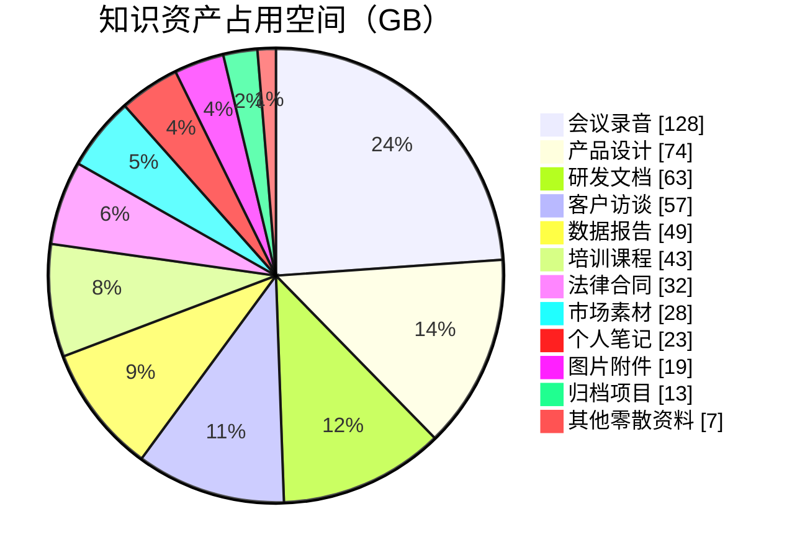

[语法参考](https://mermaid.js.org/syntax/pie.html) · [返回类型索引](#类型与本机版本实测索引)


## A02 quadrantChart

**跨团队需求投资优先级**

四象限与密集中文点位。

**跟随主题**：不指定固定色值，用于检查宿主当前配色。

观察：检查四个象限的底色差异、点标记与中文标签可读性。；点位密集区域应保留层次；不要用单一强调色承载全部语义。。

```mermaid
quadrantChart
    title 下一季度需求投资组合
    x-axis 低实施成本 --> 高实施成本
    y-axis 低用户收益 --> 高用户收益
    quadrant-1 战略投入
    quadrant-2 优先交付
    quadrant-3 顺手改进
    quadrant-4 暂缓评估
    全文检索: [0.28, 0.86]
    离线同步: [0.82, 0.91]
    批量导入: [0.36, 0.73]
    多人协作: [0.91, 0.80]
    深色主题: [0.18, 0.62]
    快捷键指南: [0.14, 0.35]
    导出模板: [0.42, 0.44]
    自定义脚本: [0.76, 0.38]
    附件去重: [0.62, 0.65]
    开机动效: [0.68, 0.17]
    拼写检查: [0.31, 0.56]
    插件沙箱: [0.87, 0.58]
```

[语法参考](https://mermaid.js.org/syntax/quadrantChart.html) · [返回类型索引](#类型与本机版本实测索引)


## A03 xychart

**订阅收入与交付目标的组合图**

双柱双折线同图。

**跟随主题**：不指定固定色值，用于检查宿主当前配色。

观察：同时比较柱体填充、折线颜色、图例及网格线的区分度。；同月份的两类柱体和两条目标线不应都呈现相近灰色。。

```mermaid
---
config:
  xyChart:
    showDataLabel: true
---
xychart
    title "季度订阅收入与目标（万元）"
    x-axis ["一月", "二月", "三月", "四月", "五月", "六月"]
    y-axis "收入（万元）" 0 --> 180
    bar "个人订阅" [48, 56, 71, 83, 96, 112]
    bar "团队订阅" [32, 41, 53, 69, 88, 106]
    line "保守目标" [70, 82, 94, 106, 118, 130]
    line "挑战目标" [90, 105, 120, 135, 150, 165]
```

[语法参考](https://mermaid.js.org/syntax/xyChart.html) · [返回类型索引](#类型与本机版本实测索引)


## A04 xychart

**各业务域响应延迟的横向对比**

横向多系列条形。

**跟随主题**：不指定固定色值，用于检查宿主当前配色。

观察：横向长中文分类的留白及标签对比度。；检查两组条形、目标线、轴刻度与底网格层次。。

```mermaid
---
config:
  xyChart:
    showDataLabel: true
---
xychart horizontal
    title "接口延迟分位数（毫秒）"
    x-axis ["知识检索", "文件同步", "附件上传", "分享访问", "全文导出", "权限校验"]
    y-axis "响应耗时（毫秒）" 0 --> 500
    bar "中位数" [42, 76, 154, 61, 188, 25]
    bar "九五分位" [88, 168, 320, 132, 420, 58]
    line "服务目标" [150, 200, 350, 150, 450, 80]
```

[语法参考](https://mermaid.js.org/syntax/xyChart.html) · [返回类型索引](#类型与本机版本实测索引)


## A05 sankey

**线索到收入的多级流量分配**

四层守恒流量。

**跟随主题**：不指定固定色值，用于检查宿主当前配色。

观察：流量在中间节点满足守恒；观察大流量和细流量是否清晰分层。；检查跨四层节点的系列色、半透明连带、重叠区域和中文标签。；本机 Pele 1.6.0 桑基图的 CSV 标签包含中文会报语法错误，因此此图采用英文节点；含义依次为自然搜索/内容阅读/社群推荐/广告投放/活动报名/合作伙伴/产品试用/暂未转化/个人方案/团队方案/试用流失/订阅收入/免费保留/商务跟进。。

```mermaid
sankey

"Organic Search","Content Reading",360
"Community Referral","Content Reading",240
"Paid Campaign","Event Registration",300
"Partner Channel","Event Registration",100
"Content Reading","Product Trial",380
"Content Reading","No Conversion",220
"Event Registration","Product Trial",260
"Event Registration","No Conversion",140
"Product Trial","Personal Plan",310
"Product Trial","Team Plan",250
"Product Trial","Trial Churn",80
"Personal Plan","Paid Subscription",230
"Personal Plan","Free Retention",80
"Team Plan","Paid Subscription",190
"Team Plan","Sales Followup",60
```

[语法参考](https://mermaid.js.org/syntax/sankey.html) · [返回类型索引](#类型与本机版本实测索引)


## A06 radar

**三套部署方案的八维能力评估**

三系列八轴与多边形网格。

**跟随主题**：不指定固定色值，用于检查宿主当前配色。

观察：检查三条闭合曲线和透明面积交叠后的颜色辨识。；轴标题、背景网格和图例应能独立读取。。

```mermaid
radar-beta
    title 部署方案能力评估
    axis privacy["隐私保护"], offline["离线能力"], speed["启动速度"], scale["扩展能力"]
    axis search["搜索质量"], collab["协作体验"], cost["成本可控"], ops["维护便利"]
    curve local["本地优先"]{96, 98, 92, 64, 81, 56, 88, 78}
    curve cloud["云端托管"]{65, 40, 76, 95, 91, 96, 62, 94}
    curve hybrid["混合部署"]{88, 84, 85, 86, 90, 83, 76, 72}
    showLegend true
    graticule polygon
    ticks 5
    max 100
    min 0
```

[语法参考](https://mermaid.js.org/syntax/radar.html) · [返回类型索引](#类型与本机版本实测索引)


## A07 radar

**九支交付小队的雷达色板压力测试**

九系列与圆形网格。

**跟随主题**：不指定固定色值，用于检查宿主当前配色。

观察：第九系列触发八色循环；特别观察第一与第九系列的重合风险。；这是刻意的高密度压力样例，检查图例与透明叠加是否仍可追踪。。

```mermaid
radar-beta
    title 九支小队能力轮廓（模拟评分）
    axis quality["质量"], delivery["交付"], service["服务"], security["安全"], research["研究"], documentation["文档"]
    curve a["平台一队"]{95, 72, 65, 96, 75, 82}
    curve b["平台二队"]{84, 88, 72, 91, 81, 76}
    curve c["搜索小队"]{88, 76, 81, 74, 96, 68}
    curve d["同步小队"]{91, 80, 75, 94, 77, 79}
    curve e["编辑小队"]{86, 92, 88, 73, 85, 84}
    curve f["移动小队"]{79, 86, 91, 78, 82, 77}
    curve g["设计小队"]{83, 81, 94, 65, 93, 90}
    curve h["数据小队"]{92, 73, 68, 88, 90, 85}
    curve i["运维小队"]{90, 87, 89, 98, 67, 95}
    showLegend true
    graticule circle
    ticks 4
    max 100
    min 0
```

[语法参考](https://mermaid.js.org/syntax/radar.html) · [返回类型索引](#类型与本机版本实测索引)


## A08 treemap

**年度研发投入的三级矩形树图**

三级分类与大小悬殊叶子。

**跟随主题**：不指定固定色值，用于检查宿主当前配色。

观察：检查大区块、嵌套分组标题和小叶片是否有足够色差。；主题应兼顾浅色大面积填充、细边框与深色中文文字。。

```mermaid
treemap-beta
"年度研发投入（人月）"
    "核心体验"
        "编辑器"
            "输入与光标": 28
            "表格与附件": 22
            "图表渲染": 17
        "检索"
            "全文索引": 26
            "语义召回": 19
    "平台工程"
        "同步服务": 31
        "账户与权限": 18
        "插件沙箱": 14
        "可观测性": 9
    "端侧适配"
        "桌面系统": 23
        "移动系统": 16
        "辅助功能": 7
    "创新实验"
        "知识关联": 11
        "自动整理": 5
        "快速原型": 2
```

[语法参考](https://mermaid.js.org/syntax/treemap.html) · [返回类型索引](#类型与本机版本实测索引)


## A09 venn

**可上线能力的三集合交集**

三集合与各区文字。

**跟随主题**：不指定固定色值，用于检查宿主当前配色。

观察：观察三个集合的半透明填充及七个语义区域的对比度。；交集标签和区内文字不应被叠色淹没。。

```mermaid
venn-beta
    title 发布候选能力的三重约束
    set user["用户价值"]
        text u1["减少重复录入"]
        text u2["跨设备继续工作"]
    set engineering["工程可行"]
        text e1["已验证同步协议"]
        text e2["性能预算可控"]
    set business["商业持续"]
        text b1["支持成本可控"]
        text b2["具备续费价值"]
    union user,engineering["值得试用"]
        text ue["本地全文检索"]
    union engineering,business["能够规模化"]
        text eb["托管团队空间"]
    union user,business["愿意付费"]
        text ub["团队知识沉淀"]
    union user,engineering,business["优先发布"]
        text all["可靠的离线协作"]
```

[语法参考](https://pele.run/examples#venn) · [返回类型索引](#类型与本机版本实测索引)


## A10 kanban

**跨角色发布冲刺看板**

五列多人五档优先级。

**跟随主题**：不指定固定色值，用于检查宿主当前配色。

观察：检查五档优先级条带、人员标签、工单号和列标题的视觉层级。；同列多卡片和长中文描述应保持分隔、文字对比度及横向可读性。。

```mermaid
kanban
    backlog[待评估]
        a[导入历史归档并去重]@{ ticket: NOTE-241, assigned: '林舟', priority: 'Low' }
        b[增加拼写词典]@{ ticket: NOTE-242, assigned: '周清', priority: 'Very Low' }
    ready[待开发]
        c[离线编辑冲突合并]@{ ticket: NOTE-243, assigned: '陈星', priority: 'Very High' }
        d[共享空间权限审计]@{ ticket: NOTE-244, assigned: '林舟', priority: 'High' }
        e[中文全文检索排序]@{ ticket: NOTE-245, assigned: '余安', priority: 'Medium' }
    doing[进行中]
        f[修复窄窗口图表标签遮挡]@{ ticket: NOTE-246, assigned: '周清', priority: 'High' }
        g[移动端附件后台上传]@{ ticket: NOTE-247, assigned: '陈星', priority: 'Medium' }
    review[联调与验收]
        h[分享访问限流]@{ ticket: NOTE-248, assigned: '余安', priority: 'Very High' }
        i[深色主题下打印预览]@{ ticket: NOTE-249, assigned: '周清', priority: 'Low' }
    done[已交付]
        j[同步失败重试提示]@{ ticket: NOTE-250, assigned: '林舟', priority: 'High' }
        k[附件缩略图缓存]@{ ticket: NOTE-251, assigned: '陈星', priority: 'Medium' }
```

[语法参考](https://mermaid.js.org/syntax/kanban.html) · [返回类型索引](#类型与本机版本实测索引)


## A11 packet

**附件同步连接的 TCP 首部**

真实 TCP 字段与 32 位多行。

**跟随主题**：不指定固定色值，用于检查宿主当前配色。

观察：每行三十二位、五行一百六十位，检查窄控制位和宽字段的边框/文字对比度。；字段边界、位编号、行编号与背景应有清楚的层级。。

```mermaid
---
title: 附件同步连接的 TCP 首部（不含选项）
config:
  packet:
    bitsPerRow: 32
    showBits: true
---
packet
0-15: "源端口"
16-31: "目标端口"
32-63: "序列号"
64-95: "确认号"
96-99: "首部长度"
100-103: "保留"
104: "CWR"
105: "ECE"
106: "URG"
107: "ACK"
108: "PSH"
109: "RST"
110: "SYN"
111: "FIN"
112-127: "接收窗口"
128-143: "校验和"
144-159: "紧急指针"
```

[语法参考](https://mermaid.js.org/syntax/packet.html) · [返回类型索引](#类型与本机版本实测索引)


## A12 block

**离线知识工作台的嵌套功能块**

三列网格与三层嵌套。

**跟随主题**：不指定固定色值，用于检查宿主当前配色。

观察：检查嵌套容器、普通块与数据库形状是否有适当色阶区分。；连线与分组边框需要保持清晰，不应盖过节点正文。。

```mermaid
block
    columns 3
    title["离线知识工作台"]:3
    block:input:3
        columns 3
        md["Markdown 文件"] voice["会议录音"] image["图片附件"]
    end
    block:processing:2
        columns 2
        parser["统一解析"] index["增量索引"]
        block:quality:2
            columns 2
            dedup["内容去重"] links["双链校验"]
        end
    end
    local[("本地数据库")]
    block:output:3
        columns 3
        editor["编辑与回顾"] search["全文检索"] share["只读分享"]
    end
    md --> parser
    voice --> parser
    parser --> index
    index --> local
    local --> search
    links --> editor
    editor --> share
```

[语法参考](https://mermaid.js.org/syntax/block.html) · [返回类型索引](#类型与本机版本实测索引)


## A13 architecture

**端侧优先协作系统架构**

三分组五种内建图标与方向端口。

**跟随主题**：不指定固定色值，用于检查宿主当前配色。

观察：观察 cloud/server/disk/internet/database 五类内建图标及组边界。；不同方向端口、箭头、图标线条和中文标题在深浅主题下都需清晰。。

```mermaid
architecture-beta
    group devices(cloud)[终端设备]
    group sync(cloud)[同步服务]
    group storage(database)[持久存储]
    service desktop(server)[桌面客户端] in devices
    service mobile(server)[移动客户端] in devices
    service vault(disk)[本地资料库] in devices
    service edge(internet)[访问网关] in sync
    service coordinator(server)[版本协调器] in sync
    service queue(disk)[增量操作日志] in sync
    service documents(database)[文档元数据] in storage
    service blobs(disk)[附件对象库] in storage
    service backup(cloud)[异地备份] in storage
    desktop:B --> T:vault
    mobile:R --> L:edge
    desktop:R --> T:edge
    edge:R --> L:coordinator
    coordinator:B --> T:queue
    coordinator:R --> L:documents
    queue:R --> L:blobs
    documents:B --> T:backup
    blobs:B --> R:backup
```

[语法参考](https://mermaid.js.org/syntax/architecture.html) · [返回类型索引](#类型与本机版本实测索引)


## M01 c4

**C4 系统上下文：跨组织知识平台**

C4Context。

**跟随主题**：不指定固定色值，用于检查宿主当前配色。

观察：区分内部、外部实体和人物；边界填充、数据库与队列图形是否有层次；跨边界关系文字与线条对比度。

```mermaid
C4Context
  title 跨组织知识协作的系统上下文
  Enterprise_Boundary(org, "协作企业") {
    Person(writer, "知识作者", "整理研究、撰写与审阅文稿")
    Person(admin, "空间管理员", "控制权限与归档规则")
    System(notes, "知识工作台", "编辑、检索与分享知识")
    SystemDb(index, "企业知识索引", "全文与语义检索")
    SystemQueue(audit, "审计事件队列", "保存访问与修改记录")
  }
  Person_Ext(guest, "外部审稿人", "通过分享链接提出建议")
  System_Ext(idp, "组织身份服务", "单点登录")
  System_Ext(mail, "通知服务", "发送审阅邀请")
  Rel(writer, notes, "撰写与搜索", "桌面应用")
  Rel(admin, notes, "管理空间", "HTTPS")
  Rel(guest, notes, "审阅指定文稿", "只读链接")
  Rel(notes, idp, "校验身份", "OIDC")
  Rel(notes, index, "更新检索索引")
  Rel(notes, audit, "记录操作")
  Rel(notes, mail, "派发通知")
  Rel(mail, guest, "发送邀请")
```

[语法参考](https://pele.run/examples/c4) · [返回类型索引](#类型与本机版本实测索引)


## M02 c4

**C4 容器：离线编辑与云端同步**

C4Container。

**跟随主题**：不指定固定色值，用于检查宿主当前配色。

观察：容器与数据库色阶区分；密集关系标签保持可读；内部边界与页面背景是否混淆。

```mermaid
C4Container
  title 离线编辑器与同步服务
  Person(user, "研究员", "在多设备编辑文稿")
  System_Boundary(platform, "知识平台") {
    Container(desktop, "桌面编辑器", "Svelte / Tauri", "离线编辑与图形预览")
    Container(web, "分享访客页", "浏览器", "轻量阅读与批注")
    Container(api, "同步 API", "HTTP 服务", "合并版本与鉴权")
    Container(worker, "索引任务", "异步 Worker", "提取文本和更新索引")
    ContainerDb(local, "本地资料库", "文件系统", "Markdown 与附件")
    ContainerDb(cloud, "版本数据库", "关系数据库", "修订与分享权限")
    ContainerQueue(queue, "同步事件", "消息队列", "任务解耦")
  }
  System_Ext(auth, "身份提供商", "组织登录")
  Rel(user, desktop, "编辑笔记")
  Rel(user, web, "访问分享")
  Rel(desktop, local, "读写文件")
  Rel(desktop, api, "推送修订", "HTTPS")
  Rel(web, api, "获取分享内容", "HTTPS")
  Rel(api, auth, "验证令牌")
  Rel(api, cloud, "提交版本")
  Rel(api, queue, "发布索引事件")
  Rel(queue, worker, "派发任务")
  Rel(worker, cloud, "写入检索数据")
```

[语法参考](https://pele.run/examples/c4) · [返回类型索引](#类型与本机版本实测索引)


## M03 c4

**C4 组件：渲染管线分工**

C4Component。

**跟随主题**：不指定固定色值，用于检查宿主当前配色。

观察：组件外观、技术标签与描述的三级文字；主题与安全组件是否容易定位；关系箭头在多层边界中是否清晰。

```mermaid
C4Component
  title 图形渲染组件及其依赖
  Container(editor, "文档编辑器", "浏览器 UI", "展示 Markdown")
  ContainerDb(cache, "资源缓存", "内存", "复用已验证资源")
  Container_Boundary(renderer, "图形渲染服务") {
    Component(parse, "代码块识别器", "语法扫描", "选择图形类型")
    Component(layout, "布局引擎", "Pele", "计算节点与连线")
    Component(theme, "主题解析器", "CSS 变量", "解析文字、边框与填充")
    Component(clean, "SVG 清理器", "DOMPurify", "移除不安全内容")
    Component(exporter, "导出组件", "SVG / PNG", "生成独立图像")
  }
  System_Ext(share, "分享页面", "展示相同图形")
  Rel(editor, parse, "提供源码")
  Rel(parse, layout, "提交图形")
  Rel(theme, layout, "提供主题")
  Rel(layout, clean, "输出 SVG")
  Rel(clean, cache, "缓存安全结果")
  Rel(clean, exporter, "生成导出副本")
  Rel(cache, editor, "显示预览")
  Rel(exporter, share, "提供可移植图像")
```

[语法参考](https://pele.run/examples/c4) · [返回类型索引](#类型与本机版本实测索引)


## M04 c4

**C4 动态：并发修订的提交顺序**

C4Dynamic。

**跟随主题**：不指定固定色值，用于检查宿主当前配色。

观察：动态关系的编号、方向与标签；重复实体之间往返关系是否混淆；数据库边框和主体填充的辨识度。

```mermaid
C4Dynamic
  title 一次修订从编辑到同步
  Container(client, "桌面编辑器", "Tauri", "离线可用")
  Container_Boundary(sync, "同步服务") {
    Component(auth, "身份验证", "令牌检查", "确认访问权限")
    Component(merge, "版本合并", "修订比较", "检测冲突")
    Component(notify, "事件发布", "异步通知", "通知其他设备")
  }
  ContainerDb(store, "版本库", "数据库", "存储文稿与修订")
  Container(other, "另一台设备", "桌面应用", "接收新版本")
  Rel(client, auth, "提交本地修订", "HTTPS")
  Rel(auth, merge, "传递已验证请求")
  Rel(merge, store, "读取父版本")
  Rel(store, merge, "返回当前修订")
  Rel(merge, store, "写入合并结果")
  Rel(merge, notify, "发送修订已保存事件")
  Rel(notify, other, "推送新版本提示")
  Rel(other, store, "读取最新内容")
```

[语法参考](https://pele.run/examples/c4) · [返回类型索引](#类型与本机版本实测索引)


## M05 c4

**C4 部署：多设备与双区域存储**

C4Deployment。

**跟随主题**：不指定固定色值，用于检查宿主当前配色。

观察：多层部署边界的线型和透明度；嵌套区域是否出现颜色过深或过浅；本地与云端实体的视觉层次。

```mermaid
C4Deployment
  title 双区域知识服务的部署结构
  Deployment_Node(device, "用户设备", "macOS / Linux / Windows") {
    Container(app, "桌面应用", "Tauri", "离线编辑")
    ContainerDb(files, "本地资料库", "Markdown", "私有文稿")
  }
  Deployment_Node(edge, "边缘网络", "CDN") {
    Container(share, "分享站点", "静态资源", "公开访问入口")
  }
  Deployment_Node(primary, "主区域", "区域甲") {
    Deployment_Node(compute, "计算集群", "容器") {
      Container(api, "同步服务", "HTTP", "处理修订与权限")
    }
    Deployment_Node(storage, "持久化节点", "数据库服务") {
      ContainerDb(db, "主数据库", "SQL", "保存文档版本")
    }
  }
  Deployment_Node(backup, "备用区域", "区域乙") {
    ContainerDb(replica, "只读副本", "SQL", "灾备恢复")
  }
  Rel(app, files, "本地读写")
  Rel(app, api, "同步版本", "HTTPS")
  Rel(share, api, "读取分享内容")
  Rel(api, db, "保存修订")
  Rel(db, replica, "异步复制")
```

[语法参考](https://pele.run/examples/c4) · [返回类型索引](#类型与本机版本实测索引)


## M06 agentflow

**Agentflow：研究、撰写与质检协作**

agentflow-beta。

**跟随主题**：不指定固定色值，用于检查宿主当前配色。

观察：input、task、tool、refdoc、decision、action 各语义形状；多个代理边界与循环修正的层次；是否只剩单一强调色，工具与动作能否分辨。

```mermaid
agentflow-beta TB
  brief["研究任务与受众"]@{ shape: input }
  global
    corpus["已有资料与术语表"]@{ shape: refdoc }
  end
  flow research["研究代理"]
    gather["收集可信资料"]@{ shape: task }
    search["文献检索工具"]@{ shape: tool }
    evidence["整理证据"]@{ shape: task }
    gather --> search --> evidence
    evidence -.- corpus
  end
  flow writing["写作代理"]
    outline["组织论证结构"]@{ shape: task }
    draft["生成中文初稿"]@{ shape: task }
    outline --> draft
    draft -.- corpus
  end
  flow review["复核代理"]
    verify["核对引用与结论"]@{ shape: task }
    ok["证据充分？"]@{ shape: decision }
    verify --> ok
  end
  publish["交付审阅稿"]@{ shape: action }
  brief --> research --> writing --> review
  ok -- 通过 --> publish
  ok -- 补充证据 --> gather
```

[语法参考](https://pele.run/examples/agentflow) · [返回类型索引](#类型与本机版本实测索引)


## M07 railroad

**铁路图 DSL：带筛选条件的检索语言**

railroad-beta。

**跟随主题**：不指定固定色值，用于检查宿主当前配色。

观察：终结符与非终结符的形状、填充区分；可选分支、重复回路、跨行轨道可读性；规则标题与普通标签层级。

```mermaid
railroad-beta
title 知识检索表达式
query = sequence(
  nonterminal("source"),
  optional(sequence(terminal("where"), nonterminal("condition"))),
  optional(sequence(terminal("sort"), nonterminal("field"))),
  optional(sequence(terminal("limit"), nonterminal("integer")))
) ;
source = choice(terminal("notes"), terminal("attachments"), terminal("tasks")) ;
condition = oneOrMore(nonterminal("predicate")) ;
predicate = sequence(
  nonterminal("field"),
  choice(terminal("="), terminal("contains"), terminal(">=")),
  nonterminal("value")
) ;
field = choice(terminal("title"), terminal("tag"), terminal("modified")) ;
value = choice(nonterminal("string"), nonterminal("integer")) ;
integer = oneOrMore(nonterminal("digit")) ;
digit = choice(terminal("0"), terminal("1"), terminal("2")) ;
string = sequence(terminal("引号"), oneOrMore(nonterminal("character")), terminal("引号")) ;
```

[语法参考](https://pele.run/examples/railroad) · [返回类型索引](#类型与本机版本实测索引)


## M08 railroad

**铁路图 EBNF：任务配置语法**

railroad-ebnf-beta。

**跟随主题**：不指定固定色值，用于检查宿主当前配色。

观察：大量规则纵向排列的间距；选择、可选、重复分支层次；终结符和规则引用是否有稳定视觉差异。

```mermaid
railroad-ebnf-beta
title "任务调度配置语法"
configuration = task+ ;
task = "task" identifier "{" body "}" ;
body = trigger action [ retry ] [ notify ] ;
trigger = "when" ( "manual" | "daily" | "on-change" ) ;
action = "run" command ( "," command )* ;
retry = "retry" integer [ "backoff" duration ] ;
notify = "notify" channel ( "," channel )* ;
channel = "desktop" | "mail" | "webhook" ;
command = identifier [ "(" arguments ")" ] ;
arguments = value ( "," value )* ;
value = string | integer | "true" | "false" ;
identifier = letter ( letter | digit | "_" )* ;
integer = digit+ ;
duration = integer ( "s" | "m" | "h" ) ;
letter = "a" | "b" | "c" ;
digit = "0" | "1" | "2" | "3" ;
string = "文本" ;
```

[语法参考](https://pele.run/examples/railroad) · [返回类型索引](#类型与本机版本实测索引)


## M09 railroad

**铁路图 ABNF：修订同步请求协议**

railroad-abnf-beta。

**跟随主题**：不指定固定色值，用于检查宿主当前配色。

观察：ABNF 核心规则与字符串常量的显示；请求主轨道横向过长时的折行连接；零次和至少一次重复的轨道样式。

```mermaid
railroad-abnf-beta
title "修订同步协议"
request = method SP path SP version CRLF headers CRLF body ;
method = "PUSH" / "FETCH" / "MERGE" ;
path = "/vaults/" identifier "/notes/" identifier ;
version = "SYNC/" 1*DIGIT "." 1*DIGIT ;
headers = 1*( header CRLF ) ;
header = revision / authorization / content-type ;
revision = "Revision:" SP identifier ;
authorization = "Authorization:" SP "Bearer" SP token ;
content-type = "Content-Type:" SP "text/markdown" ;
identifier = 1*( ALPHA / DIGIT / "-" ) ;
token = 1*( ALPHA / DIGIT / "_" / "-" ) ;
body = *OCTET ;
```

[语法参考](https://pele.run/examples/railroad) · [返回类型索引](#类型与本机版本实测索引)


## M10 railroad

**铁路图 PEG：排除保留字的计算表达式**

railroad-peg-beta。

**跟随主题**：不指定固定色值，用于检查宿主当前配色。

观察：否定前瞻与普通选择的差别；嵌套表达式的重复轨道；不同规则块的背景和细边框对比。

```mermaid
railroad-peg-beta
title "笔记公式与标识符"
Program <- Statement+ ;
Statement <- Assignment / Expression ;
Assignment <- Identifier "=" Expression ";" ;
Expression <- Term (("+" / "-") Term)* ;
Term <- Factor (("*" / "/") Factor)* ;
Factor <- Number / Identifier / "(" Expression ")" ;
Identifier <- !Keyword Letter (Letter / Digit)* ;
Keyword <- "let" / "if" / "else" / "sum" ;
Number <- Digit+ ("." Digit+)? ;
Letter <- "a" / "b" / "c" / "_" ;
Digit <- "0" / "1" / "2" / "3" ;
```

[语法参考](https://pele.run/examples/railroad) · [返回类型索引](#类型与本机版本实测索引)


## M11 treeView

**树形视图：知识库与发布工程目录**

treeView-beta。

**跟随主题**：不指定固定色值，用于检查宿主当前配色。

观察：普通条目与 highlight 条目；目录连接线、中文文件名和说明文字；深层缩进后的换行和背景强调。

```mermaid
treeView-beta
  知识工作台/
    内容资料库/
      收件箱/
        待整理的调研笔记.md ## 新捕获内容
      项目/
        主题系统改进/ :::highlight ## 当前进行中的主题工作
          配色观察记录.md
          图形验收清单.md
          参考资料/
            可访问性要求.md
      归档/
        上季度研究.md
    渲染实现/
      主题变量.css ## 背景、文字、边框和强调色
      图形适配器.ts :::highlight ## 接入主题的关键入口
      安全过滤器.ts
    验证材料/
      浅色截图.png
      深色截图.png
      窄屏截图.png
    README.md ## 从这里开始阅读
```

[语法参考](https://pele.run/examples/treeview) · [返回类型索引](#类型与本机版本实测索引)


## M12 swimlane

**泳道：跨团队的主题发布评审**

swimlane-beta LR。

**跟随主题**：不指定固定色值，用于检查宿主当前配色。

观察：泳道标题与内容底色的区分；决策菱形、普通节点、终点的层次；跨泳道回路与标签的可读性。

```mermaid
swimlane-beta LR
  subgraph 设计团队
    Observe[收集颜色观察]
    Draft[制定语义色板]
    Review{对比度合格？}
  end
  subgraph 研发团队
    Tokens[接入主题变量]
    Render[生成图形预览]
    Fix[修复边界问题]
  end
  subgraph 质量团队
    Matrix[验证浅色与深色]
    Narrow[验证窄屏导出]
    Accept{验收通过？}
  end
  subgraph 发布团队
    Package[构建签名版本]
    Ship([发布更新])
  end
  Observe --> Draft --> Review
  Review -->|通过| Tokens
  Review -->|调整| Draft
  Tokens --> Render --> Matrix --> Narrow --> Accept
  Accept -->|发现问题| Fix --> Render
  Accept -->|通过| Package --> Ship
```

[语法参考](https://pele.run/examples/swimlane) · [返回类型索引](#类型与本机版本实测索引)


## M13 cynefin

**Cynefin：主题问题的五域处置**

cynefin-beta。

**跟随主题**：不指定固定色值，用于检查宿主当前配色。

观察：五个决策域是否有可辨认色差；区域边界与跨域箭头的清晰度；长中文观察项与区域标题层次。

```mermaid
cynefin-beta
  title 图形主题问题的决策分类
  complex
    "不同图形需要哪些语义颜色"
    "用户如何理解强调与警告"
    "实验多色板并收集反馈"
  complicated
    "测量浅色与深色对比度"
    "分析透明叠色的可访问性"
    "核查跨平台字体与色彩"
  clear
    "修正不可见的边框"
    "替换失效的颜色变量"
    "执行已有回归清单"
  chaotic
    "线上图形文字全部消失"
    "立即恢复可读主题"
  confusion
    "尚不能判断问题来自主题还是布局"
  complex --> complicated : "形成可检验假设"
  complicated --> clear : "沉淀明确规则"
  clear --> chaotic : "遗漏关键边界"
  chaotic --> complex : "恢复后继续探索"
```

[语法参考](https://pele.run/examples/cynefin) · [返回类型索引](#类型与本机版本实测索引)


## M14 wardley

**Wardley：知识工具价值链演进**

wardley-beta。

**跟随主题**：不指定固定色值，用于检查宿主当前配色。

观察：演进区域底色与节点是否冲突；现状与演进目标的线型和强调；坐标轴、注释和连接文字的层级。

```mermaid
wardley-beta
  title 知识工作台的能力演进
  anchor "研究用户" [0.96, 0.52]
  component "可复用知识" [0.84, 0.45]
  component "协作审阅" [0.70, 0.30]
  component "图形表达" [0.67, 0.55]
  component "全文检索" [0.51, 0.80]
  component "主题系统" [0.45, 0.35]
  component "文件存储" [0.24, 0.90]
  component "身份服务" [0.15, 0.88]
  "研究用户" -> "可复用知识"
  "可复用知识" -> "协作审阅"
  "可复用知识" -> "图形表达"
  "可复用知识" -> "全文检索"
  "图形表达" -> "主题系统"
  "全文检索" -> "文件存储"
  "协作审阅" -> "身份服务"
  evolve "协作审阅" 0.61
  evolve "主题系统" 0.72
  note "主题能力从局部定制走向统一产品" [0.33, 0.67]
```

[语法参考](https://pele.run/examples/wardley) · [返回类型索引](#类型与本机版本实测索引)


## M15 eventmodeling

**事件建模：文稿审核的命令与事实**

eventmodeling。

**跟随主题**：不指定固定色值，用于检查宿主当前配色。

观察：界面、命令、事件是否使用不同语义色；时间帧与数据卡片的文字层级；事件和引用数据之间的连接可读性。

```mermaid
eventmodeling
  tf 01 ui DocumentEditor
  tf 02 cmd SubmitReview [[SubmitReview]]
  tf 03 evt ReviewSubmitted [[ReviewSubmitted]]
  tf 04 ui ReviewBoard
  tf 05 cmd RecordComment [[RecordComment]]
  tf 06 evt CommentRecorded [[CommentRecorded]]
  tf 07 cmd AcceptChanges
  tf 08 evt RevisionMerged
  tf 09 ui PublishedDocument
  data SubmitReview {
    documentId: string
    description: '文稿标识'
    revision: number
    reviewer: string
}
  data ReviewSubmitted {
    documentId: string
    submittedAt: string
}
  data RecordComment {
    paragraphId: string
    comment: string
    example: '建议突出关键结论'
}
  data CommentRecorded {
    commentId: string
    status: string
}
```

[语法参考](https://pele.run/examples/eventmodeling) · [返回类型索引](#类型与本机版本实测索引)


## M16 usecase

**用例：多角色知识空间权限**

usecase-beta。

**跟随主题**：不指定固定色值，用于检查宿主当前配色。

观察：实心、空心人物与用例椭圆；系统边界和治理区域的视觉差别；include 虚线和普通关联线的区别。

```mermaid
usecase-beta
  direction LR
  actor Writer("知识作者")
  actor Reviewer("外部审稿人")@{ type: hollow }
  actor Admin("空间管理员")
  systemBoundary "知识创作空间"
    Edit("编辑文稿")
    Search("检索资料")
    Share("创建分享链接")
    Comment("提出修改建议")
    Approve("接受审阅意见")
  end
  systemBoundary "治理与运维"
    Permissions("管理访问权限")
    Archive("归档历史版本")
    Audit("查看审计记录")
  end
  Writer --> Edit
  Writer --> Search
  Writer --> Share
  Writer --> Approve
  Reviewer --> Comment
  Admin --> Permissions
  Admin --> Archive
  Admin --> Audit
  Share ..> : include Permissions
  Approve ..> : include Comment
```

[语法参考](https://pele.run/examples/usecase) · [返回类型索引](#类型与本机版本实测索引)


## M17 ishikawa

**鱼骨图：图形主题单调的根因**

ishikawa-beta。

**跟随主题**：不指定固定色值，用于检查宿主当前配色。

观察：主骨、类别与子因的三级线条；各原因分支是否有稳定颜色区分；深层原因文本与背景对比。

```mermaid
ishikawa-beta
  图形主题缺少视觉层次
  色板
    强调色数量不足
    语义颜色未分配
    中性色层次过近
  映射规则
    所有节点共用一种填充
    图表系列未区分
    角色与状态没有颜色含义
  可访问性
    深色背景对比不足
    细线过淡
    仅靠颜色传达信息
  数据结构
    多系列数据分组过密
    嵌套区域叠色
      边界与节点背景混合
      透明度逐层累积
  验证方式
    缺少跨图形样本
    未对照浅色与深色
    没有窄屏验收
```

[语法参考](https://pele.run/examples/ishikawa) · [返回类型索引](#类型与本机版本实测索引)


## M18 info

**Info：渲染引擎版本与弱化文字**

info。

**跟随主题**：不指定固定色值，用于检查宿主当前配色。

观察：应显示实际 Pele 版本；弱化文字在浅色与深色下仍可读；这是引擎信息块，没有多系列配色。

```mermaid
info
```

[语法参考](https://pele.run/examples/info) · [返回类型索引](#类型与本机版本实测索引)


## 验证与已知差异

- 50 个 `mermaid` 代码块覆盖本机 Pele 1.6.0 全部 33 个注册类型，无缺项。实际 Pele 与 `renderPeleSvg` / DOMPurify 在浅色/深色 × 800/360 宽度下共 200 次 SVG 生成通过；对照原始/净化根样式，内部颜色别名丢失从 30 例降为 0。
- Chromium 140.0.7339.16 使用实际生产分享 IIFE 检查全部图形的颜色、表面、字体与根别名，并通过真实 CORE NodeView 挂载整份 Markdown，验证主题切换、宽窄窗口和源码保持。逐图明暗概览用于复核文字、填充、边框和连线；缺少旧主题变量的默认明暗场景单独检查。
- 独立 SVG → Image → Canvas → PNG 另测 F05 时序、M03 C4、A01 饼图、A03 XY 的明暗两种输出，检查实际前景/背景像素。原生 WebView、系统剪贴板和实际 PDF 输出没有据此宣称实机验收。
- 本机 Mermaid 11.17.2 与 mermaid-mini 11.14.0-mdeditor.1 分别解析通过 48/50；未识别的两个样例已在类型索引标注。不是两个旧引擎的 SVG 外观验收。
- 自动验证检查 SVG 结构、viewBox、文本标签、禁用外部图片和当前净化输出；Node 验证采用 jsdom 与非 Canvas 文字测量回退，不将其视为原生 WebView 的实际排版证明。
- A05 桑基图刻意用英文节点名，中文业务含义写在观察点中：本机 Pele 1.6.0 对所试中文节点源码报解析错误，不能把这样的失败例子放进“可直接渲染”的集合。
- M15 事件建模使用 ASCII 标识符，中文放数据描述；M14 Wardley 的中文组件名使用引号。铁路图中的形式文法保留 ASCII 终结符，中文说明在标题与观察点中。
- 当前应用禁用图表图片与外部资源，本文件不用图片节点、自定义外部图标或 JavaScript 回调。

## 官方资料

- [Pele 类型与兼容性](https://pele.run/compatibility)：核对类型、关键词和语法边界。
- [Pele 主题变量](https://pele.run/theming)：核对主题角色与八个系列色；与 note.md 的当前映射分开理解。
- [Pele 图形目录](https://pele.run/examples)：查看各类型原生示例和布局。
- [Mermaid 官方图形目录](https://mermaid.js.org/intro/)：目录可能随新版本变化，本文的实际验证版本固定如上。
- [note.md 构建与回退说明](../pele-build.md)：比较旧 Mermaid 构建与 Pele 构建。

