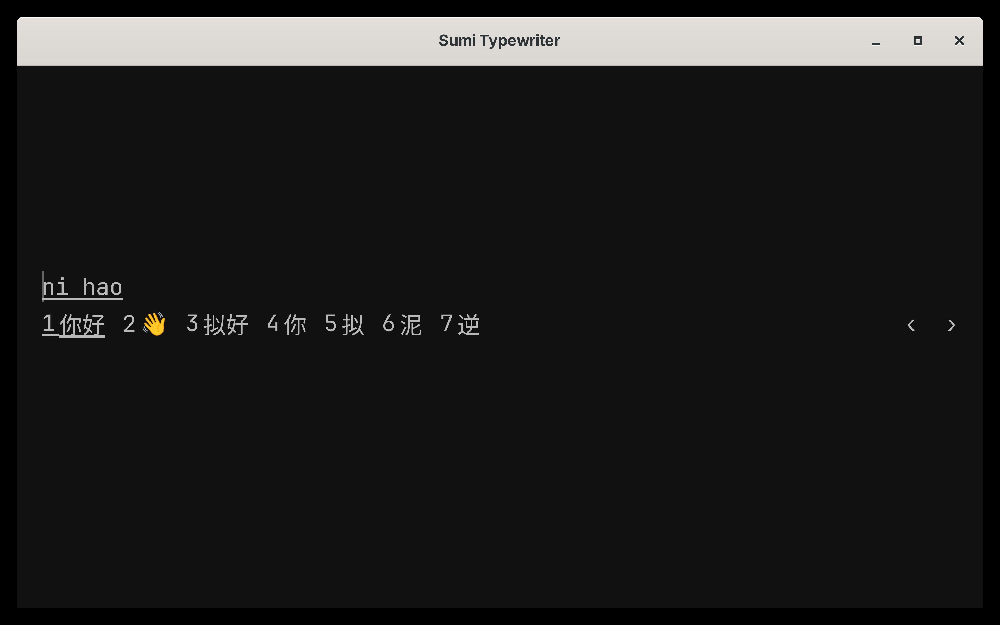
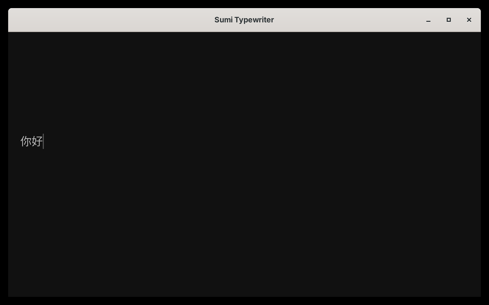

# Omarchy amd64 与特殊输入法联合发布验收

已发布 [v6.1111.4](https://github.com/wizlijun/note.md/releases/tag/v6.1111.4)。10个附件均已匿名完整下载，实际字节与已验收产物一致；见 public-verification.json。GitHub latest仍为v6.1111.3，macOS latest.json原字节未变。

## 冻结来源

- 宿主标签：`509c80e057744c6e0a54f4c241e39c21c0051923`。候选编号去点、窄空格与0.75字号组间距在该标签源码与实包GUI中同时核对。
- core：`1722a6dedec8ee79e7a6ff046e7eeafb7187102e`，已推送；BOM正文清空修复的源码与dist同批提交。容器中源dist与实际安装依赖index.js的SHA均为 `86a430e134b7da051e9c6af4e29817dd72d9269ced56d1caf7509b876162d255`。
- 特殊输入法：`fcitx5-sumi-candidates 5.1.23.r3.gb75c450f-1`，源提交 `b75c450fe8ee0249d20d8727abe59c2b818e0c16`。该分支尚未推送，但完整addon源码、许可证、配方与验证脚本已作为同次公开附件交付；构建包8文件逐字节匹配宿主冻结tag。
- 沿用正式签名Linux Sumi0.1.12，backend SHA `d044c31ddac05f654cc5901dde98c0ed7c45bc5f21d579a3b361477db86afecb`。公开索引确认其仍是最新Linux条目；源码0.1.15已发布资产仅为Apple，未将Mac发布冒充Linux更新。

## 实际安装包

|产物|SHA-256|
|---|---|
|note.md_6.1111.4_amd64.deb|`b840946645a340452fb5780b1e53e711f9829c4838ea712ea9c5f498586fd41a`|
|notemd-6.1111.4-1-x86_64.pkg.tar.zst|`ab3eb35ef0baa8ce5197b73af33a51410b150bdd02cd7fc51d2b05d607ed8b22`|
|宿主可执行文件|`eebcc8591cf31f576e0317112585e49a3ae4e4bb230788d4fd94a11c0c34cdb9`|
|fcitx5-sumi-candidates安装包|`b1b77e9f7eb9bc6951ad12dcfe0d69455b63d8c259c810287f913b532d62fbba`|

Deb/Arch的9个载荷文件字节与模式一致。Debian12包结构、ELF、GLIBC上限（实际2.35）、干净Arch依赖/重定位及CLI均通过。官方prepare.py从已公开Deb生成的配方与预先验收配方逐字节相同。首次Arch容器镜像下载签名超时，在保留原Deb后使用相同验证脚本重试成功；未绕过包签名或重新生成另一份宿主。

## 验证

- 最终前端431文件、5883测试全过，类型检查0错误/31既有警告，协议检查通过，依赖审计无high/critical（1low/4moderate）。测试前后全部记录源码与core67文件哈希一致。
- 原生候选29项、Canvas25项、mobile配置3项、core相关78项通过。发版门禁修复的mktemp兼容性、页面监听器清理和编辑器就绪fixture分别精确提交681f6ef3、beb756bf、ffc1c3db。
- r3原包和独立重建包各通过7项私有D-Bus真实拼音回归；三个安装文件逐字节相同，包容器因构建元数据不同而不同。
- 实际6.1111.4包在私有scale4会话中使用原签Sumi与实际r3模块。候选编号无点、标签间距紧凑且组间可区分；鼠标首候选和空格提交均使实际GtkTextView严格为“你好”。截图见下，测试进程已清理。
- 早期资源争抢、Node26差异和core硬链接可能导致混用的轮次只保留诊断，均不作为最终通过证据。最终重新验证固定输入。

## 范围与审计

完整worktree、分支、stash枚举见pre-release-audit.json及core-audit.json。旧非祖先改动已经核对补丁等价，旧发版元数据已被后续版本替代；未跟踪依赖链接、任务产物和个人配置不进入冻结源码。输入法未推送源码的公开可获取性由本次回读成功的源码附件证明。

未自动安装本机，未修改用户会话或正式笔记。输入法包不覆盖个人主题、DPI helper或输入偏好；隔离测试使用默认拼音候选，未改变用户关闭emoji的本机设置。误发的菜单/算法追加要求已由用户撤回，仅有只读任务审计，没有产品改动或插件市场发布。完整原始日志为本机未提交验证产物，其原始字节摘要见local-log-hashes.json；本目录为可提交的发布证据。
