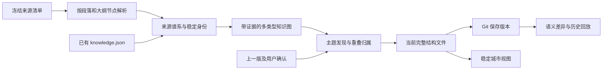

# Vault 知识结构提取与演变历史

日期：2026-09-30。状态：已实现源码开发版提取器、完整结构快照、宿主专用 Git 保存/历史接口与 2.5D 城市界面；已完成真实 Vault 的只读全量双轮验证。标准 JSONL 经 Zstandard 无损压缩后为 7.89 MiB；本轮结果只写本地审计目录，没有向真实 Vault 写入结构或 Git 历史。§1–10 保留此前设计与阶段记录，当前能力、设计偏差和验收以 [§11](#11-源码实现与真实全量验收2026-09-30) 及 [插件 README](../../../plugins-src/habitat/README.md) 为准；未发布生产插件。

## 1. 决定与目标

**先从材料提取可解释的知识结构，再把结构投影成城市。每个已保存版本都是完整快照，一个专用文件保存当前状态，Git 保存旧版本。**

目标是回答：目前有哪些主题与概念；各自根据哪些材料成立；如何关联；哪些已经被组织成项目；它们在前后版本中如何形成、细分、融合。呈现的是 Vault 中可观察的结构，不推断用户实际掌握程度，也不把布局变化叫作认知变化。

核心计算不调用大模型：结构解析、身份解析、来源去重、词汇特征、稀疏图聚类和版本比较均可本地完成。已有 AI 抽取结果可以复用，但必须保留 AI 来源和未确认状态；“本次不调用模型”不等于“所有输入都由确定性算法产生”。纯本地规则无法可靠读懂任意句子的因果、同义和承诺，缺失语义保留未知。

不预先把资料塞进 CBD、公园等区域。城市用途是用户的规划层；主题、项目、来源、活动是独立的数据层。Bushcraft 可以既是兴趣又是项目，隐性知识可以跨多个园区。



## 2. 真实输入与本轮验证

Vault：`<vault-root>`（匿名化测试资料库）。索引审计来自现有 schema v7 SQLite，以 `mode=ro`、`query_only` 和单一读事务读取；下表代表**索引覆盖量**，不宣称磁盘全部内容已覆盖。

| 实测 | 结果 | 对算法的约束 |
| --- | ---: | --- |
| 索引文件 | 13,763 | 必须分页、增量处理 |
| 搜索块 | 1,709,932 | file / section / line 相互重叠，不能当知识点数 |
| 有 type / 有 tags | 47.13% / 19.65% | 元数据只能辅助，不能单独构成全库主题树 |
| Wiki 页面 / 无正文空壳 | 1,323 / 925 | 空壳是命名锚点，知识依据来自入链上下文 |
| 完全相同 hash 的额外副本 | 87 | 无法解决摘要、日记、转录之间的语义重复 |
| stored links | 89,213 | 其中 29,943 是 `#fragment`，不能全部变道路 |
| 索引文件字节合计 | 434,648,436 | 不把全库正文一次送入前端或模型 |
| 最大 1% 文件的字节占比 | 25.00% | 必须控制长书、长转录的贡献 |

目录首先表达来源和存放方式：agent-sessions 4,252、dailynote 2,148、ssot 1,718、wikipage 1,323，project 只有 59 个索引文件。`hemory/` 是蒸馏会议记录目录，不能自动归成 Hemory 产品。

`origin=human` 包含 `.note.md` 的检索分类规则，不保证每段由人创作；仅 31 个文件带 `human_verified`，它也不能自动继承为所有主张已证实。现有注意力值是带时间衰减及编辑权重的文件聚合量，不是跨概念调用事件，暂不支持真实边级车流。

### 2.1 已有结构资产

根据 `.notemd/meetings.json` 定位到 `ssot/meetings`，已有 456 份 `meta.yml`、445 份 `knowledge.json`。445 份都是 `knowledge-representation-dataset/3.1.0`；生成规则有两版：`relation-schema-extractor/3.1.0` 224 份、`3.1.1` 221 份。366 份由 codex/gpt-5、79 份由 codex/gpt-5.6-sol 生成。导入时分别保存 dataset schema、extractor rule 和生成模型，不能用 schema 版本代替抽取规则版本。

| 对象 | 跨文件出现次数，未去重 |
| --- | ---: |
| entities | 6,199 |
| concepts | 7,514 |
| claims | 14,493 |
| events | 3,193 |
| narratives | 3,180 |
| relations | 10,259 |

可复用定义、角色、状态和来源定位，不能把这些数量相加当“已掌握的知识点”。其中 Hemory 精确名称出现 42 次，29 次为 system、13 次为 project；别名中有“产品”“系统”等局部代称，不适合全局合并。

抽样 `20260904_135400`、`20260904_135452`、`20260423_151200` 三个归档的 source SHA 均与当前原文匹配，仅证明来源版本未变。第一份有 `L1-L2002` 的整场会议引用；这种定位不够证明某个精细关系。其 AI coverage 声称前两份来自同一会议；原生 metadata 分别是 ai-split 与 mcp-window，时间高度重叠但起止、时长及 speaker_count 不同。因此先记录“同场候选”，核对重叠单元并保留第二份多出的区间，不能直接去掉整份归档。旧 `epistemic.strong` 保留为抽取器判断，不能升级为人工确认。

### 2.2 最小粒度实验

对当前 `dailynote/2026/*.note.md` 的 262 份文件，去 frontmatter、属性和代码围栏后，按一级大纲分支计算精确 Wiki 目标共现；不做别名归并或语义判断。每个文件中的一个词对最多贡献一次。

| 指标 | 实测 |
| --- | ---: |
| 一级分支 | 445 |
| 整文件内词对共现次数 | 213 |
| 同一分支支持的词对共现次数 | 49 |
| 只有同文件、没有同分支依据 | 164（77.0%） |
| Hemory / note.md 同文件 → 同分支 | 9 → 2 |

这不是语义准确率：不同分支仍可能相关，同分支也可能是汇总。它证明整篇日记共现会加入大量缺乏局部依据的边。生产解析应进一步细到大纲节点，并识别后置日记摘要的派生角色。

匿名化结构示例（私人文件名、日期和节点 ID 已省略）：

- 同一篇日记的不同大纲分支分别讨论户外兴趣、语音识别和写作；末尾生成摘要重述它们。不能制造三者两两的事实关系或重复计数。
- 某个明确大纲节点共同讨论两个产品，可以保留该节点支持的共同讨论关系。
- 原始想法与后续助手分析位于不同节点，必须保留节点级作者角色。
- 某项目文档只是原型规格；与相关研究可以同属一个主题，不能因此宣称项目已实施。

本地复验脚本在 `tasks/design/habitat-structure-audit.py`、`habitat-structure-unit-experiment.py`，聚合结果为同名 JSON；该目录受 Git 忽略。没有把原文复制到报告，没有对 Vault 做写操作。

## 3. 输出模型：事实依据与组织建议分开

保留两张图：**证据图**表达“哪里记录了什么关系”，**邻近图**辅助主题发现和布局。邻近图不能被渲染成已证实的知识关系。

| 对象 | 身份与用途 |
| --- | --- |
| SourceArtifact | 一个文件／归档对象；稳定 sourceId，路径和 hash 是版本属性 |
| SourceFamily | 同一会议、文章、视频或同源材料家族；用于去重贡献 |
| Unit | 可定位的大纲节点、段落、表格行、发言轮次等证据单元 |
| Entity / Concept | Hemory 产品、隐性知识等；身份与名称分开 |
| Claim / Event / Relation | 记录主张、事件、关系及其条件、参与角色、模态和证据 |
| Topic | 围绕共同问题的候选聚合；可重叠，保留稳定 topicId |
| Project | 有目标/意图依据的项目对象，与主题成熟度独立 |

所有派生对象具有 `status`、`evidenceRefs`、`method`、`scope`。状态至少区分 `candidate / user-confirmed / disputed / superseded / source-unavailable`。来源文本核对、语义抽取可信度、用户确认、组织稳定性是不同维度，不压成一个“置信度=0.92”。分数未校准前不得显示为概率。

多元关系使用关系节点和带角色的参与边，例如“某人在某项目中提出某方案”；不拆成所有参与者之间的完整关系网。现有 claim 的 `by / about / if / unless`、event 的计划状态和 relation 的角色必须保留。没有正式语义的文字不会被规则算法强行转成 claim。

## 4. 提取管线

### 4.1 捕获版本一致的输入

1. `host.index` 分页取来源元数据，保存 scope、indexGeneration、每个 source 的 path/hash、覆盖和排除原因。
2. 复用上版 `sourceId → hash`，仅重读变化来源及其派生依赖。路径变化优先用原生身份，其次用唯一的旧 hash 匹配；hash 相同但存在多个副本时不猜。
3. 读取原文核对 bytes SHA；解析结果与 hash 绑定。失败、权限变化、超预算分别记录，不能解释为知识被删除。
4. 导入 knowledge.json 时验证 schema、局部引用闭包、source uri/v、证据位置、quote（若有）、粒度；逐记录标记失败，保留可解释覆盖率。
5. 输入清单中明确排除本结构文件、城市缓存、自动生成的发展报告；防止模型输出被再次摄入并自我放大。

现有 index 的 fileKey 是路径派生，blockKey 还绑定 hash/行号，二者不是永久概念身份。`atlas_metadata` 模式没有正文证明；frozen index 元数据也不会冻结磁盘文件字节。实现需取得经过 hash 核对的原文／解析单元缓存，再把输入 manifest 作为准确分析集合。源在捕获中变化则重试相应来源；无法获得完整目标范围时，只保存明确标注的部分分析或沿用旧版显示待刷新。

当前 API 不直接提供完整 AST、大纲 ID、所有 frontmatter sources/aliases、节点级作者角色。生产接入须增加受权限控制的解析适配或调用已有宿主读取能力；不能声称仅凭现有 metadata 已得到这些字段。单快照 blocks 总返回预算为 32 MiB，也不能用它一次读取 434 MB 原文。按受控范围分批并校验 manifest；范围批次不是天然同一时刻的全库快照。

### 4.2 切出可解释的知识单元

大纲笔记以原生 `id::` 节点为基本单元，保留父链，分开正文、复制高亮、评论、生成摘要。父主题提供上下文，不自动让兄弟节点两两连边。普通 Markdown 用 AST 切标题下的段落、列表项和表格行；章节是上下文，不与子段落重复计量。

转录保留发言人和时间位置；连续发言可组合为检索窗口，但窗口只产生弱共现。Agent 会话按 user / assistant / tool 角色拆分。长书按章节再分段，贡献按来源家族封顶。主文和 `.note.md` 批注保留伴生映射；复制高亮不新增独立证据，用户评论是独立介入记录，主文改版后定位失效要重新核对。

每个单元至少带：`unitId, sourceId, sourceHash, locator, parentId, authorship, artifactRole, textHash`。author 未知就保留 unknown；文件级 human 不能覆盖节点中的 agent 标记。

### 4.3 来源谱系与重复控制

按强到弱顺序建谱系：显式 sources／父归档／已验证的伴生引用 → 稳定外部对象 ID 或规范 URL → 精确正文 hash → 近重复候选。保存每次来源归组的依据、状态、重叠区间及单元对应；同一场活动的不同记录不一定覆盖相同内容。近重复签名和旧 AI 说明只能提名；不能把共享短句经传递闭包并成一个巨大来源。

区分 `copy_of`、`summary_of`、`quotes`、`comments_on`。总结同时依赖多篇资料时保存多个根来源及段级对应，不能把所有被引用来源并成一个家族。若段级对应未知，该总结不额外增加“独立来源数”；仍保留其组织和用户评论贡献。

对概念 c 的讨论上下文量采用来源家族封顶，并分别计算已核对、暂定和谱系未知三种计数：

```text
support_known(c) = Σ_{f with checked lineage} min(1, Σ_{u in family f} contribution(u,c))
counts(c) = { verifiedFamilies, provisionalFamilies, unresolvedLineage }
```

这里 support 表示出现/讨论依据，**不是主张为真的支持票数**。`verifiedFamilies` 只指来源分组已核对，也不保证立场或事实来源在认识论上独立。未知谱系文件可以显示材料量，不能每份自动叫一个“已证实独立来源”。已确认的精确复制 contribution=0；与原文相同的派生摘要不另开独立份额；疑似重复保持不确定标记。用户提出新的问题或改写有单独的 `userIntervention` 维度，不被重复消除。

### 4.4 名称、概念与实体消歧

候选锚点来源：Wiki 目标、显式 aliases/tags、标题中的完整术语、人工词典、已有知识数据的 term/name。纯本地短语候选用标题/局部语料 TF-IDF 和重复出现的完整短语生成，不能把全部高频词都升级成概念。

匹配先做 Unicode NFKC、空白整理及适用范围内的英文大小写归一，再按“对象类型＋命名空间＋上下文”判断。顺序为：原生 ID → 明确的同对象引用 → scoped alias → 名称与上下文候选。保留原显示名。

- `Hemory` 的 system / project 记录先归到同一命名锚点待消歧，不能只凭同名硬合并角色对象。
- `Hemroy` 是可能的拼写错误，只提名；ASR 纠错仅使用命中 domain 的 confirmed 词典记录。
- `Recall` 分别可指检索指标、Hemory 功能、微软产品或闭卷练习文件，不做全局别名。
- “15分钟荒野”是 Bushcraft 下的品牌/方案候选，不是它的全局同义词。
- 空 Wiki 页继承其被引用的局部依据，空正文不给知识体量加分。

证据不足就保留 unresolved mention 和候选关联；可显示“待辨认”，不为了城市完整而硬归类。

### 4.5 建关系：每种边有出处和限制

| 关系层 | 可采用的证据 | 用途 |
| --- | --- | --- |
| 明确引用 | 解析成功的 Wiki/正文链接、批注引用、来源链 | 可回源的引用通道 |
| 明确语义关系 | 用户确认，或已有结构化抽取且保留其候选状态、角色和条件 | 定义、包含、依赖、反例等，按状态筛选 |
| 局部共现 | 同一个非汇总的节点/小段落中共同出现 | `co_mentioned_in`，只说明共同讨论 |
| 词汇相似 | 可解释的共享短语与 TF-IDF 特征 | `lexically_similar`，用于邻近建议 |
| 实际应用 | 可验证的引用/组合应用事件 | 未来的车流依据；当前缺失则不开启 |

先用 AST 区分代码、文内导航、目录、外链和知识引用，解析 wiki 别名、heading/block target、相对路径和重名目标。现有 links 轻量扫描会漏 frontmatter sources，且 target 未消歧；它只做候选召回。

每种类型的边分开计数。关系 (a,b) 的强度保留 `verifiedFamilies / provisionalFamilies / unresolvedLineage / distinctUnits / explicitReferences / recentEvents` 向量。明确联系的视图权重可取 `w=log1p(verifiedFamilies)`；未核对材料仍以候选通道可见，不混入同一强度刻度。全场会议一次 co-presence 不等于每对实体之间各有边；过宽证据只挂到关系的“上下文依据”，不当精细直接证明。

### 4.6 发现主题而不强造主题树

对去重后的单元生成稀疏词汇向量：局部标题、命名锚点和 tags 比正文权重高；日文件日期标题和通用模板不给权重。中文使用本地分词，字符 2/3-gram 仅做候选召回兜底。统计 df 时以来源家族为单位，避免同源摘要重复改变 IDF。

```text
idf(t) = log((1 + familyCount) / (1 + familiesContaining(t))) + 1
v(u,t) = fieldWeight × log1p(tf(u,t)) × idf(t)
v(u)   = L2-normalize(v(u))
```

TF-IDF 和字符 n-gram 的用途遵循 [scikit-learn 特征提取文档](https://scikit-learn.org/stable/modules/feature_extraction.html)；它们表达词汇相近，不证明语义同一。family df、字段权重和下列阈值是本规格的方案，尚未做质量校准。

先保留明确锚点，再用倒排表产生有界候选，不计算全量 N²；初始每单元最多 256 个候选、32 个高信息特征、12 个邻居。词面邻接取 mutual-kNN，低相似、只有通用词相同的边剔除；explicit 边单独保留，不因排名低而丢掉。高 df 特征降低布局作用但保留概念本身，例如 AI 可以是宽域入口，不能仅因常见就删除。

聚合到概念后再按来源家族封顶边贡献，形成无向组织邻近图。初始邻近权重可用归一化的 `0.6×lexical + 0.4×localContext`，只用于布局/聚类，两种分量在详情保留；这不是“语义置信度”。不能把 claim 的因果方向丢进这个权重后又拿无向边展示因果。

对稀疏图做 Leiden 社区发现，固定种子和排序，在少量分辨率下生成宽主题与子主题候选。Leiden 的连通性保证是图论性质，不能证明聚类语义正确，参见 [原始论文](https://arxiv.org/abs/1810.08473)。现有 STRATA `localMove` 管线可参考有界邻接，但不是完整 Leiden，生产实现需明确选择和版本。

主题标签从用户命名、完整术语和代表标题中选取，不显示中文 bigram 碎片。重叠归属按概念 c 到社区 T 的来源封顶邻接质量计算：`membership(c,T)=sum(w(c,j), j∈T)/sum(w(c,j), all j)`；无邻边则未知。最大值作为 primary 候选；初始 secondary 要求≥0.2 且≥最大值的0.5，保存原始分值和参数版本，允许平局/多归属，不强迫 primary。明确用户归属单列并优先，不能被该分数覆盖。

不同分辨率的社区并不天然构成树。父子主题候选需要细社区加权成员在粗社区中的包含率≥0.8，或有明确用户层级依据；交叉成员保留 cross-topic，不自动升级为概念 `part_of`。以上阈值都须经本 Vault 校准；稀疏材料和孤点也可以是有效命名主题，不能要求“攒够数量才有资格存在”。

主题主图先展示稳定命名锚点。算法聚类是其上的候选组织层，已确认概念和项目不因一次聚类变化而被拆毁。

### 4.7 项目与城市投影

项目依据来自明确元数据、用户命名“X 项目”、已确认目标或用户规划；项目目录只是线索。分别保存 `projectIdentity / intentStatus / activityStatus / completionStatus`，draft、建议、设想不能变成已承诺、正在实施或完成。

城市读取同一知识图：概念是可命名建筑，主题是街区，项目是有意图的园区，未归属材料是生长地。CBD、公园由用户指定用途；不由主题算法决定人生分类。

体量用独立来源量的饱和函数和子主题组织丰富度，并展示实际数值；不按字数、搜索块或摘要数无限增高。道路宽度表示选定类型的累计联系，近期活动只影响灯光/有证据的车流。长期安静不自动破坏已有关系；来源撤回和近期未使用应显示成不同状态。

## 5. 持久身份与增量更新

`id` 表示同一个对象，`hash` 表示此对象某个内容版本。概念 ID 不用名称或当前正文 hash，主题 ID 不用聚类中最小成员 ID。

- 原生 outline ID 以 vaultId 命名空间注册；检测复制导致的重复 ID，不能假定全库唯一。无原生 ID 时分配持久 ID。
- 先复用上版匹配身份；确需新建时用确定性首次分配键：`vaultId + baseSnapshotId(或固定genesis) + kind + creationAnchor`。anchor 由首次 sourceId/原生节点或规范 locator/初始内容摘要构成；新主题用排序后的稳定锚点成员集。规范编码后派生 UUID/摘要 ID，并检查键冲突。创建后登记该身份，不能随名称或正文重新计算；同一前版和输入清缓存重跑仍得到相同新 ID。
- 无 ID 的段落按 sourceId、标题路径、前后锚点及内容重叠匹配上一版，仅接受有明显优势的一对一匹配；不确定则新建并标记待确认。
- 概念改名、路径移动不换 ID；语义真正合并/拆分则创建新 ID，保存 `mergedFrom / splitFrom`。用户确认的身份不得自动覆盖。
- 主题延续比较稳定命名锚点和来源家族/单元成员集合，以加权 Jaccard 做确定性最大权一对一匹配；初始阈值 0.6、最佳与次佳差 0.15，仅作待校准默认值。多对一/一对多超出简单延续时记录候选重组。
- 整体相似度、成员进出和命名变化都写入差异原因；不能只比较标题。

增量缓存按 `(sourceHash, parserVersion, rulesVersion)` 命中，存于 plugin data_dir；变更影响来源家族、相关概念及邻居。IDF 是全局统计，不能宣称只改一个文件就只影响一个主题：批次末重新计算受影响词项的边，必要时重聚类，前版匹配保护身份与布局。词典/分词/规则升级触发相应范围重算，原因记录为算法变化。

## 6. 单文件 + Git 历史协议

建议路径：

```text
<Vault>/.notemd/habitat/knowledge-structure.jsonl
```

这是一个完整当前快照，**不是追加日志**。JSONL 每行一个 JSON 记录，便于按对象查看 Git diff。过去快照仅在 Git commits 中保存，不在文件内套一个不断增长的 versions 数组。先前城市规格的 `.notemd/habitat/` 持久化方案在此具体化。

实际 `git check-ignore` 已验证该路径目前可追踪；隐藏目录不天然被忽略。`.notemd/habitat/.local/` 目前也未被忽略，因此事务状态放 plugin data_dir，不默认写在那里。

### 6.1 最小数据契约

下例是字段示意，不是当前 Vault 已生成的真实结构：

```json
{"kind":"meta","schema":"vault-knowledge-structure/1","snapshotId":"sha256:…","parents":["sha256:…"],"generatedAt":"…","algorithm":{"version":"1","parserVersion":"1","tokenizerVersion":"…","configHash":"…","effectiveParams":{"maxCandidates":256,"maxNeighbors":12},"assets":[{"id":"alias-dictionary","version":"…","hash":"…"}],"seed":42},"input":{"vaultId":"…","manifestHash":"…","scopeHash":"…","sourceGitHead":"…","sourceWorktreeDirty":true},"hashes":{"structure":"…","evidence":"…","layout":"…"},"coverage":{"status":"illustrative-only"},"changeCause":"content"}
{"kind":"source","id":"s:…","path":"dailynote/2026/2026-07-21.note.md","hash":"sha256:…","family":"f:…"}
{"kind":"evidence","id":"x:…","source":"s:…","sourceHash":"sha256:…","locator":{"outlineId":"VxwRFbdaK","lines":[7,10]},"role":"co_mentioned_in","verification":"matched"}
{"kind":"node","id":"c:…","type":"concept","label":"隐性知识","status":"candidate","evidence":["x:…"]}
{"kind":"membership","id":"m:…","node":"c:…","topic":"t:…","role":"secondary","method":"local-cluster/1"}
{"kind":"edge","id":"r:…","type":"co_mentioned_in","participants":[{"id":"c:a","role":"subject"},{"id":"c:b","role":"subject"}],"evidence":["x:…"],"verifiedFamilies":1,"provisionalFamilies":0,"unresolvedLineage":0}
{"kind":"layout","id":"c:…","parcel":"p:…","position":[12,0,9],"pinned":true,"epoch":1}
```

记录类型还包括 family、必要身份注册/退休记录、lineage、override。保存当前图需要的概念、项目、主题、成员、关系和去重的证据定位；完整搜索块、原文、词向量、三角网格和逐代历史不进入文件。未纳入主图的 claim/event 可保留 dataset/hash/recordRef，在详情按需验证读取；覆盖统计明确“被导入的记录”和“已投影的对象”，不能偷偷丢记录后宣称全量语义抽取。

规范序列化：固定记录类型顺序，同类型按稳定 ID 排序；对象键排序，无序集合排序；有语义的角色/时间顺序不重排；浮点固定精度，UTF-8、LF、末尾换行。manifest 是 sourceId/path/hash/scope 的确定性摘要。布局 seed、epoch、地块位置和用户固定项单独保存。算法元数据必须保存完整 effectiveParams（字段权重、阈值、候选上限、分辨率等），以及词典/规则资产的版本与内容 hash，不能只留 configHash；示意中的 params 是节选。

`stateHash` 对规范化的语义、证据、来源 manifest/scope、算法配置、实质覆盖状态及布局计算，不包含 snapshotId、运行时间、capture 时间、indexGeneration、sourceGitHead 和 Git dirty 等观测元数据。否则保存结构自身改变 HEAD，就会制造下一次空版本。`snapshotId = SHA256(canonicalJSON({schema,stateHash,parents:sorted(parentSnapshotIds)}))`，避免循环依赖和拼接歧义。Git 自己的 commit SHA 不写进其自身 blob。相同输入、相同算法、相同前版得到相同语义状态；无变化复用已有文件、时间戳及观测元数据，不制造“发展”。

source manifest 与捕获时 Git HEAD 记录分析的输入版本；`sourceWorktreeDirty` 仅针对来源集合，不包括结构文件和缓存。HEAD 可能不包含未提交/未跟踪来源，hash 也不是正文备份。旧结构可回放不代表旧原文一定能恢复，界面分别标示。

### 6.2 生成和保存事务

1. 读取上一已提交结构及当前工作区。受控事务日志（plugin data_dir）记录预期 base、目标 snapshot/hash 和写入阶段。只有 schema、hash、引用闭包、父版本、门禁及事务记录都匹配，才把未提交文件认定为 pending 并重试；任意工作区差异不等于 pending。未知外部编辑、截断或冲突文件保留原字节并显示待处理，不自动提交/覆盖。已有有效 pending 时，不开始覆盖它的下一次生成。
2. 在缓存中构造新快照，核对证据版本、引用闭包、ID 冲突、成员、覆盖和体量；先比较不含 parents 的 stateHash，确实变化后才生成带 parents 的 snapshotId，产生差异预览数据。
3. 发布时取得与 Vault Sync 共用的写锁，核对 base snapshot、HEAD、源 manifest。生成期间源变化则重算受影响部分或明确只保存已捕获版本，不能伪称发布时最新全库。初版默认重试，预算不足保留旧版。
4. 临时文件写在目标文件同一文件系统，宿主持锁完成写入、校验、flush、原子替换；同步器明确排除临时后缀，崩溃后恢复/清理。临时文件不能被普通 `git add -A` 收进去。
5. 仅提交该结构路径，保留其他 staged/unstaged 内容。已有全库自动提交 API 不能直接当专用版本 API；实现路径限定提交，并处理首次跟踪、并发 HEAD 和 merge/rebase 中止条件。[Git `commit --only` 官方说明](https://git-scm.com/docs/git-commit)支持按路径提交、排除其他暂存变更，具体首次创建流程需测试。
6. 提交后读回 `git show <commit>:<path>`，校验 snapshotId、hash 和引用闭包，才显示“版本已保存”。文件替换成功但提交失败，保留 pending，不覆盖；重启结合受控事务记录与已提交 blob 校验恢复。若提交成功后、记录确认前崩溃，读回匹配 blob 后结束事务，不重复创建提交。远端同步成功是另一个状态。

没有结构变化但源 hash 变化可保存“证据更新版”；完全相同的再生成是 no-op，可在本地运行日志记录。用户明确需要保留每次运行时，可显示重复运行指向同一快照，不复制出虚假的新发展节点。

任何旧版恢复都创建一个新的当前版本，标记 `restoredFrom`，保留被恢复前的历史；不 reset/force-push。纯查看历史不更改 Vault 或当前分支。

### 6.3 与现有 Git 同步的边界

`src-tauri/src/git_history/mod.rs` 已有单文件 log/show/at 可复用，历史界面再按 snapshot parents 建版本 DAG；不按作者机器时间强行线性排序。

现有 Vault Sync 是 commit-first + merge。普通冲突处理保留 ours 并生成冲突副本，不适合结构图：需要结构路径特判。比较 merge-base、ours、theirs 的结构 blob，双方均变更时保留双方并进入结构分叉处理，**即使两端改不同 JSONL 行、Git 能无冲突自动合并，也禁止接受文本拼出的快照**；单方变化才可在完整校验后采用。首版指定单写设备，其他设备只查看和同步；检测到另一条 parent 分支仍显示分叉，不以时间戳覆盖。以后多写时，从双方 parent 与合并后的来源重新解析产生 reconciled snapshot，不引入 CRDT 或第二套历史数据库。

默认大文件门禁实际是 **10 MiB = 10,485,760 字节**。对 13,763 条真实 source path/hash 加 36 字符占位 ID 的内存测量：pretty JSON 3,224,836 B，compact JSON 2,756,886 B，JSONL 2,977,080 B。仅 manifest 就约 3 MB，不能承诺完整图已低于门禁。

首版体量目标 ≤8 MiB（设计预算，非实测完成值）。必须输出各类型字节、总字节、最大行、耗时和读取内存。超过预算先消除冗余；超过门禁则保留旧版并报告，不能截断成“全库”、绕过门禁或误报保存成功。若真实完整表示仍超限，需另行决定修改合理门禁或改变存储方案；本规格不擅自修改设置。

## 7. 版本比较：解释“发生了什么”

读取两个完整快照，先验证 schema、scope、算法和覆盖可比性，再按持久 ID 比较。不以 Git 的文本行数当知识增长。

| 变化 | 判定 | 展示 |
| --- | --- | --- |
| 新命名对象 | 新 ID，有新证据或用户命名 | 新概念/新命名；不说今天才学会 |
| 改名 | ID 相同、label 不同 | 原名 → 新名，地址保持 |
| 材料积累 | 成员/独立来源增加，结构未变 | 依据增加，区分批量导入 |
| 结构形成 | 分散成员形成可解释群落 | 新主题候选及代表依据 |
| 主题融合/细分 | 明确 lineage、多对一/一对多 | 合并/拆分动画，旧身份可回看 |
| 联系增强/减弱 | 同类型、同口径的独立依据变化 | 道路变化及新增/失效依据 |
| 缺失/撤权 | coverage/source 状态变动 | 当前不可见/待核对，不当作遗忘 |
| 方法变化 | parser/tokenizer/config/model 等变化 | 分析方法更新 |
| 用户规划 | override/layout/intent 变化 | 命名、搬迁、园区规划 |

累计关系与近期注意力各自比较。日期窗口平移产生的衰减不能说成知识结构消失；一个来源被复制十次不能增强十次道路。

区分三种时间：`eventAt`（来源所述事件时间，允许未知）、`ingestedAt`（首次被系统纳入）、`snapshotAt`（结构版本形成时间）。本轮已有 15.66% 的 doc_date 由 mtime 推导，其余也可能是生成日期；不得统一视为知识产生时间。

变更归因使用 `content / evidence / algorithm / user-organization / layout / scope / mixed`。若算法与内容同时改变，没有控制实验就显示 mixed。若保留两版源、旧算法实现和对应规则/词典资产，可用“旧算法+新语料”和“新算法+新语料”的对照重算辅助分离；任一必需版本取不回就标记对照不可用，不编造差异原因。

每次正式保存保留当时结果。重跑旧来源只能作为“用今天的方法重建过去资料”的独立实验，不能覆盖历史快照。真实发展史从首次快照开始；不能凭今天的文件 mtime 自动补出过去真实的城市。

## 8. 城市历史界面

时间轴选择两个版本，支持同视角并排或叠加；另有“只看结构变化”过滤器。概念保持同一地址，新增对象在邻近空地生长；消失对象在比较层保留轮廓，合并/拆分用继承线说明。布局升级单列，不把整城搬动演成知识迁移。

选中一个街区，显示：首次被观察到 → 命名 → 成员变化 → 形成子主题 → 与其他街区建立联系 → 被用户规划为项目。每一步能回到该版本的证据定位；原文旧版不可恢复时明确显示，不拿当前原文冒充旧证据。

“为什么变了”面板优先展示具体依据，例如“新增两组独立讨论；另有六份摘要为同源，不增加强度”。未经确认的自动重组保持候选样式。历史坐标和必要几何参数入快照；旧 renderer 未保留时保证语义/地址回放，不承诺像素完全一致。

历史显示仍受当前授权约束。删除当前来源不会抹掉 Git 已保存的旧概念名、路径、关系；隐藏历史展示与彻底清除 Git 历史是不同操作，不声称删一份文件就完成历史清除。

## 9. 首版范围、规模与验收

首版交付范围：Markdown/outline 与已有 knowledge.json 适配、锚点/来源谱系/候选主题、完整结构快照、语义差异和历史列表、稳定坐标投影。先交付可解释的结构列表/图，再连接城市。跨设备同时生成、自动语义纠错、全库新 LLM 抽取、任意语言因果发现不进入首版。

规模设计：流式解析原文，缓存单元与稀疏特征；有界候选复杂度约 O(U×C)，C 初始≤256，U 为去重单元量。长来源先单元→锚点/局部概念聚合，全局聚类不直接使用 170 万检索块。概念图按场景 LOD 聚合，近景按需展开。全局 IDF 与图聚类另记成本，不承诺严格常数时间增量。

质量评估采用本 Vault 分层样本：日记、多角色 Agent 会话、原文+摘要+批注、空 Wiki、会议知识文件、长书、项目草稿。首轮人工评审至少 100 个单元、100 条关系、50 个身份匹配和 20 对主题延续；用真实证据逐条判断，不用漂亮城市反证算法正确。

初始发布目标：展示为明确关系的证据定位合格率 100%；自动身份归并准确率目标≥98%（报告样本数/不确定性，不能只报百分比）；弱边永不升级因果；已确认同源的摘要不增加独立来源量；未知谱系不显示为已证实独立；全部 unresolved 和被排除范围可见。聚类准确率、阈值和响应时间目前尚无全库基准，需在实现后实测，不以本轮小实验冒充。

必须验证的行为：

1. 同输入/算法/前版清缓存重跑、发布前中断重跑，结构与 ID 一致；保存后再运行、只提交无关文件后再运行，均不产生空历史版本。
2. 文件重命名、概念改名、局部正文编辑不造成身份和地址无故跳变。
3. 拷贝一份材料、加入已确认同源摘要，不让独立来源计数和道路翻倍；谱系不明保留不确定性，不伪称已验证独立。
4. 日记不同分支不因同文件而自动构成关系；局部共现明确保留弱类型。
5. Recall 多义、局部“产品”别名、Wiki 空壳、整场证据不会被过度归并或证实。
6. 合并/拆分可追踪旧 ID，用户确认结构不被无提示覆盖；跨项目概念的 secondary 归属可见，跨分辨率交叉社区不伪造成包含树。
7. 算法升级、筛选范围变化、证据缺失和新内容分别呈现；混合原因明确标记。
8. 写入后提交失败、提交成功后确认前崩溃均可恢复；外部编辑/截断 JSONL 不被当作 pending 自动提交；并发 Sync/HEAD 改变不发布混合快照。
9. 临时仓库中保存→读回，hash、记录数、引用闭包一致；其他已暂存文件不被专用提交带入。
10. 门禁 threshold / threshold+1、schema 不支持、分叉、冲突、首次创建均有明确结果；双端修改不同 JSONL 行也触发分叉校验，失败不损坏上个已保存版本。
11. 历史结构与当前原文版本区分；源码缺失时不展示未经核对的旧引文。
12. 测量真实完整快照体量、内存、首轮/增量时间，再确定实现预算。

## 10. 本轮完成边界

已完成：真实索引与 Wiki 审计、445 份知识数据概况、六类主题的回源抽样、262 份日记的结构粒度实验、来源 manifest 体量试算、Git ignore/同步/门禁兼容性检查，以及本规格的独立审阅。

另在自动清理的临时 Git 仓库中验证：专用路径首次 `add -N` 后 `commit --only` 及后续提交均保留其他已暂存文件；三份快照能逐字节从各自 commit 读回，ID/坐标不受样例改名影响，单独方法变化可以辨认。脚本为 `tasks/design/habitat-git-snapshot-experiment.py`。这仅验证 Git 原语与样例记录的可行性，不代表宿主事务、崩溃恢复或同步竞争已实现。

待实现：全库概念消歧与聚类、完整快照序列化、专用 Git 保存事务、版本差异界面和城市接线。本轮没有创建真实 Vault 结构文件，没有提交/推送，也没有把候选聚类报告成已经验证的知识结构。

## 11. 源码实现与真实全量验收（2026-09-30）

本节更新实现状态；此前章节中的“本轮”“待实现”属于设计阶段记录，不表示以下代码仍未实现。复验命令与模块入口统一维护在 [HABITAT README](../../../plugins-src/habitat/README.md)。

### 11.1 已落地的职责边界

`habitat-core` 负责 AST/outline/会议数据解析、确定性身份、来源家族、候选组织、布局、规范快照和语义比较；插件 backend 通过已有索引与 Vault 接口捕获输入、核对 hash、运行任务并保留失败预览；宿主 `knowledge_structure` 提供限定文件的保存事务、Git 提交/历史、恢复与同步分叉保护；Svelte UI 展示城市、全量列表、主题归属、证据和历史差异。

没有新增大模型调用。现有 AI 数据以 `imported` 声明导入，`matched` 只表示本轮来源字节/定位核对，不表示观点为真。来源家族的 `unresolved` 不计为已经证实独立；精确副本和可核对单一来源链才共享已验证谱系。

### 11.2 与原设计的当前差异

| 原设计方向 | 当前源码实现及边界 |
| --- | --- |
| 多层语义组织与 Leiden 候选 | 使用版本化 `connected-local-moving/1` 的本地移动及连通性细化，不是完整 Leiden，也没有完成全库语义准确率评估。主归属来自社区分区，次归属依据邻近图保留跨主题联系 |
| 完整知识对象投影 | 原知识集全部读取并检查闭包；首版只投影概念、实体、项目及参与者完整的关系。claims/events/narratives 留在原数据集，计入 `unprojectedRecords`，不建立逐条建筑/定位索引。已投影对象保留 record/evidence JSON Pointer |
| 跨来源身份消歧 | Wiki 按配置命名空间、明确名称和别名解析；歧义不猜。会议同名对象保留 dataset 作用域，不把不同会议的“产品”等局部别名全局合并 |
| JSONL 单文件历史 | 当前固定路径改为 `.notemd/habitat/knowledge-structure.jsonl.zst`，完整规范 JSONL 用标准 Zstandard level 9 无损压缩；没有裁剪来源或图对象。`encode_jsonl` 及标准 `zstd -d -c` 可供人工查看 |
| 城市规模展示 | 2.5D Canvas 最多抽样 72 个混合地标；60 项分页列表、搜索与主题过滤覆盖完整快照，不把概览样本冒充全图 |
| 用户培育与完整城市 | 尚未实现人工合并/拆分、用途规划编辑、园区改建、真实调用车流和完整 3D。显式项目元数据是候选意图，不是项目完成状态 |
| 历史演变 | 已有保存版本列表与语义 diff，区分新增/缺失/改名、关系、归属、布局、算法与范围变化；完整成长动画、旧版恢复为新版本及跨设备同时生成仍未实现 |

城市不会从文件数量、目录名或 170 万重叠搜索块直接生成知识点。输入材料、原文证据、候选组织和视觉抽样分别计数。

### 11.3 真实 Vault 离线验收

验证目标为 `<vault-root>`；现有 SQLite 用 `mode=ro`、`query_only` 读取，未重建索引。受控输入清单为 14,207 项，包含 445 份 `knowledge.json` 和两份配置；全部 parsed，0 unavailable、0 unsupported/excluded。此处 `excluded=0` 仅描述交付给提取器的清单，不表示私有目录也被纳入。

开发适配器与生产 capture 的索引文件范围已比对为 delta=0；适配器仍使用不同的开发 `vaultId/scopeHash`，不能以此替代生产 host RPC 的捕获、保存与打开来源验收。

| 项目 | 实测结果 |
| --- | ---: |
| 完整节点数 | 32,526：concept 11,603 / entity 5,805 / project 401 / document 12,437 / topic 2,280 |
| 关系 / 证据定位 | 31,067 / 63,870 |
| 原知识记录覆盖 | 44,838 = imported 19,145 + unprojected 25,693 + isolated 0 |
| 尚无命名概念归属的来源 / 未解析本地链接 | 8,184 / 12,287 |
| diagnostics 总数 | 14,027，保留有界诊断明细 |
| 保存格式体量 | 8,274,428 bytes（7.89 MiB），通过 10 MiB 门禁 |
| 展开 JSONL 体量 | 48,601,593 bytes，压缩率 17.03% |
| 首轮提取 / 组织 / 完整解码 | 30,376 / 1,282 / 1,050 ms |
| 相同输入完整重跑 | 32,913 ms；压缩字节和展开 JSONL 字节均一致，无伪历史变化 |
| 解码往返 / 空标签 / 坏证据引用 | 完全无损 / 0 / 0 |
| 主题布局 / 坐标重复 | 方形螺旋，边界 `[-782,-782,816,816]`，宽高比 1.0；全图坐标重复 0 |

展开 JSONL 的实际字节分解：source 4,455,182；node 9,780,598；evidence 15,902,325；edge 11,588,798；membership 3,268,417；layout 3,555,410；meta 50,863。压缩未改变这些记录，门禁降低来自标准无损编码。

stateHash 为 `b52bc257620ad7653ec76235ee3c612060e4937557d23a256bd42d4ae72b40fa`；manifestHash 为 `834645c7affe4fc1c95cfd2d9386d392fb0581bbbbdf48e57e2a2e070afd0dc5`。Hemory、note.md、隐性知识、Bushcraft 均可搜索；名称包含匹配数量不等于独立项目数或已验证知识数。

12 项提取 fixture 测试已通过：覆盖代码内伪链接、外部/fragment 排除、Wiki 空锚点入链、`[[note.md]]` 实际命名、路径扩展、字面百分号、局部大纲归属、唯一 hash 改名、精确重复和单一来源链、会议引用闭包/重复 JSON 键、多元关系角色及输入 hash 漂移。其他模块的复验命令列于 README，最终完整测试汇总由实现任务另行记录。

只读浏览器预览已验证真实 32,526 对象的全量搜索/分页，以及亮色、暗色、800 px 窗口、详情、覆盖面板和不可用写操作提示，浏览器错误为 0。单次本机 Chrome 首次显示 325 ms、搜索 54 ms；只作为性能观察，不作为 SLA。六张截图保存在 `tasks/design/habitat-final-{overview,hemory,detail,coverage,dark,narrow}.png`，不替代原生宿主集成验收。

本次文件仅输出到仓库忽略目录 `tasks/design/habitat-current.jsonl`、`.jsonl.zst`、`habitat-current-summary.json`；没有在真实 Vault 创建 `.notemd/habitat/`、提交、推送或替换正式应用。浏览器预览使用显式只读适配器；原生宿主全量生成→保存→历史回放、人工语义评审、p50/p95 与峰值内存仍需独立验收。

### 11.4 开发宿主版本与人工查看

当前源码 package 版本为 `6.924.1`，插件源 manifest 保留未来发布约束 `>=6.930.3`。本地 dev 安装仅把安装副本设为当前源码 package 的精确版本 `=6.924.1`；它只适用于包含新 `host.knowledge.*` 的源码宿主，同版本正式 app 不具备新接口。此轮没有市场发布或正式 app 替换。

正常生成经宿主只提交固定压缩文件，其他 staged/unstaged 文件保留。人可用 `git log -- <path>` 查看提交，用 `git show <commit>:<path> | zstd -d -c` 在 Vault 外导出完整 JSONL；结构变化在 HABITAT 的历史/语义 diff 中读取，不用二进制或文本行差异代替知识变化。只读预览命令 `pnpm --filter habitat-plugin preview --snapshot /absolute/path/snapshot.jsonl --port 8787` 自动构建 UI，仅监听 `127.0.0.1`，不保存、不运行提取、不读取历史。
