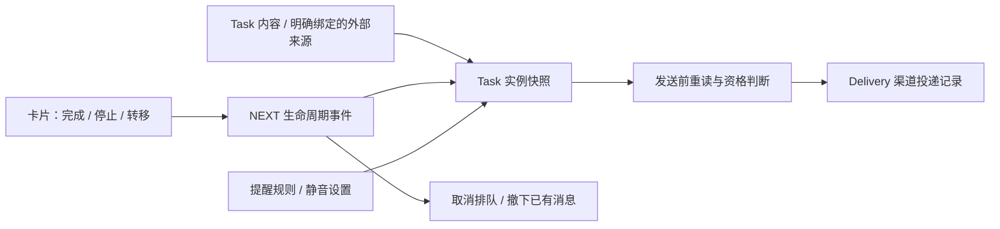

# Task / Reminder 统一协议 v1

日期：2026-10-26。状态：完整交换协议尚未接入；Task 级提醒控制已部分实现，见下方实现进展。正式名称使用 **Reminder**。

实现进展：Task 级提醒开关与暂停现已按本协议的职责分离实现，见 [NEXT 提醒交互](2026-10-26-next-reminder-interaction.md)。任务操作 CLI 与一次性绝对时刻规则/成功投递回执现已实现，见 [Agent 操作实现](2026-10-26-task-reminder-agent-operations.md)。这只覆盖单次、单 cube 端点、sent 回执的协议子集，尚未生成完整交换快照；重复实例调度、完整 Delivery 状态机、外部日历同步及远程运行器部署仍未接入。

本协议统一任务卡片与提醒消费者看到的数据，不新增另一份有独立完成状态的“提醒任务”。现有 Task Markdown 和 NEXT 事件账本仍是内容与生命周期的权威来源。协议定义本身不迁移真实数据、不启用推送调度器，也不发送或撤回消息。

## 1. 核心模型



- **Task**：要处理的事，持有唯一业务 ID、内容、日期和生命周期投影。NEXT 卡片直接展示它。
- **Reminder**：Task 的提醒规则。一个任务可有零到多个规则；没有自己的 `done` 或任务标题副本。
- **Delivery**：某条规则在某次任务实例、某个渠道端点上的一次投递。保存排队、发送、确认、关闭和撤下结果，不作为任务是否完成的依据。

这是本地应用协议，以 iCalendar 的 VTODO / VALARM 概念为基础；不是 CalDAV 服务协议，也不宣称兼容所有 Apple / Google 字段。普通日程 VEVENT 是有起止时间的事件，不能直接替代有完成状态的 Task。

## 2. 与当前实现的衔接

盘点基线：`plugins-src/next/src/lib/task-source.ts`、NEXT ledger / reducer，以及 Vault `skills/proactive-reminder-push/scripts/{compute_candidates.py,next_state.py}`、`stat/closed-reminders.json`。具体源文件格式继续遵循 [Task 卡片设计](2026-09-01-next-task-cards-design.md)。

| 当前数据 | 统一协议中的位置 | 规则 |
|---|---|---|
| `task.id` UUID v4 | `task.id` | 永不使用标题、路径或屏幕消息 ID 代替 |
| `title / description / task.priority / task.done_when` | Task 同名字段 | 消费时从原文读取，发送前刷新 |
| `created` | `task.created_at` | 保留真实时刻；不凭文件名推断 |
| `task.due`（日期） | `task.due` 的 date 形式 | 日期来自显式字段；禁止从正文第一个日期猜截止日 |
| Task `dedupe_key` | `task.dedupe_key` | 来源去重辅助键，不替代 UUID |
| NEXT `lane / settle.exit / at` | `task.state` | 只读折叠结果；不把状态写回 Task 原文 |
| NEXT `review_at` | `task.review_at` | 仅解析成功、时区明确后使用；它不是截止日 |
| NEXT `wake_trigger` 自然语言 | 留在原账本 | 不冒充机器可执行时间 |
| NEXT 标签与 Task 项目归属 | 留在各自来源 | 本协议不合并成一个含义不明的 project 字段 |
| `closed-reminders.json` 精确 task_ids / 已绑定 display_ids | `task.reminder_policy=muted` | 这是独立抑制，不是任务完成；NEXT 重开不清除它 |
| 旧关键词闭合规则 | 兼容适配器中的 legacy 抑制 | 不根据关键词生成任务身份或完成状态；无法精确映射时标记待核实 |
| `xiaobu-task-<UUID>` | Delivery `remote_id` | 只用于已有单任务屏幕消息；不再当 Reminder ID |
| Cube `due_at / ttl_seconds` | 适配器展示时间 / Delivery `expires_at` | `due_at` 不自动等于触发时刻；TTL 不改 Task 截止日 |

现有脚本只实现了其中一部分：按 NEXT closed / unsupported 过滤、独立闭合过滤、消息 ID 绑定。它还没有统一快照、重复实例、完整 RRULE、Delivery 回执或新协议写入功能。当前“72 小时”候选实际按日期 `as_of` 到 `as_of + 3`（含边界）选取；本协议不得沿用这个名称却实现四个日历日期。

财务、聊天等外部来源：用稳定的 `(provider, account, source_record_id)` 显式绑定一个本地 Task UUID，并投影 `source.kind=external`。不靠相似标题归并，也不要求复制外部账单为另一份权威 Task 文件。无稳定来源身份时不得自动推送。账户和连接凭据不放进快照。

协议 `version:1` 与 Task 文件 `task.version:1`、NEXT ledger `version:2` 是三个独立版本号。本协议是规范化的交换结构，不是替换现有存储格式的迁移脚本。

## 3. 交换结构

机器定义：[JSON Schema](../../../protocol/schema/task-reminder-v1.schema.json)。顶层每条记录描述一个 Task 实例及其相关规则与投递；传输批次使用多条记录，不将整个 Vault 作为一个可覆盖写入的 JSON 文档。

```json
{
  "protocol": "note.task-reminder",
  "version": 1,
  "as_of": "2026-10-26T02:00:00Z",
  "revision": "opaque-source-ledger-policy-revision",
  "sync_status": "verified",
  "task": {
    "id": "8afad9c5-07ac-4e4d-8d1e-4ed04c06f2d8",
    "title": "提交报销材料",
    "source": {"kind": "task_markdown", "ref": "inbox/tasks/2026-10-26-1000-expense-task.md"},
    "due": {"kind": "date", "value": "2026-10-28", "time_zone": "Asia/Taipei"},
    "state": {"lane": "waiting"},
    "reminder_policy": "enabled",
    "occurrence": {"key": "single", "generation": 0}
  },
  "reminders": [{
    "id": "6648ef36-e3d8-4254-bfea-f7b556a8be1c",
    "enabled": true,
    "trigger": {"kind": "relative", "anchor": "due", "offset_seconds": 0, "local_time": "09:00:00"},
    "channels": ["cube", "local"]
  }],
  "deliveries": []
}
```

以上表示“10 月 28 日当天截止，台湾时间当天上午 9 点提醒”。用户只填标题也可以创建 Task；日期、提醒、重复规则均可缺省。创建时程序填身份与结构字段，不能要求用户填写 JSON 元数据。

| 字段 | 含义 |
|---|---|
| `as_of` | 生成快照的时刻，不是任务修改时刻 |
| `revision` | 不透明一致性标记，覆盖任务内容、NEXT 事件、规则和独立抑制输入；任何相关输入改变都必须改变 |
| `sync_status` | `verified / unavailable / unsupported`；后两者可显示已知内容，但禁止新投递 |
| `task.source.ref` | Vault 相对路径或外部来源的稳定标识；路径重命名通过已有 relink 或显式绑定更新 |
| `task.state` | 由权威生命周期折叠得到；详见下一节 |
| `task.reminder_policy` | `enabled / muted`，任务级静音；不等于删除或完成 |
| `task.occurrence` | 单次或系列中的实例身份，以及重开代数 |
| `reminders[]` | 当前实例适用的规则；ID 为 UUID v4，修改规则不随标题换 ID |
| `deliveries[]` | 已知投递记录；允许保留旧 revision 和旧 generation 的历史 |

Schema 拒绝拼写错误和未知顶层字段。未知版本不得按 v1 猜读或覆写；适配器保留原始数据并报告 unsupported。本结构不是原始供应商数据的无损归档，供应商额外字段留在原记录或绑定存储。

## 4. 生命周期与用户操作

| NEXT 选择 | `state` | 新投递 | 标准任务完成含义 |
|---|---|---|---|
| 未安放 | `lane=capture` | 仍需检查提醒规则 | 未完成 |
| 现在推进 | `lane=wip` | 同上 | 进行中 |
| 等待回收 | `lane=waiting` | 同上 | 未完成，等待 |
| 以后再看 | `lane=dormant` | 不因泳道自动建提醒 | 未完成，暂放 |
| 完成 | `lane=closed,outcome=done,closed_at=真实事件时间` | 禁止 | 完成 |
| 停止 | `lane=closed,outcome=stopped,closed_at=…` | 禁止 | 取消承担，不是完成 |
| 转移他人 | `lane=closed,outcome=transferred,closed_at=…` | 禁止给原用户 | 转移，不是完成 |
| 现有压缩出口 | `lane=closed,outcome=compressed,closed_at=…` | 禁止 | 压缩处理，不是完成 |
| 无法安全解释事件 | `lane=unsupported` | 禁止 | 未知，不推断完成 |

`closed` 不能映射为统一的 `completed=true`。只有 `outcome=done` 的 `closed_at` 才能导出为 COMPLETED / completionDate。重开删除当前投影的 outcome / closed_at，保留历史事件，`generation` 加一；不会解除独立静音，也不会把已确认的旧投递复活。

当前 ledger 按既有数组顺序折叠、以 event_id 幂等；不改为按墙上时间重排。正常完整账本里没有该 Task 事件是 capture；账本不可读、读取范围不确定或事件冲突是 unavailable / unsupported，不能退回 capture 当作未完成。

操作语义：

| 操作 | 写入对象 | 对未来提醒的影响 |
|---|---|---|
| 完成 / 停止 / 转移 | Task 生命周期事件 | 立即禁发、取消排队；支持撤回的渠道撤下该实例现有消息 |
| 关闭这次提醒（dismiss） | Delivery | 关闭本次投递；其他规则和未来实例仍可提醒 |
| 已知晓（acknowledge） | Delivery | 记录用户确认；不完成 Task |
| 稍后提醒（snooze） | 当前 Delivery + 新 Delivery | 新触发时刻仍属于同一任务实例和原渠道端点，使用 `snoozed_from` 关联；不改截止日 |
| 不再提醒（mute） | 任务级提醒策略 | 抑制该 Task 全部实例和渠道，并请求支持渠道撤下消息；需显式 unmute 才恢复 |
| 隐藏卡片 | 视图偏好 | 不改变业务状态；不得以此证明任务完成 |

NEXT 仍保持一步安放和直接完成；拖拽只改状态，不要求日期、等待对象或原因。“更多…”才编辑这些细节。用户点“完成”持久化成功后播放页面内礼花，减少动态效果设置仍生效。提醒表面如提供“完成”，必须调用同一 Task 生命周期命令，不能只关屏幕消息。

## 5. 日期、时区和触发

字段职责固定：`start` 是可开始时间；`scheduled` 是计划执行日期/时间；`due` 是真实截止；`review_at` 是复查时间。`Reminder.trigger` 控制提醒，`Delivery.expires_at` 控制消息展示到何时。它们不能互相借用。

Temporal 有两种形态：

- `date`：`value=YYYY-MM-DD`，附解释该日期的 IANA `time_zone`。任务 date 截止语义为**该日内完成**，逾期从下一日开始计算；不伪造 `23:59:59`。
- `date_time`：带明确 offset 的 RFC 3339，秒精度；可附 IANA `time_zone`，附加后必须与该时刻的偏移一致。所有快照时间戳也采用此秒精度 profile：不接受 floating time、`-00:00`、小数秒或闰秒。供应商精度更高时适配器显式归一化并保留原值，不静默冒充无损映射。

date 是日历日期，不是 UTC 午夜；源数据没有时区时，用明确的 Vault / 账户设置解析，并把使用的 zone 写入快照。没有设置则阻止定时投递，不能猜运行脚本机器的时区。Apple 的 floating 日期也要先解决解释时区。

Reminder 触发规则二选一：

1. `absolute`：`at` 是明确时刻，仅适用于当前实例；不得自动复制到未来重复实例。
2. `relative`：`anchor` 为 `start / scheduled / due / review_at`，加 `offset_seconds`。启用规则的锚点必须存在；date 锚点必须带 `local_time`（HH:mm:ss），在其 zone 中先得到该日时刻，再加固定秒数；date_time 锚点禁止再写 local_time。`-86400` 表示精确 24 小时，跨 DST 不保证“前一天同一钟点”。

relative date 的 local_time 是标注日期当天的提醒时刻，不是截止过期边界。比如 due=28 日、local_time=09:00，触发在 28 日 09:00，不在 29 日。不存在或有歧义的 DST 本地触发时刻不得静默调整：阻止该投递并要求解析为明确 offset；RRULE 的展开另按标准规则处理。

时间窗口必须明确：未来 72 小时是 `[now, now + 72h)`，按时刻判断；日历三天则按显式 zone 的日期区间并使用另一名称。候选筛选和实际发送必须用同一语义。过期投递不自动补发，需显式生成新的触发记录。

## 6. 重复任务与实例

可选 `task.recurrence` 保存 `dtstart`、不带 `RRULE:` 前缀的 `rrule`、可选 `rdates / exdates`。重复采用 RFC 5545 的 recurrence set；date 类型、zone 必须与 dtstart 一致，定时系列必须带 IANA zone。v1 要求一个 RRULE（不支持仅 RDATE 的系列），限定 RDATE 为 date / date_time，不接收 PERIOD 型 RDATE；超出 profile 的导入保留原记录并报告 unsupported。

- `task.id` 始终为同一系列的 Task UID。
- 非重复任务 `occurrence.key=single`，不能附 original_start。
- 重复任务必须附 `occurrence.original_start`，用原始开始日期/时刻产生 key：`date:2026-10-28` 或 `instant:2026-10-28T01:00:00Z`。即使改期，key 和 original_start 也不变；当前 `scheduled` 可以改变。
- 完成或停止当前实例只关闭该实例；不是关闭整个系列。整个系列取消需显式 series scope 的生命周期动作，所有实例一并禁发。现有 NEXT 事件没有 occurrence scope，因此在实现实例事件扩展前，重复任务只能只读预览，**不能交给现有 Task-only settle 写入器**。
- 下一实例重新计算 relative 触发；已完成实例永不复活。重复实例重开时只递增该实例 generation。
- series ID 相同不等于每个实例已完成；实例身份相同但内容变更，不得新建另一份“未完成卡片”。

Schema 与本轮验证器检查结构、时间形态和实例身份，**不充当完整 RRULE 解析器或调度器**。生产接入必须通过符合 RFC 的解析/展开库验证合法性、实例成员关系、COUNT / UNTIL、RDATE / EXDATE、DST 和异常实例；不能仅凭 Schema 成功就发送重复提醒。

## 7. 投递、幂等与完成竞态

`Delivery.state` 取 `queued / sent / acknowledged / dismissed / withdraw_pending / withdrawn / failed`。

- queued → sent / failed / withdrawn；sent → acknowledged / dismissed / withdraw_pending；acknowledged、dismissed 仍可因撤屏进入 withdraw_pending；withdraw_pending → withdrawn，失败保留待撤状态并重试。
- `sent` 仅表示渠道接受消息，不代表用户已读；只有显式用户确认才进入 acknowledged 并写 acknowledged_at。Task 完成不伪造确认回执。
- `expires_at > trigger_at`；历史投递的 generation 可小于当前实例 generation，不能大于它。允许已关闭 Task 的快照暂时仍有 sent Delivery，供撤下补偿处理；结构合法不等于允许再次发送。
- snooze 先处理旧提醒，生成同 reminder 的新 Delivery，trigger_at 必须严格更晚，并引用旧 id；generation、channel、endpoint_id 必须与旧记录相同，不能跨重开或跨渠道复活旧提醒。新消息仍须经过资格判断。重复提交同一 snooze 动作由命令层 operation ID 幂等处理，不能每次生成随机记录重复发送。

交换层所有 UUID 使用小写规范形式；导入适配器先规范化，再做关联和幂等计算。一个 Task 实例内 Reminder ID、Delivery ID、Delivery idempotency_key 分别唯一；重试更新原投递记录，不新建同键副本。Delivery 的 reminder_id 必须存在；task_revision 等于当前 revision 时，channel 必须在当前规则 channels 中，旧 revision 的历史记录允许保留已移除渠道。规则删除采用 enabled=false 保留定义，直到引用它的历史投递一同归档；这类禁用规则不再要求已删除的 Task 时间锚点存在，也不解析其触发时刻。归档记录独立保存完整关联。

`idempotency_key` 是以下数组 UTF-8 紧凑 JSON（无空格，保留 Unicode，字段顺序固定）的 SHA-256 小写十六进制：

```text
["note.task-reminder/1", task.id, occurrence.key, generation,
 reminder_id, trigger_at规范为UTC秒精度Z, channel, endpoint_id]
```

它不包含 title、路径、快照 revision 或重试次数。同一触发重试复用 key；重新安排行为改变 trigger_at 或 generation。新 Cube 消息 ID 可用 `xiaobu-reminder-<idempotency_key>`；旧 `xiaobu-task-UUID` 留作 remote_id 别名，通过显式绑定撤回，不用模糊匹配。

发送资格必须在发送前重新计算：

1. 重新读取 Task 内容、完整 NEXT 状态、提醒策略、规则和来源绑定；比较 revision，变化后重建候选，重新算日期窗口和展示内容。
2. sync_status 必须 verified；lane 不能 closed / unsupported；task 不能 muted；Reminder 必须 enabled。
3. 验证 task / occurrence / generation / reminder / channel / endpoint 身份；旧候选 generation 不能用于重开的任务。触发已到、消息未过期，并且同幂等键无 sent、acknowledged、dismissed、withdrawn 等终态记录。
4. 正常投递 trigger_at 必须由当前规则解析得到。snooze 的时刻来自显式用户动作，不可把任意改写的 trigger_at 当成合法规则；已知网络结果不明时，先按幂等键回读渠道状态再重试。
5. 提交后记回执；完成、停止、转移、静音或改期时取消旧排队，并按渠道能力请求撤下失效消息。支持撤回的渠道发生暂时网络失败时持久化 withdraw_pending 并重试；不可恢复错误停止自动重试并显式报告，不能伪造 withdrawn。撤下失败不允许再生成替代重复消息。

渠道端点的适配器必须声明是否支持撤回。Cube / 本地通知按其实际能力处理；email 通常无法撤回，保留历史 sent / acknowledged 等状态，报告“不支持撤回”，同时永久抑制该闭合实例后续投递。不可撤回的消息不进入无限重试的 withdraw_pending。渠道能力和动作错误由适配器结果报告，快照中的 sent 本身不保证可撤回。

本地状态检查和远端发送不是一个原子事务，仍可能在检查后、发送前完成任务。必须以发送后复核、撤下补偿及下一轮扫描收敛；不宣称 exactly-once 或绝对零瞬间竞态。mutation 命令携带 expected_revision 和 operation_id，冲突重读，不覆盖新状态；命令 API 的传输格式不在本快照 Schema 范围。

## 8. 标准与平台映射

以下是互操作边界，前文的泳道、mute、Delivery 等为本地决策，不冒充平台标准。

| 目标 | 映射与限制 |
|---|---|
| iCalendar VTODO | Task UID / title / description → UID / SUMMARY / DESCRIPTION。capture、waiting、dormant → NEEDS-ACTION，wip → IN-PROCESS，done → COMPLETED；其余关闭可导出 CANCELLED 并用 X-NOTEMD-OUTCOME 保留原因。这不授权取消别人会议。NEXT 泳道、原 UUID 和日期解释也需扩展或绑定保存，纯标准往返会有损失。 |
| iCalendar VALARM | 每条 Reminder 对应 alarm；start/due 相对触发映射 RELATED=START/END，absolute 映射 UTC TRIGGER。scheduled/review_at 不是标准 alarm 锚点，需算成具体绝对时刻并报告失去动态锚点；不能伪称无损。 |
| iCalendar 日期边界 | 本地 date due 包含当天；RFC VTODO 示例中 DATE DUE 是该日开始前截止。导出明确转换为下一日 DATE 边界并记录 X-NOTEMD-DUE-DATE / zone，导入无扩展的标准 DATE DUE 按边界还原前一日，而不是同名照抄。DTSTART 与 DUE 必须满足标准类型/先后约束；不满足则报告不可映射。 |
| Apple EventKit | 对应 **EKReminder**，不是 EKEvent：title/notes、startDateComponents/dueDateComponents、alarms、recurrence；done 对应 isCompleted + completionDate。date 以 date components 表达；stopped/transferred/compressed 无等价完成字段，留在本地 overlay，禁止标成 completed。 |
| Google Tasks API | title/notes 对应任务；needsAction/completed 对应未完成/完成，completed 为完成时刻。其 due 是计划日期 → **scheduled.date**，不是 deadline，也不能保存时分。未提供闹钟、重复规则字段，保留本地能力并报告不能同步。 |
| Google Calendar API | 仅当用户明确需要日历事件时做 VEVENT 投影，start/end 描述事件；事件没有 Task 完成状态，不以 confirmed/cancelled 推断 done。提醒 override 为开始前分钟数（0..40320），最多 5 条，email/popup；超范围规则不可悄悄截断。 |

日期截止转换后，VALARM 的相对 offset 必须按导出的锚点重新计算，不能照抄 offset_seconds。例如本地 due=28 日、09:00 提醒，导出 DUE=29 日边界时需提前 15 小时，而不是零偏移。跨 DST、日期 local_time 或其他无法由固定相对时长无损表达的规则，应按实例导出 absolute TRIGGER 并报告失去系列规则语义，不能静默调整。

VTODO、状态、日期边界和 alarm 锚点依据 [RFC 5545](https://www.rfc-editor.org/rfc/rfc5545.html#section-3.6.2)。本地 date 截止的“当天内”解释是本协议产品选择，不能套用 VEVENT 全天 DTEND 的语义代替任务语义。

alarm 的独立 UID、确认和 snooze 关系参考 [RFC 9074](https://www.rfc-editor.org/rfc/rfc9074.html#section-6)。本地 acknowledge 与发送成功仍分开；snooze 不完成任务。

Apple 的对象与日期行为参见 [创建事件和提醒](https://developer.apple.com/documentation/eventkit/creating-events-and-reminders)、[dueDateComponents](https://developer.apple.com/documentation/eventkit/ekreminder/duedatecomponents)、[completionDate](https://developer.apple.com/documentation/eventkit/ekreminder/completiondate)。iOS 的 reminder due 需要 start，适配器不能为此伪造业务 start；需要明确转换策略或报不可映射。不得由 EventKit 能力推断现代 iCloud Reminders 全部支持 CalDAV。

Google 的字段依据 [Tasks resource](https://developers.google.com/workspace/tasks/reference/rest/v1/tasks) 和 [Calendar Events resource](https://developers.google.com/workspace/calendar/api/v3/reference/events)。Google Calendar 的 reminders 属于当前用户，其修改不更新事件 updated，不能只靠 updated 检测提醒变更；Google Tasks 拉取已完成任务时还需处理 [showHidden](https://developers.google.com/workspace/tasks/reference/rest/v1/tasks/list)，否则可能漏掉第一方完成记录。

外部绑定至少包含 provider、account_id、container_id、remote_id，可选 iCalUID / etag / provider revision；绑定表独立于本快照管理。内部 UUID 不用远端 ID 替换：Apple [本地标识](https://developer.apple.com/documentation/eventkit/ekcalendaritem/calendaritemidentifier) 可能因完整同步改变，[external identifier](https://developer.apple.com/documentation/eventkit/ekcalendaritem/calendaritemexternalidentifier) 也不保证唯一；Google 重复事件各实例 ID 不同、共享 iCalUID，用 originalStartTime 关联原始实例。发现冲突不按最后写入强行覆盖。

适配器对每次读写返回“无损 / 有损字段清单 / 不支持”，并保留原始记录。v1 不提供全自动双向同步，也不把删除远端项目、转移给他人等动作隐含在日期或完成字段映射中。

## 9. 接入顺序与验收

本轮交付文档、Schema、正反例与验证脚本；以下为后续接入顺序，**不是已经完成的运行时能力**：

1. Task + NEXT 适配出统一快照；保留原文件和 ledger。Reminder 配置、mute 与 Delivery 先由单一适配层管理，存储 schema / 原子更新策略另行落地，不由多个脚本各写一份状态。
2. 改造 `compute_candidates.py`，只消费快照；统一 date/time、发送前内容刷新、明确的时间窗口及静音检查。保留现有旧 ID 绑定和独立闭合兼容入口。
3. NEXT 的完成、停止、转移及提醒界面的同名操作使用同一生命周期写入器；接通取消排队、撤屏回执、失败重试。先支持 single 实例。
4. 增加 occurrence-aware ledger 与 RRULE 调度，再接入重复任务；之后才开发 Apple / Google 适配器，逐项显示映射损失。

后续运行时必须通过的验收：

| 场景 | 必须结果 |
|---|---|
| 候选生成后用户完成 / 停止 / 转移 | 重读后不发送；支持渠道的已有消息撤下，其余报告不可撤回；仅 done 导出 completed |
| 任务完成后重开，但独立静音仍在 | generation 增加，仍不推送；显式 unmute 后只考虑新投递 |
| dismiss 一次提醒、另有规则 / 次日实例 | 只关本次，不完成 Task，不抑制其他实例 |
| 同一标题两张 Task / 源文件重命名 | 依 UUID 区分；显式 relink，不误关另一张 |
| 发送前改截止日或文案 | 刷新全文、重新计算触发；不发旧时间和旧内容 |
| 发送后才收到完成事件 / 撤屏失败 | 暂时失败保留 withdraw_pending 并重试；不支持撤回则报告；不恢复任务或重复发送 |
| 日期、明确时刻、DST 跨界、72h 右边界 | 使用约定时间语义；歧义时阻止，不猜时区 |
| 重复实例改期 / 完成本次 | 原始实例 key 保持；后续实例不受误关 |
| 同次网络重试 / 相同 snooze 动作重复提交 | 幂等复用；一次动作只生成一次后续投递 |
| 外部取消、Google Tasks due、未知账本版本 | 不伪造完成；计划日不变硬截止；未知状态禁发 |

2026-10-26 验证结果：69/69 正反例通过（22 个有效样例、47 个拒绝样例）；本文 JSON 示例另行通过同一验证器。独立审查已复核身份、幂等、重开、时区和平台映射边界。

本轮机器验证：

```sh
python3 scripts/validate-task-reminder-protocol.py
```

需要 Python `jsonschema`（使用 format checker）与系统 IANA tzdata。脚本检查 Schema 自身、正反例、跨字段引用、日期/时区、闭合形态、实例键与投递幂等键。它不连接真实 Vault 或渠道，不验证远端送达、完整 RRULE 展开、同步新鲜度或原子性；这些必须由运行时适配器测试证明。
