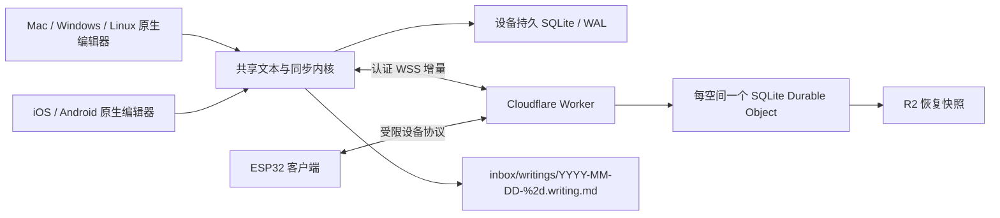

# 沉浸式写作：全平台产品与同步设计

日期：2026-11-07。状态：规划稿；未实现、未验证性能、未部署。

配套实施计划：[macOS 首版计划](../plans/2026-11-07-immersive-write-macos.md)。工作名 `Write / 写作`，非最终品牌。

## 1. 需求与成功标准

产品是一个轻量、专注于文字的个人写作空间。用户打开后面对一页纸，继续写，写完翻到下一页；不需要先起名、选目录、保存或理解创建时间。

- macOS / Windows / Linux：note.md 插件入口与专用文档视图，编辑区使用本机原生富文本控件。
- Linux 的首要目标环境为用户指定的 Omarchy（Hyprland / Wayland）；以其官方写作应用 Omawrite 的 Qt 技术路线为首选原型参考。
- iOS / Android：独立原生应用，不依赖桌面 note.md 或完整 Vault。
- ESP32：独立设备客户端；板型、内存、屏幕及输入硬件尚未指定，需单独验证能力边界。
- 独立同步服务只同步这个产品的纸页、必要元数据和偏好，不上传整个 Vault。
- 页面可以列举、新建、修改、删除；用户看到“纸页”，底层以 Markdown 文件保存。桌面默认落在 `inbox/writings/YYYY-MM-DD-%2d.writing.md`。
- 富文本编辑不显示 YAML、行 ID 或同步信息；普通源码模式仍能读取完整 Markdown。
- 主题、统一字体、整体字号、行距、正文宽度可调；沉浸窗口只提供全屏与固定尺寸两种形态。
- **用户已确认**：每个明确换行划分的逻辑行记录首次书写与最后修改时间；首版不做逐笔回放。
- **用户已确认**：首版支持同一页跨设备同时编辑、离线后重连自动合并。不能用整篇最后写入覆盖，也不能把单写者锁当作完成此需求。

首版是 macOS 客户端 + 最小生产同步服务 + note.md 原生宿主接入。两台 Mac/两个隔离客户端可验收同步；移动端尚未实现时不得声称“全平台已交付”。

## 2. 用户体验

### 2.1 一页纸

启动恢复上次纸页、光标和阅读位置；首次启动提供空白页，第一次有效输入时持久化。关闭空白页不累积无意义文件。新建动作必须有幂等 ID，防止重试重复生成页面。

编辑主界面只有正文、光标和留白。无常驻文件树、格式工具栏、时间、路径或保存按钮。按需唤出的底部轻量操作提供：上一页、下一页、新的一页、纸页概览、外观、移到废纸篓。错误与离线状态可发现，不能为了沉浸隐藏未保存风险。

纸页概览按用户纸页顺序展示首行摘要和短预览，不显示文件名或创建日期。每页身份是随机 UUID；摘要随正文变化，不需要“重命名文件”。列表分页加载。首版无文件夹、标签体系、拖拽排序与团队协作；新页插在当前页之后，并发新页采用可收敛的顺序键与 UUID 打破平局。

“下一页”不因视觉上写满而自动分页；纸页可以长篇滚动。下一页存在则导航，不存在则提供空白页。用户主动创建才产生新的容器。

### 2.2 排版与窗口

建议默认：22 pt、行距 1.6、左对齐、正文最大宽约 80 个半角列（约 40 个中文全角字）。以实际字体度量约束视觉宽度，窄屏取可用宽度；软折行不插入 Markdown 换行、不产生时间记录。80 不是所有写作软件的强制标准；W3C 的阅读排版指导使用 80 字符／40 CJK，可作默认参考。[W3C](https://www.w3.org/WAI/WCAG22/Understanding/visual-presentation.html)

预设主题：黑底白字、黑底灰字、白底黑字；整个编辑区、光标、选区、留白同主题。字号与行距只属于显示偏好，不写成正文行内样式。建议同一跨平台字体家族，候选 Noto Sans CJK；实现前核字体授权、中文覆盖和包体。无法加载的设备明确字体回退；ESP32 子集字库不能宣称覆盖完整桌面字库。

专注窗口默认固定逻辑尺寸 960×720，可在设置选择少量固定规格；小屏限制在可用工作区。全屏切换保留光标与滚动位置，保留标准退出方式。普通 note.md tab 随宿主布局变化是兼容阅读入口；“只全屏/固定尺寸”约束独立专注窗口，不强迫整个 note.md 主窗口固定尺寸。

下方设置键盘/候选区避让空间。移动端跟随系统键盘实际 inset；硬件键盘连接后收回空白。桌面可配置底部保留高度，为以后自制输入法留位置。光标保持在可用编辑区内，不被预留区挡住。

### 2.3 输入法边界

首版保证原生 IME 正常组合、选词、撤销与候选定位。应用自身不能统一强制系统输入法的候选面板固定在底部，也不能任意改变其配色。候选框定位提示不是对所有输入法的强制设置；不通过伪造光标位置实现固定候选条，以免破坏辅助功能与系统文本服务。

定制输入法是独立子项目：由输入法自己实现底部布局与主题协议；编辑器传输的仅是经授权的主题/几何参数，不传不必要的全文。iOS 的键盘外观提示、Android 的系统 IME、macOS/Windows/Linux 输入框架分别适配，不承诺跨系统同一开关。此项目首版不包含输入法开发。

官方接口依据：iOS [keyboardAppearance](https://developer.apple.com/documentation/uikit/uikeyboardappearance) 只提供有限外观提示，[keyboardLayoutGuide](https://developer.apple.com/documentation/uikit/uiview/keyboardlayoutguide) 跟踪占位；Android [InputMethodService](https://developer.android.com/reference/android/inputmethodservice/InputMethodService) 的主题属于输入法服务。Windows [ImmSetCandidateWindow](https://learn.microsoft.com/en-us/windows/win32/api/imm/nf-imm-immsetcandidatewindow) 需逐输入法验证；Linux [Fcitx 主题文档](https://fcitx-im.org/wiki/Theme_Customization) 区分 X11/Wayland 渲染路径。

## 3. 原生 rich 与 Markdown 的边界

`rich` 指原生控件中的可编辑样式，不等于支持 RTF 的所有能力。首版支持段落、明确换行、标题、粗体、斜体、删除线、引用、简单列表与链接。格式操作由快捷键和按需菜单触发；不添加常驻工具栏。标题可用同字体家族的有限层级样式，整体字号按比例调整。

表格、图片附件、公式、嵌入 HTML、图表和复杂嵌套结构不纳入首版富文本编辑。遇到未支持语法，保留原文片段，可只读呈现或切到 Source；不能导入后静默丢失。富文本粘贴清洗到支持的子集，复杂内容降级前提示，并保留可恢复的原始草稿。

权威文本为 LF 换行的 Markdown body，映射到原生 attributed text；RTF/HTML 只可作为剪贴板输入格式，不能成为权威存储。采用保留源码范围的解析与最小替换，不能每次击键“全文 HTML → Markdown”。格式操作同样生成局部源码事务；触及不支持的范围时拒绝该格式操作并保留原文。

建立 source map：Markdown 范围 ↔ 原生可见文本范围，专门处理隐藏语法、转义、列表前缀、软换行、emoji、组合字符。协议指定 UTF-16 偏移边界，Rust 显式转换，不以 UTF-8 字节冒充；可编辑边界不得切开代理对或用户可见字素。无编辑的导入导出保留原始正文；首次外部导入的 CRLF 正规化必须明确记录。

source map 绑定文档 revision。捕获原生编辑时即在同一串行 session 内转换成 CRDT 相对锚点/事务；不能把旧 UI 的绝对 offset 套到已接收远端更新的新正文。Yrs 显式配置 UTF-16 offset，与 Y.Text 对齐；锁定版本后跑跨语言样本。[Y.Text](https://docs.yjs.dev/api/shared-types/y.text)；[Yrs OffsetKind](https://docs.rs/yrs/latest/yrs/doc/enum.OffsetKind.html)

并发编辑 Markdown 语法可能收敛为用户不期望的格式。CRDT 保证操作合并和文本一致，不能保证所有并发格式操作符合意图；语法暂时无效时保留全部文字，局部显示为原文，不自动格式化修复或丢字。

## 4. 平台选型与性能判断

系统自带控件没有可比的 GitHub stars；开源项目热度也不等于适用性。候选须同时核实是否原生、维护状态、授权与 Markdown 往返能力。精确版本与许可证在实施锁定依赖时再次核验。

| 平台 | 系统/框架控件与热门候选 | 本项目建议 |
|---|---|---|
| macOS | NSTextView + TextKit 2；[STTextView](https://github.com/krzyzanowskim/STTextView) 约 1.6k stars；[RichTextKit](https://github.com/danielsaidi/RichTextKit) 约 1.3k | 首版直接 NSTextView，薄 AppKit 适配。STTextView 当前要求 macOS 14+、GPLv3/商业双许可，作性能备选；RichTextKit 是系统控件包装，作者已提示未来维护方向不确定 |
| iOS | [UITextView](https://developer.apple.com/documentation/uikit/uitextview) + TextKit 2；[Proton](https://github.com/rajdeep/proton) 约 1.4k；RichTextKit | UITextView；复用文本/同步内核，单独实现键盘与选区 UI。Proton 的 Catalyst 支持不等于 AppKit 编辑器 |
| Windows | [Win32 Rich Edit](https://learn.microsoft.com/en-us/windows/win32/controls/about-rich-edit-controls)；[WinUI RichEditBox](https://learn.microsoft.com/en-us/windows/apps/develop/ui/controls/rich-edit-box) | Tauri 内嵌优先验证原生 Rich Edit HWND；WinUI 控件需额外宿主集成，不能假定可直接嵌入 |
| Linux / Omarchy | 官方写作应用 [Omawrite](https://github.com/omacom/omawrite) 的 Qt Quick + C++ 路线；[Qt Quick TextEdit](https://doc.qt.io/qt-6/qml-qtquick-textedit.html) / QTextDocument；[QTextEdit](https://doc.qt.io/qt-6/qtextedit.html) | 优先验证 Qt 6 富文本适配，借鉴 Omawrite 主题/字体/布局。它自身是 PlainText + MarkdownHighlighter，不是可直接复用的完整 rich 控件；GTK3 TextView 仅作宿主兼容备选 |
| Android | EditText/Spannable；[AztecEditor-Android](https://github.com/wordpress-mobile/AztecEditor-Android) 728；[Compose Rich Editor](https://github.com/MohamedRejeb/Compose-Rich-Editor) 约 1.9k | 简单写作优先 EditText + spans 薄层；Aztec 是 EditText 扩展、HTML 导向、MPL-2.0。Compose 是无 WebView 的另一套文本框架，需单独评估 |
| ESP32 | 用户指定参考 [Draftor](https://github.com/Ohhellboy/Draftor)：自研 C++ Document / BodyEditor / LayoutEngine、bgIME 与直接屏幕绘制 | 优先评估复用其编辑内核、中文输入和局部重排/刷新设计；不再默认选 LVGL Text Area。现有模型是纯文本，需要新增 Markdown 样式映射、行时间与同步适配 |

以上热度为本次检索页面的近似快照，不作“绝对最热门”排名。[wasabeef RichEditor](https://github.com/wasabeef/richeditor-android) 虽约 6.3k stars，其实现基于 WebView，因此不列入系统原生方案。Linux 没有适用于所有发行版/桌面的单一系统 rich 控件，GTK/Qt 是主流原生工具包选择。

Apple 官方文档建议采用现代 TextKit 布局路径；误用旧 `layoutManager` 可能切换回 TextKit 1。因此“用了 NSTextView”不足以证明实际启用 TextKit 2。[TextKit](https://developer.apple.com/documentation/AppKit/textkit)；[WWDC TextKit 兼容模式](https://developer.apple.com/videos/play/wwdc2022/10090/)

当前 note.md 是 Tauri + 系统 WebView + ProseMirror/@moraya/core，并非必然携带一份 Electron Chromium。原生的预期收益是缩短输入/组合/排版路径、减少 DOM 和跨进程同步压力，以及更直接的系统文本服务。宿主 WebView 仍存在，不能承诺插件令整个应用内存锐减。

原生也会因全篇 attributed string 替换、全文 Markdown 解析、主线程 SQLite、错误撤销绑定而卡顿。**不承诺几倍性能提升**。必须在同机器、同字体、同内容、同输入法下比较当前 Rich、简化 Web 基线与原生原型；实测不达标先定位瓶颈，再决定是否引入 STTextView 等替代控件。

### 4.1 Omarchy 原生编辑路线

用户偏好的 Omarchy 为 Linux 主验收环境。其[官方 GUI 手册](https://omarchy.org/manual/guis/#omawrite)列出自家写作应用 Omawrite；[Omawrite README](https://github.com/omacom/omawrite)说明从 Quattro 新装版本开始默认提供，依赖 Qt 6 / Qt Quick。不能据此假定用户当前版本已预装，也不能声称 Omarchy 官方为第三方应用指定了某个 rich SDK。这里的 Qt 选型是本项目结合官方应用与生态作出的工程推荐。

固定源码 `c1ea454e70fb01935623b151668a8f3dc3f2d7ba` 中，[Main.qml](https://github.com/omacom/omawrite/blob/c1ea454e70fb01935623b151668a8f3dc3f2d7ba/src/Main.qml#L633) 使用 `TextEdit.PlainText`，[backend.cpp](https://github.com/omacom/omawrite/blob/c1ea454e70fb01935623b151668a8f3dc3f2d7ba/src/backend.cpp#L268) 接入 QTextDocument 与 MarkdownHighlighter；[高亮器](https://github.com/omacom/omawrite/blob/c1ea454e70fb01935623b151668a8f3dc3f2d7ba/src/markdownhighlighter.cpp#L125)以字号/字距/颜色弱化语法标记。借鉴它的原生输入与沉浸布局，不把此源码高亮机制直接称为本项目的 rich 实现。

本项目首选原型为 Qt 6 `QTextDocument + Qt Quick TextEdit` 的富文本显示/编辑适配；若操作 API 或 IME 实测证明 Qt Widgets 更合适，再收敛为 `QTextEdit`，不同时维护两套正文 UI。Markdown 仍由共享内核与 source map 负责无损往返；不直接以 Qt 导出整篇覆盖权威文本。Omarchy 的[基础包清单](https://github.com/omacom/omarchy/blob/quattro/install/omarchy-base.packages)提供 Qt/Wayland、Fcitx5 与 CJK 字体基础，但分发包仍须声明实际运行依赖。

宿主集成是前置风险：本仓 `src-tauri/Cargo.lock` 锁定 `gtk 0.18.2`（GTK3）与 WebKitGTK；Qt 的 QQuickWidget 是 QWidget 容器，并不是 GTK 容器。先做独立专注窗口只是 PoC 的一部分，**Qt/GTK3 在 Wayland 下 tab 内挂载、事件循环、焦点/输入法、缩放、菜单遮挡、辅助功能与销毁必须全部实测**。不假设能把外部窗口 reparent 进 tab；不以外部窗口或 Web 预览替代原生 tab 验收。桥接不可行时重新评审 [GTK3 TextView](https://docs.gtk.org/gtk3/text-widget-overview.html) 或宿主结构，并明确方案变化，不能悄悄退回通用 GTK 优先或扩大成整宿主重写。[QQuickWidget 边界](https://doc.qt.io/qt-6/qquickwidget.html)

Omarchy 专项验收：

- 主路径是 Hyprland 原生 Wayland；XWayland 结果单列，不能冒充 Wayland 已通过。
- 沿用系统实际 Fcitx5 配置，测试拼音/注音及已安装的 Rime、候选位置、组合中远端更新、剪贴板与撤销；不为应用全局覆写 `GTK_IM_MODULE` / `QT_IM_MODULE`。按已锁定 Qt/Fcitx/合成器版本验证所用输入协议。[Fcitx Wayland 指南](https://fcitx-im.org/wiki/Using_Fcitx_5_on_Wayland)
- 默认快捷键避开系统已占用绑定；特别核对 Omarchy 的输入法切换与 Super 组合键，不盲目复制 macOS 快捷键。[Omarchy 输入设置](https://omarchy.org/manual/keyboard-mouse-trackpad/#typing-in-chinese-japanese-and-other-languages)
- 固定尺寸窗口需验证平铺环境的浮动/尺寸协商；分数缩放、多显示器、全屏切换与系统深浅主题实测。主题可跟随系统，用户显式选黑白/黑灰主题时不被系统更新覆盖。
- 安装包采用 Arch 对应 CPU 架构的 `.pkg.tar.zst`，验证依赖与实际启动；不能用 `.deb` 或另一架构包证明 Omarchy 可安装。

## 5. 数据模型和 Markdown

### 5.1 页面模型

- `space_id`：账号内写作空间；首版一个默认空间，不暴露文件夹 UI。
- `page_id`：随机 UUID，跨设备稳定，不含日期。
- `epoch`：CRDT 世代，防止从裸 Markdown 重建后错误混合旧增量。
- `body`：Y.Text Markdown 正文；`root_line_id` 与换行身份属性共同定义逻辑行。
- `line_timing`：各行的首次/末次书写信息；不保留逐键回放承诺。
- `order`、`deleted`、`delete_generation`：纸页顺序与删除状态，独立于正文。
- 设备局部状态：光标、滚动、窗口尺寸、键盘高度；不同设备不互相抢光标。
- 全局显示偏好：主题、字体家族、字号、行距、宽度，可同步；无法支持的字体本机回退。

### 5.2 文件格式：正文与伴随元数据分离（用户已确认）

用户已确认采用小 YAML 头 + 标准 Markdown 正文 + 同目录 `.writing.meta.json` 伴随文件，取代原“尾部 HTML 注释内 YAML 行表”草案。逐行时间保存在 meta 中，正文与时间仍共同参与文档事务及同步；完整迁移正文和时间需携带匹配的文件对。存储布局已确定，具体生产 schema 与并发时间归属结构在 P0 验证后冻结。

顶层类型拟登记 `Writing Page`。实施时遵循 OKF 类型登记和 origin fixture；人工正文签名复用宿主真实 `human:<id>`，不得编造身份。文件内部允许有时间，用户界面不出现创建日期。

`2026-11-07-01.writing.md`：

```markdown
---
type: Writing Page
write_schema: 1
page_id: 87d92d1a-f37d-46e8-b83e-dc3e671fb425
write_epoch: 1
write_metadata: sidecar-v1
---
今天开始写一点东西。
下一行继续。
```

伴随文件名为 `2026-11-07-01.writing.meta.json`。名称用于定位，身份必须匹配 `page_id` 与 `epoch`；文件重命名需由投影器协调，不通过文件名认定同一页。下例为结构示意，占位值不是有效生产数据：

```json
{
  "schema": 1,
  "page_id": "87d92d1a-f37d-46e8-b83e-dc3e671fb425",
  "epoch": 1,
  "projection_id": "<snapshot UUID>",
  "body_sha256": "<normalized Markdown body SHA-256>",
  "root_line_id": "<UUID>",
  "lines": [
    {
      "id": "<UUID>",
      "text_sha256": "<exact logical line SHA-256>",
      "first_written_at": "2026-11-07T10:20:30.000Z",
      "last_written_at": "2026-11-07T10:21:05.000Z",
      "time_source": "device"
    },
    {
      "id": "<second line UUID>",
      "text_sha256": "<second logical line SHA-256>",
      "first_written_at": "2026-11-07T10:21:08.000Z",
      "last_written_at": "2026-11-07T10:21:08.000Z",
      "time_source": "device"
    }
  ]
}
```

行表按正文逻辑行排列；上例正文假设第二行后无末尾 LF，实际必须包含所有逻辑行。未写过的空行 first 为 null；未知历史时间与已知时间区分。LF 分割包括末尾空项：空正文有一个空逻辑行，`a\n` 有两行，`a\n\n` 有三行；空格、Tab 和硬换行尾部空格原样参与行摘要，不 trim。body hash 不含 frontmatter；首次导入的换行正规化遵循 §3。摘要只检测一致性，不证明创作时间真实性，也不能仅凭同一 body hash 判定哪个时间快照更新。`projection_id` 是关联本地投影日志的标识，不是可排序时钟；MD 没有此字段，配对依据为 page/epoch/body hash，不能靠此 ID 证明两文件来自同轮。行摘要不替代稳定行 ID。

#### 5.2.1 为什么不逐行塞时间注释

行末写 `<!-- ... -->` 技术上可行，但对任意 Markdown 不透明：闭合代码围栏后只能有空白，附注释会破坏闭合；两空格/反斜杠硬换行失效；注释行替代空行可能改变段落和列表；代码块内注释会显示。若采用该路线，必须定义专用行编码并在任何 Markdown 解析前剥离，处理字面保留标记、损坏/未知版本、空行和末尾 LF，外部工具仍不能保证等价渲染。[CommonMark 围栏](https://spec.commonmark.org/0.31.2/#fenced-code-blocks)；[硬换行](https://spec.commonmark.org/0.31.2/#hard-line-breaks)

因此，本项目不采用逐行时间注释；它需要专用格式支持，不是标准 Markdown 免费支持的元数据能力。前置/独占行注释同样可能打断块结构；不能以换个注释位置解决全部情况。本轮使用仓库 marked 对段落、双空格/反斜杠换行、围栏、列表、末尾 LF 与空正文做了七组探针；先解码可往返，不代表原始带注释文件通用兼容。证据为本机 `tasks/writing-storage-review/markdown-probe.json`，尚非生产 codec 测试。

#### 5.2.2 CRDT 与文件布局解耦

权威协同模型仍为 Markdown body + 稳定行身份 + §5.3 的时间归属信息。时间是结构化事务数据，不把整段 JSON/YAML/HTML 注释放入正文 Y.Text 作为可编辑字符，也不让 sidecar 自己走第二套独立合并。正文与时间在同一逻辑编辑事务更新，按同一同步协议收敛；序列化时才决定元数据写入哪里。

在此设计下，行内、尾部或 sidecar 主要影响文件体积、解析/投影、工具兼容和恢复流程，不直接改变 CRDT 正文字符数量。若把时间戳作为正文字符串协同，每次更新时间会额外产生删除/插入，污染选区和 source map，并可能让并发操作生成失效注释；不能这样实现。结构化时间仍有存储与同步开销，尤其并发拆合行的 provenance，不因采用 sidecar 消失。没有性能实测，不给延迟百分比。

#### 5.2.3 持久化、投影与恢复契约

客户端 SQLite/WAL 保存完整 CRDT snapshot、正文与时间事务、未确认 outbox、远端 inbox、去重键和投影基线；这是恢复活文档所需的持久状态，有未确认写入时不是可删除缓存。事务提交后，再从同一 revision 生成 MD 与 sidecar 快照。

两个文件各自可原子替换，**两次 rename 不构成跨文件原子事务**。投影器串行写入、校验匹配关系并记录完成状态；中途崩溃时从已提交数据库恢复，先辨别外部修改，不能直接覆盖用户新稿。UI 区分本地持久化与 Markdown/元数据投影失败；失败保留待重试状态。配对导出必须取同一冻结快照打包，不把复制目录中的两个活动文件当一致性备份。

导入先核对 page/epoch、schema、body hash、行数与行摘要。匹配只表示内容对应；现有数据库 session 的时间状态不能被旧 sidecar 回滚。外部仅改 MD 时按可信上次投影做三方导入；时间不能照抄旧表。无基线时只对可可靠匹配的未变行继承时间，重复内容/复制 ID/拆合歧义标为未知历史并记录导入来源，不伪造原始首次或最后修改时刻。sidecar 缺失/损坏/版本未知时保全文件，正文可恢复，时间进入待恢复或未知状态；不生成看似完整的历史。

迁移能力明确分层：仅 MD 保留正文和页面身份；MD + 匹配 sidecar 保留正文与行时间快照；完整设备备份另含一致性数据库状态，才能恢复完整离线同步上下文。普通 Markdown 导出可以移除内部头部，明确不含行时间。单文件含时间归档不纳入首版范围；当前完整内容迁移采用配对快照打包。

独立同步服务传输文档事务，不依赖 MD/sidecar 到达顺序。Vault 文件同步若传输这对文件，应按 §7 处理迟到配对和外部导入，不将两个文件各自的 LWW/文本合并结果视为已经 CRDT 合并。sidecar 在纸页 UI 不显示；文件树、搜索、索引和分享的 companion 规则必须显式实现，不假定 JSON 扩展名会自动隐藏。

本机使用 WAL 与 `synchronous=FULL` 作为耐久起点，并核实目标文件系统与平台 flush 行为；进程崩溃和断电分别验证。事务成功不自动等于任意硬件断电零损失，不超出实际验证范围承诺。[SQLite synchronous](https://www.sqlite.org/pragma.html#pragma_synchronous)

裸文件恢复先与服务器对齐当前 epoch，再做显式外部改动导入；无法取得可靠基线时恢复为新纸页 UUID，不把新 CRDT 状态套在旧 UUID/epoch 上。重置 epoch 必须有专门协议与旧设备重接处理。

### 5.3 行身份与时间

“行”是 Markdown body 中明确 LF 划分的逻辑行，包含空行，不是屏幕折行；YAML 头与伴随元数据不计入正文行。首行固定 ID，其余行由前置换行上的非显示 `next_line_id` 属性标识；这些属性不进入可见 Markdown，导出到伴随行表。

这是待 PoC 的 Y.Text 属性方案：必须验证 Yjs/Yrs 格式属性互通、插入时禁止属性错误继承、undo 恢复与并发换行。若不能满足，改用经过验证的相对位置锚点模型再冻结协议，不能在生产中靠行号匹配补洞。

| 操作 | 身份与时间规则 |
|---|---|
| 首次键入 | 非空内容首次提交时设 first；每次已提交正文修改更新 last |
| IME 组合中 | 仅本机临时显示，不同步拼音中间态，不更新时间；确认文字后作为一次输入事务 |
| 自动折行/字号主题改变 | 行身份、first、last 均不变 |
| Enter 分裂 | 左行保留 ID，新右行获得 ID；携带已有文字时继承来源 first，last 为分裂事务；新空行 first 为空，首次书写再设 |
| Backspace 合行 | 左行保留 ID，first 取有效来源最早值，last 为合并事务；右行删除，撤销所需身份仍由 CRDT 管理 |
| 清空一行 | 保留行身份与已有 first，更新 last；移除换行导致的行删除按合行规则处理 |
| 格式修改 | 改 Markdown 内容则更新受影响行 last；只改变阅读外观不算 |
| 删除/撤销 | 正文恢复通过新事务；恢复身份可追溯，first 不伪造为现在，last 记录本次撤销/重做 |
| 粘贴/外部导入 | 新行记本次写入/导入时刻及来源；不能当作被粘贴文字的原始创作时间 |

跨设备时间不能只用普通 LWW 覆盖一个 `{first,last}` 对象。候选实现为每行按 actor 保存单写者的时间极值，再合成 min/max；actor 在安装/会话身份上避免并发复用。正文事务与时间属性一次提交。时间有客户端 UTC、逻辑顺序和服务端接收时间：因果顺序不依赖设备墙钟；离线设备时钟错误时保留来源和不确定标记，不宣称毫秒级真实创作时间准确。

actor 会话唯一，复制本地数据库后不得并发复用；各 actor 的有效极值单调累计，未知时间不参与 min/max。Undo 只恢复正文/行身份，不把时间摘要回滚到旧值，而是追加本次修改的 last。

**每行/actor 极值只适用于行边界未变化的简单情形，不是完整算法。** 例如 A 把一行分裂，B 离线修改右半段；B 的修改合并后归属新右行，不能仍只更新旧行时间。协议必须保留紧凑的文本范围/边界 provenance，以稳定 CRDT 锚点关联时间；收敛后由同一 reducer 按最终行归属汇总 first/last。删除与合并还要记录受影响边界，不能只追踪存活字符。P0 验证后冻结具体结构；不能为节省元数据忽略这种并发情况。它用于正确汇总，不提供逐字历史回放功能。

整理增量时，只有已由 checkpoint 的范围摘要承接、仍能正确处理合法离线更新的时间记录才可移除。初版可保留较多紧凑时间事务以保证正确性；报告实际增长量，再决定压缩策略，不能盲删引用中的锚点或因果信息。

不存逐键历史不等于没有恢复日志；增量日志按快照策略整理，首次/末次摘要仍保留。含删除正文的恢复快照与日志属于敏感历史，跟随明确保留/清除策略。

## 6. 独立实时同步服务

### 6.1 推荐结构



Worker 处理鉴权、HTTP API 与 WebSocket 升级；首版一个账号的默认空间对应一个 SQLite Durable Object，保证页面目录、删除状态与增量落盘在同一串行协调边界。内容模型候选 Yjs（服务端）与 Yrs（Rust 共享内核），通过固定协议 fixtures 验证互操作，不把库名相同当作 wire 兼容证据。

选择依据：Yjs 的 updates 支持重复/乱序应用与 state vector 增量补齐；Yrs 以兼容 Yjs 协议为目标并提供 FFI。能力声明仍需本项目验证。[Yjs updates](https://docs.yjs.dev/api/document-updates)；[Yrs 项目](https://github.com/y-crdt/y-crdt)

DO 保存 pages、updates、checkpoints、去重信息、目录游标；R2 仅做后台恢复快照与大对象备份，不在每键同步路径。KV 不用作实时正文权威库。WebSocket 使用 hibernation；重唤醒必须从持久库恢复，内存广播成功不等于已保存。[Cloudflare DO WebSocket](https://developers.cloudflare.com/durable-objects/best-practices/websockets/)；[SQLite DO](https://developers.cloudflare.com/durable-objects/best-practices/access-durable-objects-storage/)

初版按个人空间设计，接受热点边界，不提前拆成每页一组微服务。上线前用真实页数/活跃连接/日志增长压测再定限额；限额必须对 HTTP、WS 和解码后对象同时执行。大量历史页不全量驻留内存，长时间后台连接可断开后基于游标补齐。

DO 的单行/BLOB 大小受限，快照使用分块与内容 hash，不设计成任意大单行；具体限额以部署时官方文档和实测为准。[DO limits](https://developers.cloudflare.com/durable-objects/platform/limits/)

### 6.2 协议草案

HTTP：`GET /v1/pages?cursor=…`，`POST /v1/pages`，`GET /v1/pages/:id`，`DELETE /v1/pages/:id`，`POST /v1/pages/:id/restore`。Markdown 导入/导出使用独立端点；修改正文走带基线的事务，不开放无条件覆盖全文的 PUT。

WSS：hello（协议版本、设备、能力）→ 目录增量 → subscribe(page, epoch, stateVector) → missing updates / checkpoint → update → durable ack。消息带 `spaceId/pageId/epoch/deviceId/opId`；元数据、正文与时间摘要有一致的事务标识。重复、乱序、重连重放不重复生效。

离线目录操作也进持久 outbox。新页在本机生成 page/root-line UUID 与初始 epoch，把 create、排序锚点和首次正文原子落盘；重连先幂等确认 create，再发正文，或使用服务端原子 create-with-initial-update。未上云的新页被删除时可折叠为本机废纸篓记录；已上云页离线删除保留 delete 请求，待服务端确认，不以本机隐藏冒充全局已删除。排序锚点指向已删除纸页时使用仍保留的顺序键；并发页以稳定 UUID 排序，不丢失页面。

客户端先本地持久化再发送。服务端鉴权、配额与消息校验后，在持久事务中提交增量/去重信息/版本，提交成功再 ack/broadcast。发送者等待 ack 只影响“已同步”，不阻塞继续打字。连接中断后按 state vector 补差异；大快照分块、有校验及可恢复进度，不能假设一条 WebSocket 装下所有历史。

客户端 UI 区分：正在本地保存 / 已在本机保存待同步 / 已同步 / 同步失败。远端更新只修改必要范围，映射本地选区；用户正在 IME composition 时先进入模型队列，延迟影响该编辑面的应用，commit 后映射再合并，不覆盖 marked text。撤销只撤销本设备本次操作，不能删除远端后来输入。

IME 的具体顺序：composition 开始冻结当前 surface 的 revision/source map，并锚定替换区；远端包可先持久写入 inbox，但暂不应用到此编辑 session。组合确认时先按冻结基线产生本地 CRDT 事务并持久化，再按序集成远端队列并更新显示/选区。切页/关闭必须完成或明确取消组合，不无限等待失联的 compositionend。队列有大小限制；超限先安全提交/取消组合并保存恢复稿，再追平远端，不允许无限占用内存。

业务操作统一由服务端判权限及状态。正文 CRDT 可并发合并，删除与恢复则用 generation/服务端状态机。删除为 tombstone；离线设备的旧编辑不得静默复活已删除页，保留到可恢复草稿。恢复必须显式请求；删除与恢复重试幂等。

### 6.3 身份、数据恢复和运维

首版支持单人多设备：独立服务账号/设备配对、短期 access token、可撤销设备凭据；浏览器登录或一次性配对码均需后续选择已具备的身份基础设施。密钥存系统安全存储，不能写进 Markdown。服务端以已认证账号解析 DO，不信任客户端自报 owner；每个订阅与 CRUD 均校验归属。

首版默认 TLS 传输与云端受控存储，**不宣称端到端加密**。若后续加入 E2EE，会改变服务端校验、预览与受限设备代理策略，需要独立设计。

建议废纸篓 30 天与每日 R2 备份作为初始可调整策略；最终保留期在上线配置明确。DO 的平台恢复能力不替代应用级备份、用户删除与恢复演练。彻底删除需说明备份过期前仍可能留存，不把列表消失称为立即彻底清除。

计费评估以连接消息数、活跃执行时间、SQLite 写入/存储、R2 请求/存储为主；hibernation 只减少空闲连接执行成本，持续输入仍有费用。不在没有流量模型时承诺免费或固定成本。

### 6.4 ESP32 的交付边界

按用户指定，以 [Draftor](https://github.com/Ohhellboy/Draftor) 为主要工程参考。本次核对固定源码 `d36fb31693991d22197fe9101d7b1114ade3cc10`（Alpha 2.1），不将今后的 main 变化视为本次已验证内容。它采用自研 C++ 编辑与绘制链路，不是一个直接安装的通用 rich 控件；ESP32 也不能预先假定可运行完整 Yrs。全平台的“同一份文字”与“每端同等格式/离线能力”分别验收。

源码选型依据及复用边界：

| 层 | Draftor 已有实现 | 本项目接入要求 |
|---|---|---|
| 文本编辑 | [Document](https://github.com/Ohhellboy/Draftor/blob/d36fb31693991d22197fe9101d7b1114ade3cc10/integration/product/dependencies/common/document.hpp) 是 UTF-8 字节定位正文；[BodyEditor](https://github.com/Ohhellboy/Draftor/blob/d36fb31693991d22197fe9101d7b1114ade3cc10/integration/product/dependencies/common/body_editor.hpp) 提供范围事务、选区、复制粘贴、撤销/重做、IME 两阶段提交 | 优先评估这些模块；增加绑定 revision 的 UTF-8 字节↔共享协议 UTF-16↔字素映射，不能直接发送 byte offset |
| 排版与刷新 | [LayoutEngine](https://github.com/Ohhellboy/Draftor/blob/d36fb31693991d22197fe9101d7b1114ade3cc10/integration/product/dependencies/common/layout.hpp)、视觉行导航与[水平正文绘制](https://github.com/Ohhellboy/Draftor/blob/d36fb31693991d22197fe9101d7b1114ade3cc10/integration/product/platform/horizontal_body.hpp)；[display_delta](https://github.com/Ohhellboy/Draftor/blob/d36fb31693991d22197fe9101d7b1114ade3cc10/integration/product/platform/display_delta.hpp) 计算差分刷新带 | 借鉴可见区排版、光标跟随和增量刷新；不照搬文件名/状态栏 UI，也不因参考支持竖排就扩展本项目首版范围 |
| 中文输入 | [bgIME](https://github.com/Ohhellboy/Draftor/blob/d36fb31693991d22197fe9101d7b1114ade3cc10/ime/bgime/README.md) 支持全拼、小鹤双拼和五笔86，C++17 Core/Extension/Wubi 可独立构建，词库按需读 | 作为 ESP32 首选输入引擎评估；候选/组合区由本机控制，可固定在底部；只把提交文字写入同步模型 |
| 容量与保存 | [product_config](https://github.com/Ohhellboy/Draftor/blob/d36fb31693991d22197fe9101d7b1114ade3cc10/integration/product/dependencies/common/product_config.hpp) 正常配置正文 64 KiB，剪贴板 4 KiB、历史池 8 KiB/32 条、事务缓冲 8 KiB；已有本地文稿持久化 | 这是字节预算，不能当作 64K 汉字；加入 MD 元数据、outbox、TLS 和同步基线后重新评估。沿用本项目 MD/UUID/日期序号协议，不把上游存储格式当最终格式 |

原型硬件参考为 ESP32-S3 N16R8（16 MB Flash、8 MB PSRAM）+ BLE 键盘 + TF 卡 + 300×400 ST7306 黑白红反射式 TFT；这是参考而非用户已选定硬件。该屏不是电子墨水屏，灰阶/任意主题、字体缩放和底部候选区需按实际屏幕能力验收。字号统一指产品偏好，不能承诺这块小屏与桌面显示相同每行字数。[硬件说明](https://github.com/Ohhellboy/Draftor/blob/d36fb31693991d22197fe9101d7b1114ade3cc10/docs/HARDWARE.md)

上游正文和排版没有本项目需要的 Markdown 样式模型。需要新增受支持 Markdown 的源映射与样式显示；未知格式保留原文，超出容量明确拒绝进入编辑而不截断。仅复用纯文本编辑器不等于已经实现 rich。上游 bgIME/词库/字体的资源量与许可证分别核对，不将整套 Resources 一律按 Apache-2.0 重新分发。[第三方声明](https://github.com/Ohhellboy/Draftor/blob/d36fb31693991d22197fe9101d7b1114ade3cc10/THIRD_PARTY.md)

实时同步还需改造 owner 与撤销：上游 [BodyEditor::synchronizeExternalDocument](https://github.com/Ohhellboy/Draftor/blob/d36fb31693991d22197fe9101d7b1114ade3cc10/integration/product/dependencies/common/body_editor.cpp#L139) 检测外部正文 revision 变化时清空历史/选区；`DocumentTextEdit` 仅供最近一次重排提示，不能当持久 outbox。我们的适配必须在提交路径捕获完整增量及基线，明确本地/远端来源，让远端修改映射选区并保持约定的本地撤销语义，验证 IME prepare/commit 间远端到达不会丢已确认文字。

建立 Draftor 风格的本机输入/显示层 + 有界持久 outbox；轻客户端可把基于 `baseRevision` 的 range 操作交给网关转为 CRDT，并持久化原始基线与本地修改。其现有 USB/本地 Wi-Fi 文稿传输不等于本项目独立云同步。

性能只采用其测量方法作参考：上游报告在 Wi-Fi 关闭下，计时从设备收到事件到同步 LCD 传输返回；不能用这些结果证明 BLE+Wi-Fi 实时同步体验。P4 必测 BLE/Wi-Fi 并发、远端增量、后台保存、长文/内存上限、输入法与候选刷新、断电恢复，分别报告事件延迟与实际显示延迟。[性能报告](https://github.com/Ohhellboy/Draftor/blob/d36fb31693991d22197fe9101d7b1114ade3cc10/docs/PERFORMANCE.md)

**仅有过期版本拒绝接口不满足用户要求的离线自动合并。** 若要将 ESP32 纳入同等验收，必须验证：重连可取回所需基线，代理为离线操作保留稳定 actor/位置映射并与当前 CRDT 合并，日志整理后仍有正确恢复路径。无法证明时，ESP32 阶段只能标注“在线接续/受限离线”，不能宣称全平台离线合并完成。硬件与协议 PoC 后再决定完整内核或代理实现，不在 macOS 首版强行实现第二套自制 CRDT。

受限代理至少保存 base/local/current：无冲突差异自动转换，缺基线或重叠歧义保留本地稿和冲突稿。此三方保全机制本身仍不等价于完整端的 CRDT 离线能力，不能据此删去上述验收门槛。

## 7. Vault 投影与外部修改

文件命名采用用户指定的 `inbox/writings/YYYY-MM-DD-%2d.writing.md`。这里 `%2d` 按两位补零的每日序号解释（实现格式为 `%02d`），例如 `inbox/writings/2026-11-07-01.writing.md`、`2026-11-07-02.writing.md`；从 01 开始，超过 99 自然扩为 100，不截断、不循环。日期取纸页首次有效输入时创建端的本地日期并固定；跨日续写或切换时区不改名。日期只用于内部文件组织，不在写作界面暴露创建时间。

文件路径不是同步身份，`page_id` UUID 保持不变。服务端按空间/日期分配并持久记录正式序号，重复 create 返回同一映射；已分配序号不因删页复用。离线新页先在本地占用可用序号并标记待确认，重连后由服务端协调跨设备重名，必要时安全改名为新的正式序号，所有设备采用同一映射。遇到本地同名但不同 UUID 或来源不明的文件，保留双方并报告投影冲突，不能覆盖或误合并正文；名字变化不得改变纸页顺序、行时间或同步身份。

同步内核拥有活文档；桌面单一投影器把已持久化事务生成 `inbox/writings/YYYY-MM-DD-%2d.writing.md` 与同名 `.writing.meta.json` 配对快照（按 §5.2 已确认布局）。写盘后台去抖，目标输入停止后 0.5–1 秒内更新；切页/关闭执行 flush。每文件原子写、基线 hash 校验、配对完成日志、磁盘错误保留草稿；不宣称双文件原子性。不同页面隔离保存队列。

移动端对应为应用私有 Documents 内的 Markdown 快照与持久状态，不需要 `inbox/writings` 目录 UI；通过系统文件分享导出 MD；保留行时间的迁移需配对快照打包。ESP32 的板载闪存/SD 文件布局待硬件验证，始终不能将 RAM 中正文当作已保存。

note.md Source、普通 Rich、外部编辑器与 Vault 同步都可能改文件。文件监视先识别自身投影 hash，避免回声；对未知修改用上次确认投影、外部文本、当前 CRDT 做三方导入。无冲突差异转换为 CRDT 操作；歧义或重叠无法可靠映射时保留两份草稿，不能用整篇 replace 假装自动合并。

投影写入前重新读取磁盘基线，不匹配即转导入。原子 rename 不是跨任意外部进程的内容 CAS；对不参与文件协调/锁的第三方仍存在检查后改写竞态。因此默认推荐排除第二条实时同步通道，不能以 watcher/一次 hash 检查保证任意外部同时编辑绝不覆盖；保存日志和恢复副本用于保全，测试报告明确协调边界。

应用内原生/Source/Rich 必须经过同一个文件 owner 交接。原生激活时停止隐藏 Rich 的可写会话；Source 的本机编辑作为规范化导入事务进入当前模型。已有 `FileMountSession` 带 ProseMirror view，不能把原生对象伪装成它。

隐藏保护只针对专用正文编辑面；Source 是原始文件视图，能看见并选中元数据。保存时若更改/删除 `page_id`、`write_epoch` 或 `type`，暂停同步投影，保留用户草稿并提示身份冲突；不默默补回，也不删除云端页。用户可恢复原身份，或明确另存为普通 Markdown/新纸页后继续。Source 全文清空属于此情况；native 正文清空则保留身份与合法隐藏数据。外部文件同样按身份验证处理。

伴随文件的迟到/缺失/孤儿状态不等于正文或云端页被删除；移动/重命名时通过 page UUID 寻找候选并校验匹配，不自动删除陌生孤儿文件。伴随行表 hash 失配时，未变行可按可靠 diff 继承时间；重复相同行等歧义部分标为未知/外部导入时间，不编造原始创作时间。复制文件携带相同 UUID 时检测别名与内容分叉，不能把复制品自动覆盖成同一页。

同一目录若又被 Vault Git/iCloud 等传输，不能让两个协议无条件互相覆盖。优先让独立服务承担写作实时同步，Vault 传输只作为文件归档；实现前核已有排除能力。无法排除时必须通过上述三方导入及墓碑测试，外部删文件只视为投影丢失/导入事件，不能立即推导为全平台删页。

## 8. note.md 集成范围

已确认现状（源码锚点以本次研究为准）：

| 能力 | 当前证据 | 设计动作 |
|---|---|---|
| 文件类型选择 | `src/lib/plugins/file-views.ts:140,169` | 复用 `.md` + 顶层 `type: Writing Page` 匹配 |
| 插件文件视图 | `src/components/FilePluginView.svelte:199` | 当前为 iframe，需增加原生 surface 分支 |
| 快照保存权限/队列 | `src/lib/plugins/v2/file-view-msg.ts`、`src/lib/tabs.svelte.ts:902` | 沿用权限与基线原则，不逐键发整篇 `file_view.save` |
| 保留 Markdown 扩展名 | `src/lib/plugins/custom-editors.ts:30` | 不用 custom_editors 接管全部 `.md` |
| 插件窗口 | `src-tauri/src/plugin_runtime/windows.rs:358` | 当前 WebView 且 resizable(true)，增加窄范围原生展示能力 |
| 窗口协议 | `plugin-protocol/src/lib.rs:152` | 当前无 native/fullscreen 字段，必须修改 schema/生成类型/能力探测 |
| 文档会话 | `src/lib/file-editor-sessions.ts`、`src/editor-kit-v2/file-main.ts` | 新增可适配 native owner 的交接契约 |
| 原生依赖 | `src-tauri/Cargo.toml:99` | 已有 objc2；没有现成 NSTextView 编辑实现 |

用户已确认将原生编辑桥封装为 **`tauri-plugin-native-editor`**，不采用 macOS/Windows 或全桌面统一 Qt。各平台独立后端：macOS 使用 NSTextView/TextKit 2，Windows 使用 Win32 Rich Edit；Linux 保留 §4.1 的 Omarchy Qt 6 原型与宿主集成门槛。统一的是编辑接口和文档语义，不要求控件实现一致；Linux 的 Qt 依赖不得进入 macOS/Windows 构建。

采用“宿主内编译的 `tauri-plugin-native-editor` + Write 插件产品逻辑 + 共用 Rust 文本同步内核”。Tauri 插件是随宿主编译、签名的 Cargo crate，与可安装的 note.md Write 插件分开；宿主显式注册并按平台报告能力，不加载任意插件 dylib。原生按键路径直接进入本地内核；JS 只承载菜单/设置/列表与低频状态，不作为每键中转站。

职责边界：原生编辑桥负责控件、布局、样式、焦点、IME、选区与编辑事务交接；`write-core` 负责 Markdown/source map、行时间、CRDT、持久化与同步。桥接层不自行解析隐藏 YAML、不直接写 Markdown 文件或建立同步连接；通过进程内 Rust 接口绑定宿主授权的文档 session。独立移动端和 ESP32 复用内核/协议，不为使用此桌面桥而引入 Tauri。

窄接口包括 mount/activate/setBounds/setAppearance/applyRemote/flush/detach 与事件 revision/selection/saveState。参数绑定插件身份、Vault、page、tab、session generation；窗口销毁、插件卸载或切 Vault 后拒绝旧调用。命名为设计概念，不能直接写入当前 manifest 假装已有 API。

同页 tab 与专注窗口共享一个文档 session；首版同一页只允许一个活动可编辑 surface，切换转移选区、滚动与撤销上下文，另一个入口聚焦已有编辑面。避免两套本机编辑器相互回放。

原生 tab 与 WebView 之间必须验证 clipping、DPI、Retina、多显示器、弹层遮挡、焦点、快捷键、VoiceOver 与 IME。原生 NSView 不服从 DOM z-index。Web 弹层继续使用 `.menu-panel/.menu-row`；原生弹层采用系统菜单。若宿主菜单覆盖冲突，需有明确 surface 暂停/恢复与焦点交接，不能用截图冒充可交互 native tab。

项目宿主最低 macOS 当前为 11.0；建议 Write 首版要求 macOS 13+ 使用 TextKit 2，不抬高整个 note.md 的系统下限。旧系统保持普通 Markdown 阅读/Source 并明确原生写作不可用；能力与最低宿主版本共同检查。

## 9. 全平台里程碑

| 阶段 | 交付物 | 退出条件 |
|---|---|---|
| P0 风险验证 | Mac 原生 tab/窗口、源映射、Yjs/Yrs/行时间 PoC | IME、Markdown 往返、并发收敛及焦点通过；方案冻结 |
| P1 macOS 首版 | 原生 Write 插件 + 宿主扩展 + CF 服务 | 两客户端离线并发、恢复与真实输入性能验收 |
| P2 iOS / Android | 独立原生应用、设备配对、键盘布局 | 与 Mac 混合并发/离线 fixture 与移动电量/后台重连通过 |
| P3 Windows / Linux | Windows 原生适配；Omarchy 优先的 Qt 6 原型与宿主接入 | Windows IME；Omarchy/Hyprland原生Wayland、Qt/GTK3 tab桥接、Fcitx5、分数缩放、Arch包与格式往返验证；XWayland单列 |
| P4 ESP32 | 以 Draftor 编辑内核/bgIME/绘制链路为参考的固件与协议适配 | UTF-8/UTF-16映射、远端更新/撤销、BLE+Wi-Fi负载、MD样式、内存/字库/掉电/离线合并逐项实测 |
| P5 定制输入法 | 按平台单独实现固定底部与配色联动 | 输入法生命周期/安全/可访问性通过，编辑器无需读取组合中全文 |

独立客户端共享协议/测试样本/文本内核，不追求共享所有 UI。首版暂估 5–8 工程周（1 名熟悉 Rust、AppKit、CF 的工程师，不含审批等待）；P0 后再估，其余平台不做未经硬件/桥接验证的日程承诺。

## 10. 实施前保留的决策

需求已经足够开始原型，无需以这些问题阻塞本次规划：最终产品名；登录/配对供应商；跨平台字体与安装包大小；ESP32 板型与显示/输入硬件；底部输入法未来采用哪些现有项目。原型后必须锁定的技术决策是 Yjs/Yrs 版本与索引单位、行身份属性可行性、原生 tab 布局、最低支持系统和服务限额。

本设计中性能数字、排版默认值、工期与备份保留期均为建议目标，不是已实测或已上线能力。
