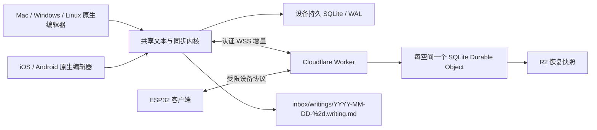

# Sumi：全平台沉浸式写作与同步设计

日期：2026-11-07；实施核对：2026-11-08。状态：macOS首版与呼吸修复版已公开，版本范围见§12；四秒光标、按需字体和独立插件后台等后续改动仍须按各轮冻结源码、安装包与验收证据确认交付。本文是最终需求与设计基线，不以需求条目代替实现、实机验收或冻结发布证据；后续平台尚未交付。

配套实施计划：[macOS 首版计划](../plans/2026-11-07-immersive-write-macos.md)；本轮职责与交付边界补充见[插件资源与Sumi后台迁移](2026-11-08-plugin-payload-extraction.md)。用户已确认产品名为 **Sumi**，用于 note.md 插件与独立客户端。技术组件名及 `.writing.md` / `.writing.meta.json` 文件约定保持不变。

## 0. 最终决定总览与解释顺序

本节汇总用户最后确认的方案；后续章节给出契约与验收。具体快捷键、默认尺寸、时间周期及性能阈值等未由用户逐项指定的数值，是实现团队为使需求可测试而明确的工程细则，不冒充用户逐项选定。需求更新以用户最后一条明确选择为准，已取消的研究候选不再作为并行实现或额外菜单项。`已确认`表示需求决定，不表示功能已发布。

| 用户要求/议题 | 最终方案 | 细则 |
|---|---|---|
| 产品名称与目标 | **Sumi**，轻量沉浸写作，一页纸/下一页纸；自动保存，无文件夹、文件名、创建时间的日常UI概念 | §1–2 |
| 桌面与移动 | macOS/Windows/Linux 为 note.md 插件；iOS/Android/ESP32 为独立客户端；首版先交付macOS | §4、§6.4、§9 |
| 本地化名称 | 英文 Sumi Typewriter、简体中文「玄霜打字机」、日文「すみ」；展示名随宿主语言切换，品牌ID/文件格式/字体alias不改 | §2.2、§2.3 |
| 原生编辑桥 | `tauri-plugin-native-editor`；不采用Mac/Win统一Qt或整桌面统一Qt；Delphi类方案属于讨论候选，未选为实现框架 | §4、§8 |
| Linux与ESP32 | Omarchy/Hyprland原生Wayland优先，借鉴Omawrite；ESP32以Draftor编辑/输入/绘制链路为参考 | §4.1、§6.4 |
| 原生相对Web性能 | 同机同字体同内容实测，不能用框架名称推断提升倍数 | §4；配套计划§7 |
| 存储路径 | `inbox/writings/YYYY-MM-DD-%2d.writing.md`；%2d按两位补零序号实现，UUID作稳定身份 | §5、§7 |
| Markdown与隐藏元数据 | 小YAML头+Markdown正文，同目录 `.writing.meta.json` 保存行时间快照；不把时间插入每个Markdown行，不追加HTML meta行表 | §5.2 |
| 每行时间 | 明确LF逻辑行的首次书写/最后修改时间；屏幕折行不产生新行记录；首版不提供逐键回放 | §5.3 |
| 同步 | 独立CF服务、纸页CRUD/列表、实时增量；同页并发及离线重连自动合并首版必须有 | §6 |
| 原生专用Tab | note.md识别Writing Page，独立原生rich Tab可直接阅读续写；与专注窗口共享session并交接owner | §7–8 |
| 窗口/排版 | 独立窗口固定规格或全屏，可自由进入/退出；整体字号/行距/约80半角列可调 | §2.2 |
| 主题 | 黑底白字、黑底灰字、白底黑字、米色深灰，正文/光标/留白统一 | §2.2 |
| 最终字体 | 依次Plex组合、文楷Mono Lite、朝华打字机、油茶馓子体、独立朱雀仿宋、复古绿磷 CRT；仅这六项，点击后后台下载，不随宿主/插件打包大字库 | §2.2 |
| 输入线 | 稍粗竖线、高度随字体；默认4秒稳定平缓呼吸，可选不闪烁常亮；普通输入/中文组字都不消失、不出现额外系统细线 | §2.2、§2.5 |
| 输入法与底部 | 底部避让与配色协同；系统IME能力如实适配，定制输入法作为独立后续项目 | §2.3 |
| 快捷键与剪贴板 | 常用编辑键完整可达且不被宿主抢占；复制/剪切为Markdown纯文本，所有粘贴转文本/Markdown | §2.4、§3.1 |
| 自主开发与交付 | 持续对照spec开发、测试、验收，最后发布宿主与插件；不把本地构建说成正式发布 | §11 |

明确退役：早期 `inbox/write`、`inbox/writes`、`.write.md` 路径；逐行内嵌时间和尾部HTML/YAML行表；统一Qt桌面路线；旧Courier Prime组合；Special Elite+又又意宋；光标横线方案。A2 Typewriter、LTR NCND Variable及其他字体仅是研究候选，未进入最终包。朱雀仿宋按最新要求重新加入第五项，但不恢复其旧Courier英文搭配。

## 1. 需求与成功标准

产品是一个轻量、专注于文字的个人写作空间。用户打开后面对一页纸，继续写，写完翻到下一页；不需要先起名、选目录、保存或理解创建时间。

- macOS / Windows / Linux：note.md 插件入口与专用文档视图，编辑区使用本机原生富文本控件。
- Linux 的首要目标环境为用户指定的 Omarchy（Hyprland / Wayland）；以其官方写作应用 Omawrite 的 Qt 技术路线为首选原型参考。
- iOS / Android：独立原生应用，不依赖桌面 note.md 或完整 Vault。
- ESP32：独立设备客户端；板型、内存、屏幕及输入硬件尚未指定，需单独验证能力边界。
- 独立同步服务只同步这个产品的纸页与必要元数据，不上传整个 Vault；显示偏好首版保存在本机，见§5.1。
- 页面可以列举、新建、修改、删除；用户看到“纸页”，底层以 Markdown 文件保存。桌面默认落在 `inbox/writings/YYYY-MM-DD-%2d.writing.md`。
- 富文本编辑不显示 YAML、行 ID 或同步信息；普通源码模式仍能读取完整 Markdown。
- 主题、统一字体、整体字号、行距、正文宽度可调；沉浸窗口只提供全屏与固定尺寸两种形态。
- **用户已确认**：每个明确换行划分的逻辑行记录首次书写与最后修改时间；首版不做逐笔回放。
- **用户已确认**：首版支持同一页跨设备同时编辑、离线后重连自动合并。不能用整篇最后写入覆盖，也不能把单写者锁当作完成此需求。

首版是 macOS 客户端 + 最小生产同步服务 + note.md 原生宿主接入。两台 Mac/两个隔离客户端可验收同步；移动端尚未实现时不得声称“全平台已交付”。

## 2. 用户体验

### 2.1 一页纸

启动恢复上次纸页、光标和阅读位置；首次启动提供空白页，第一次有效输入时持久化。关闭空白页不累积无意义文件。新建动作必须有幂等 ID，防止重试重复生成页面。

编辑主界面只有正文、光标和留白。无常驻文件树、格式工具栏、时间、路径或保存按钮。按需唤出的底部轻量操作提供：上一页、下一页、新的一页、纸页概览、外观、移到废纸篓。错误与离线状态可发现，不能为了沉浸隐藏未保存风险。

纸页概览按用户纸页顺序展示首行摘要和短预览，不显示文件名或创建日期。每页身份是随机 UUID；摘要随正文变化，不需要“重命名文件”。列表分页加载。首版无文件夹、标签体系、拖拽排序与团队协作；新页插在当前页之后，并发新页采用可收敛的顺序键与 UUID 打破平局。

“下一页”不因视觉上写满而自动分页；纸页可以长篇滚动。下一页存在则导航，不存在则提供空白页。用户主动创建才产生新的容器。

### 2.2 排版与窗口

建议默认：22 pt、行距 1.6、左对齐、正文最大宽约 80 个半角列（约 40 个中文全角字）。以实际字体度量约束视觉宽度，窄屏取可用宽度；软折行不插入 Markdown 换行、不产生时间记录。80 不是所有写作软件的强制标准；W3C 的阅读排版指导使用 80 字符／40 CJK，可作默认参考。[W3C](https://www.w3.org/WAI/WCAG22/Understanding/visual-presentation.html)

字号与四周留白同步协调：22pt时左右最小各24pt、上下各32pt，随整体字号/22线性缩放；小字号下限为左右16pt、上下20pt，分别不超过视口宽/高的四分之一。正文仍按实际字体的列数上限居中，额外横向空白可以大于最小留白。底部输入区预留是独立的绝对逻辑点数，不随字号缩放，不覆盖上下留白。改变字号只影响显示，不改正文、选区、revision或行时间；窄矮窗口保留可用正文宽度，超出视口的内容沿原生滚动阅读。

预设主题：黑底白字、黑底灰字、白底黑字、米色深灰（背景 `#f3ead7`、正文 `#44413c`）；整个编辑区、光标、选区、留白同主题。新增「复古绿磷 CRT」主题：黑底 `#000000`、绿字 `#0ccc68`，取自[冻结 Monochrome Green 配置](https://github.com/Swordfish90/cool-retro-term/blob/74ae511f923a7c42274086f9b9959e2292d74ddc/app/qml/ApplicationSettings.qml)；新增「复古蓝磷 CRT」（`crt-blue`）：黑底 `#000000`、正文/光标 `#7fb4ff`，取自 cool-retro-term [Deep Blue 冻结配置](https://github.com/Swordfish90/cool-retro-term/blob/1394ce82fa53d2a87d5adc4d99f9eeba598ea53d/app/qml/ApplicationSettings.qml#L436-L446)，不将其称为行业统一标准。沿用原生选区前景色及22%透明同色背景。字体仍是原有六项，不添加字库或触发下载；字体与主题分别选择，不连带改变字号。字号与行距只属于显示偏好，不写成正文行内样式。用户于 2026-11-08 最终确认六项字体，外观面板按顺序列出以下可点击选项及下载状态：

1. `Sumi Plex`：英文 IBM Plex Mono Light + 中文 IBM Plex Sans SC Light，必须使用实际 Light 字面。
2. `Sumi WenKai`：LXGW WenKai Mono Lite Regular，中英文同字族；Lite 指精简字符集，不是 Light 字重。
3. `Sumi Zhaohua`：朝华打字机，中英文同字族，精确字面 `ZhaohuaTypeWriter-Light`。
4. `Sumi Youcha`：油茶馓子体，中英文同字族，精确字面 `YouchaSanz-Light`。
5. `Sumi Fangsong`：Zhuque Fangsong / 朱雀仿宋 v0.212，中英文都使用自身字形，不混配其他英文。
6. **复古绿磷 CRT**：GNU Unifont 18.0.01 单字体承担中英文（alias `Sumi CRT`），约5.3MB，首次点击才下载。绿色配色参考 cool-retro-term 的 Monochrome Green；不声称 GNU Unifont 是该项目的内置或默认字体。用户要求比较单字体后，Terminus 因不含常用中文被排除。

宿主和插件均不内置上述七个大字体文件；固定下载目录与许可/来源说明由Sumi插件交付，宿主只保留原生应用所需的小型字体身份契约。用户明确选择轻量宿主：字体列表、打开设置、打开纸页及默认选择都不得隐式下载；点击字体项才启动后台下载。选项显示大小、未下载/下载进度/已下载/失败重试状态；下载、校验与应用私有缓存由Sumi独立后台负责，宿主负责CoreText进程内注册及安全应用；关闭设置、切换纸页或隐藏插件窗口仍继续，正文可以使用原字体继续编辑。下载完成且完整性校验通过后应用；同项并发请求去重，多次选择只有最后一次选择有权切换，先前任务可完成缓存。只更新字体偏好，保留同期字号/主题等改动，不改变正文、选区、行时间或revision；IME组字期间推迟原生样式切换到组字结束。

初次离线使用系统等宽字体及系统中文回退，明确显示所选专用字体尚未下载，不阻塞纸页、不冒充所选字形。已验证缓存可离线使用；旧设置的五组选择保留，新增CRT独立可选，缺缓存不自动联网。缓存位于应用私有数据目录，独立于Vault，不安装到系统Fonts。来源仅使用冻结目录中的HTTPS地址，严格校验大小、SHA-256和实际字体身份；ZIP同时校验归档和目标字体。部分下载/损坏文件不成为可用字体，失败保留旧字体并可重新点击重试；退出应用中止的未完成任务下次由用户重试，不声称跨进程续传。

用户已删除 Special Elite + 又又意宋组合；旧 Courier Prime、思源宋体及退出选项的许可/来源文件不恢复。旧 `Sumi Typewriter`、`Sumi Elite`、思源宋体或其他不再提供的设置只将字体字段迁移为第一组 `Sumi Plex`，保留其他外观与正文；新用户默认第一组但不自动下载。中文罕见缺字由系统回退，正常样本不能以系统字形冒充选中字体。macOS仅进程内注册，CoreText实际run与字重必须验证。全部资源冻结版本、来源、大小、SHA-256，唯一资源清单见[字体manifest](../../../src-tauri/resources/sumi/manifest.json)，校验与开发资源准备入口为[prepare-sumi-font.py](../../../scripts/prepare-sumi-font.py)；朝华/油茶保留原作者许可快照，不能标成OFL。正式包验收同时报告宿主、插件、下载缓存的体积，断言无大字库打包；开发目录存在字体不等于应分发到宿主。

用户最终选择竖直输入光标，取消横线方案。以主题色的稍粗竖线替换系统默认细线，高度跟随当前整体字体的 ascender/descender 度量，不扩展至行距；宽度约2–3pt，只小幅随字号改变。默认 `caretMotion: breathing`，4秒一轮平滑明暗变化（2秒渐暗、2秒渐亮），最低仍保持可见，不采用突然开关的闪烁；连续输入不重启周期，以维持稳定节奏。外观设置可选 `steady`（不闪烁/常亮），立即停止动画并保持完全可见；以 Sumi 的明确选项为准，不因系统“减少动态效果”静默覆盖用户选择，也不修改系统偏好。旧设置缺失该字段按breathing补默认，保留其他偏好。仅更新可见插入点，不能全篇重排或改写正文。普通输入、中文markedText多次更新与提交全程只显示自定义加粗竖线，系统原细线保持隐藏；候选定位沿用系统公开接口，不干扰组字。常亮模式不得因输入事务中的临时选区或布局状态而消失；失焦、非输入事务中的普通范围选区或隐藏时不显示自定义光标，停止后台动画。实现只用公开AppKit/TextKit API，默认系统竖线须以真实绘制阳性对照核抑制，不仅测试API返回值。

无法加载的设备明确字体回退；ESP32 子集字库不能宣称覆盖完整桌面字库。

专注窗口默认固定逻辑尺寸 960×720，可在设置选择少量固定规格；小屏限制在可用工作区。全屏切换保留光标与滚动位置，保留标准退出方式。普通 note.md tab 随宿主布局变化是兼容阅读入口；“只全屏/固定尺寸”约束独立专注窗口，不强迫整个 note.md 主窗口固定尺寸。

下方设置键盘/候选区避让空间。移动端跟随系统键盘实际 inset；硬件键盘连接后收回空白。桌面可配置底部保留高度，为以后自制输入法留位置。光标保持在可用编辑区内，不被预留区挡住。

### 2.3 输入法边界

首版保证原生 IME 正常组合、选词、撤销与候选定位。应用自身不能统一强制系统输入法的候选面板固定在底部，也不能任意改变其配色。候选框定位提示不是对所有输入法的强制设置；不通过伪造光标位置实现固定候选条，以免破坏辅助功能与系统文本服务。

用户显式打开设置、纸页列表或其他 Sumi 面板时，先完成受控的编辑面交接：把当前可见组字内容按冻结基线提交为一次本地编辑，成功后才解除 composition、清除输入法预编辑状态并隐藏原生正文。若本地提交失败，保留文字、组字选区和可见编辑器，提示重试，不丢弃输入或直接暴露 `composition active`。AppKit 嵌套的 unmark/insert 回调只在最外层完成组字收束；已无 marked text 的残留组字状态也能恢复。此显式交接不改变后台隐藏、远端更新和切换操作原有的 composition 防护，不允许后台操作擅自提交组字。

macOS公开接口进一步界定（2026-11-08）：编辑器的 [NSTextInputClient.firstRect](https://developer.apple.com/documentation/appkit/nstextinputclient/firstrect(forcharacterrange:actualrange:)) 用于返回真实文字/插入点屏幕矩形，并不是候选框底部停靠开关。系统中文输入法允许横/竖候选布局及跟随系统高亮颜色（[Apple指南](https://support.apple.com/guide/chinese-input-method/cim12992/mac)），但没有供Sumi指定任意专用皮肤、强制固定底部的通用公开契约。自行开发的输入法可用 [IMKCandidates.setCandidateFrameTopLeft](https://developer.apple.com/documentation/inputmethodkit/imkcandidates/setcandidateframetopleft(_:)) 和 [setAttributes](https://developer.apple.com/documentation/inputmethodkit/imkcandidates/setattributes(_:)) 控制自己拥有的候选面板位置与外观，不能据此操控系统拼音。鼠须管有[官方配色/字体配置](https://github.com/rime/squirrel/blob/master/data/squirrel.yaml)，可作为改造基础，但不把memorize_size减少跳动说成已支持固定底部。本次仅核实接口与规划，不改候选定位、系统设置或安装输入法。

用户于2026-11-08明确决定自己改造输入法，解决固定底部输入位置；输入法负责候选栏位置和皮肤，Sumi保留真实文本几何，后续按双方约定提供窗口几何与主题参数。具体输入法工程及对接协议尚未确定，不能将此决定写成接口已实现或输入法已交付。

定制输入法是独立子项目：由输入法自己实现底部布局与主题协议；编辑器传输的仅是经授权的主题/几何参数，不传不必要的全文。iOS 的键盘外观提示、Android 的系统 IME、macOS/Windows/Linux 输入框架分别适配，不承诺跨系统同一开关。此项目首版不包含输入法开发。

官方接口依据：iOS [keyboardAppearance](https://developer.apple.com/documentation/uikit/uikeyboardappearance) 只提供有限外观提示，[keyboardLayoutGuide](https://developer.apple.com/documentation/uikit/uiview/keyboardlayoutguide) 跟踪占位；Android [InputMethodService](https://developer.android.com/reference/android/inputmethodservice/InputMethodService) 的主题属于输入法服务。Windows [ImmSetCandidateWindow](https://learn.microsoft.com/en-us/windows/win32/api/imm/nf-imm-immsetcandidatewindow) 需逐输入法验证；Linux [Fcitx 主题文档](https://fcitx-im.org/wiki/Theme_Customization) 区分 X11/Wayland 渲染路径。

### 2.4 macOS 常用编辑快捷键契约

下面是“全面支持常用编辑快捷键”的首版验收范围与默认绑定。它们是目标契约，不能因AppKit理论上继承某selector就标记实机通过。菜单、键盘与右键必须走同一命令语义；原生正文聚焦时以其page/owner为目标，设置输入框则保留普通系统编辑行为。主窗口、其他Tab与另一篇稿件不得被Sumi快捷键误操作。修饰键按完整集合匹配，不把额外Ctrl/Option/Shift组合吞成另一动作。

| 操作 | macOS默认键位 | 行为 |
|---|---|---|
| 全选、复制、剪切、粘贴 | ⌘A / ⌘C / ⌘X / ⌘V | 全选仅正文；剪贴板遵循§3.1，剪切先确认复制成功 |
| 纯文本粘贴入口 | ⌘⇧V、⌘⌥⇧V | 共用文本化清洗，但按字面插入、不解释Markdown语法；不引入外来样式 |
| 撤销、重做 | ⌘Z / ⌘⇧Z | 本机文档事务，保留远端后来输入，避免两套undo栈 |
| 字符/词/行/文档移动 | 方向键、⌥左右、⌘左右、⌘上下；Home/End/PageUp/PageDown按Mac习惯 | UTF-16/字素安全；保持原生视觉行导航 |
| 扩展选择 | 上述移动加⇧ | 不切开代理对/组合字素；支持跨行和全文选择 |
| 删除 | Backspace、Fn+Delete、⌥Backspace/⌥Delete、⌘Backspace | 字符/词/至行首等系统语义，统一转成文档事务 |
| 原生文本服务键 | Ctrl-A/E/B/F/P/N/H/D/K/Y/T 等AppKit常用绑定 | 保持系统移动/删除/转置语义，修改内容仍经过内核；不侵占输入法切换或emoji快捷键 |
| 换行与缩进 | Return、⇧Return、Tab / ⇧Tab、⌘] / ⌘[ | Return为普通LF；⇧Return为Markdown显式换行；Tab/⌘]缩进当前或所选段落两空格，反向键退一级；均可撤销，普通正文不跳出编辑器 |
| 粗体、斜体、删除线 | ⌘B / ⌘I / ⌘⇧X | 有选区时切换对应Markdown格式；空选区切换后续输入样式，重复按关闭，规则见下文 |
| 标题/正文 | ⌘⌥1…6 / ⌘⌥0 | 当前段落或所选段落的Markdown标题级别/正文 |
| 引用、无序/有序列表 | ⌘⇧9 / ⌘⇧8 / ⌘⇧7 | 当前/所选逻辑段落，保持选区与撤销 |
| 链接 | ⌘K | 正文内编辑Markdown链接；其他宿主界面保留原功能 |
| 查找/下一/上一/替换 | ⌘F / ⌘G / ⌘⇧G / ⌘⌥F | 仅当前纸页；替换走同一文档事务，不绕过source map与行时间 |
| 新页、纸页列表、前/后页 | ⌘N / ⌘O / ⌘⌥← / ⌘⌥→ | 本产品纸页操作，不新建普通Vault文件或打开别的宿主文档 |
| 立即保存、导出快照 | ⌘S / ⌘⇧S | 自动保存之外的flush/当前纸页导出；失败可见，不隐式另存新身份 |
| 字号 | ⌘+或⌘=、⌘-、⌘0 | 当前Sumi整体字号增减/默认字号，不缩放宿主Web界面 |
| 外观设置、关闭、全屏 | ⌘, / ⌘W / ⌘Enter（保留 ⌃⌘F） | 写作设置；关闭当前Sumi窗口/Tab且flush；全屏往返 |
| Esc | 按上下文 | 先由IME处理组字取消，再关闭当前弹层，否则打开Sumi按需菜单 |

空选区输入样式是当前编辑面的临时状态：初次切换参考插入位置已有样式，粗体/斜体/删除线可组合；仅切换不改正文、revision或行时间。实际键入、IME确认及可兼容的粘贴在同一次内核事务中生成合法Markdown，不能先插文字再追加独立格式事务。关闭某样式时正确拆分已有格式范围，不改变后续未编辑原文；一次撤销撤销该次内容提交。显式移动光标、普通范围选择、切页/owner交接或Undo/Redo清除此临时状态；IME内部临时选区不清。提交含LF时，第一个LF之前沿用临时样式，从LF起清除；普通空白保持原字面并保留待输入样式，不强造无效强调标记。Markdown边界无法合法表达时优先保全原文；多行/未知块粘贴保留自身语法，不强行包装破坏结构。

Return写入普通LF，首版不新增自动列表续写；⇧Return写入两个尾部空格加LF的Markdown显式换行，均为单一可撤销事务。Tab/⌘]对当前或所选逻辑段落增加一级两空格缩进；⇧Tab/⌘[反向移除，前缀不足一级只去掉已有缩进，无缩进时不改内容。普通段落保持可见空格、不因重复缩进意外变成不可编辑代码块；列表保持合法Markdown层级，选区通过锚点跟随。不支持的原文块保留源码，不强制重排。

不支持的RTF属性操作（任意字体面板、粘贴外来样式、与Markdown无关的对齐等）不得绕过规范模型直接修改attributed text。⌘U不能被偷换成删除线。Windows/Linux后续按本平台习惯映射Ctrl/原生文本服务键，并避开Omarchy/Fcitx全局绑定；不假设Mac键位可原样搬移。

### 2.5 光标动态验收

- 普通输入、删除、替换、撤销、远端投影、字号/字体变化和滚动时，光标只跟随位置/几何变化；不出现双光标或默认细线。
- 常亮模式须检查输入事务的中间状态与连续帧，不能只验证最终静止帧；文本更新造成的临时selection/layout不应让光标闪失。
- 中文IME要覆盖多次markedText、非零子句选区、替换已有选区、跨行组字及commit；全程同款自定义竖线，候选框位置与系统文本服务保持正确。
- 呼吸周期默认4秒（用户最终选择的产品视觉节奏，不是健康测量或生理同步），最低透明度约0.25，明暗平滑往返、输入不重启相位。常亮立即停止动画、opacity=1；由 Sumi 的光标选项直接决定，不被系统“减少动态效果”覆盖。
- 只有真正失焦、隐藏、非输入事务中的普通范围选区、插入点离开可视区等情形才不显示。恢复聚焦/可见布局时正确恢复，后台不运行无意义动画。
- 使用公开API；同时保留“系统默认细线确实出现”的阳性对照与“自定义线存在且系统线不可见”的真实绘制证据。离屏测试、物理IME、安装包实机分别标记，不互相冒充。

## 3. 原生 rich 与 Markdown 的边界

`rich` 指原生控件中的可编辑样式，不等于支持 RTF 的所有能力。首版支持段落、明确换行、标题、粗体、斜体、删除线、引用、简单列表与链接。格式操作由快捷键和按需菜单触发；不添加常驻工具栏。标题可用同字体家族的有限层级样式，整体字号按比例调整。

表格、图片附件、公式、嵌入 HTML、图表和复杂嵌套结构不纳入首版富文本编辑。遇到未支持语法，保留原文片段，可只读呈现或切到 Source；不能导入后静默丢失。所有粘贴按§3.1转成纯文本或Markdown，不导入外来字体、字号、颜色或RTF排版；不支持的结构保留其文本/源码，不静默丢失。

权威文本为 LF 换行的 Markdown body，映射到原生 attributed text；RTF/HTML 只可作为剪贴板输入格式，不能成为权威存储。采用保留源码范围的解析与最小替换，不能每次击键“全文 HTML → Markdown”。格式操作同样生成局部源码事务；触及不支持的范围时拒绝该格式操作并保留原文。

建立 source map：Markdown 范围 ↔ 原生可见文本范围，专门处理隐藏语法、转义、列表前缀、软换行、emoji、组合字符。协议指定 UTF-16 偏移边界，Rust 显式转换，不以 UTF-8 字节冒充；可编辑边界不得切开代理对或用户可见字素。无编辑的导入导出保留原始正文；首次外部导入的 CRLF 正规化必须明确记录。

source map 绑定文档 revision。捕获原生编辑时即在同一串行 session 内转换成 CRDT 相对锚点/事务；不能把旧 UI 的绝对 offset 套到已接收远端更新的新正文。Yrs 显式配置 UTF-16 offset，与 Y.Text 对齐；锁定版本后跑跨语言样本。[Y.Text](https://docs.yjs.dev/api/shared-types/y.text)；[Yrs OffsetKind](https://docs.rs/yrs/latest/yrs/doc/enum.OffsetKind.html)

并发编辑 Markdown 语法可能收敛为用户不期望的格式。CRDT 保证操作合并和文本一致，不能保证所有并发格式操作符合意图；语法暂时无效时保留全部文字，局部显示为原文，不自动格式化修复或丢字。

### 3.1 剪贴板：Markdown复制与文本化粘贴

**复制/剪切输出**：从当前revision/source map把原生选区导出为对应Markdown文本，写入通用纯文本剪贴板类型；不写富文本样式、内部YAML、page UUID、行时间或同步元数据。加粗/斜体/链接/列表等受支持格式应保留其Markdown语义，不能只复制去掉格式的屏幕字符；部分语义选区应导出有效且不夹带未选正文的片段。完整正文全选复制保留Markdown body原文；部分引用式链接选区携带所需定义，不夹带无关正文。多段选择按文档顺序合并且不重复文字。未知原文片段可按原始Markdown复制。复制是只读动作，不改正文或行时间。

剪切只有在目标剪贴板成功写入后才删除所选正文；失败保留选区/正文。删除走同一本机可撤销事务，不直接改attributed text绕过CRDT。复制/剪切与源码模式、其他普通输入框区分：Source可复制用户显式选中的原始文件内容；隐藏元数据保护针对Sumi正文。

**粘贴输入**：优先使用明确Markdown或纯文本表示；内容同时提供纯文本与HTML/RTF时优先文本，避免把来源应用排版带入。文本中的合法Markdown作为Markdown源插入，不能再次转义为可见星号而破坏自身复制/粘贴往返。纯文本中的特殊字符、空行、制表符和换行不得无故吞掉，换行统一为LF。

仅有HTML时提取纯文本，保留可读的段落、列表、表格单元分隔、预格式文本与图像替代文字；仅有RTF时提取文本，移除字体、大小、颜色、附件和布局属性。网页/富文本中的脚本不得执行，转换不请求远端图片/资源。文件/URL按可阅读的路径、链接或名称文本粘贴，不导入为附件；表格可降为制表符/分行文本。仅图像或无法提取文本的类型不得伪造识别结果，应明确说明或插入可理解的文字占位，保留原剪贴板内容可恢复；首版不隐式做OCR或上传文件。

粘贴只新增本次写入内容和时间，不继承剪贴板里的内部page/行身份。一次粘贴形成可撤销的本地事务，与输入法/远端更新保持同一选区锚点语义。键盘与菜单的普通粘贴语义相同；显式“粘贴为纯文本”共用输入类型清洗，但按字面插入并由内核保留字面字符，不解释其中Markdown标记。普通粘贴的HTML/RTF文本化结果也可按Markdown插入；需要保留星号等字面字符时使用显式纯文本粘贴。不提供绕过清洗的“原样富文本插入”。转换失败或超限须保留原文/原剪贴板并可重试，不把失败报告为已粘贴。

验收必须包含：粗斜体/链接部分选区、跨段/多段选择、空行、emoji/组合音符、围栏与未知语法、Markdown往返、HTML-only、RTF-only、浏览器复制、表格TSV、文件URL、图像only、剪贴板写入失败后的cut、粘贴后undo/redo及并发远端输入。测试使用隔离/私有pasteboard与合成文本，不清空用户系统剪贴板或真实稿件。

## 4. 平台选型与性能判断

系统自带控件没有可比的 GitHub stars；开源项目热度也不等于适用性。候选须同时核实是否原生、维护状态、授权与 Markdown 往返能力。精确版本与许可证在实施锁定依赖时再次核验。

| 平台 | 系统/框架控件与热门候选 | 本项目建议 |
|---|---|---|
| macOS | NSTextView + TextKit 2；[STTextView](https://github.com/krzyzanowskim/STTextView) 约 1.6k stars；[RichTextKit](https://github.com/danielsaidi/RichTextKit) 约 1.3k | 首版直接 NSTextView，薄 AppKit 适配。STTextView 当前要求 macOS 14+、GPLv3/商业双许可，作性能备选；RichTextKit 是系统控件包装，作者已提示未来维护方向不确定 |
| iOS | [UITextView](https://developer.apple.com/documentation/uikit/uitextview) + TextKit 2；[Proton](https://github.com/rajdeep/proton) 约 1.4k；RichTextKit | UITextView；复用文本/同步内核，单独实现键盘与选区 UI。Proton 的 Catalyst 支持不等于 AppKit 编辑器 |
| Windows | [Win32 Rich Edit](https://learn.microsoft.com/en-us/windows/win32/controls/about-rich-edit-controls)；[WinUI RichEditBox](https://learn.microsoft.com/en-us/windows/apps/develop/ui/controls/rich-edit-box) | Tauri 内嵌优先验证原生 Rich Edit HWND；WinUI 控件需额外宿主集成，不能假定可直接嵌入 |
| Linux / Omarchy | 官方写作应用 [Omawrite](https://github.com/omacom/omawrite) 的 Qt Quick + C++ 路线；[Qt Quick TextEdit](https://doc.qt.io/qt-6/qml-qtquick-textedit.html) / QTextDocument；[QTextEdit](https://doc.qt.io/qt-6/qtextedit.html) | 优先验证 Qt 6 富文本适配，借鉴 Omawrite 主题/字体/布局。它自身是 PlainText + MarkdownHighlighter，不是可直接复用的完整 rich 控件；GTK3 TextView 仅作宿主兼容备选 |
| Android | EditText/Spannable；[AztecEditor-Android](https://github.com/wordpress-mobile/AztecEditor-Android) 728；[Compose Rich Editor](https://github.com/MohamedRejeb/Compose-Rich-Editor) 约 1.9k | 简单写作优先 EditText + spans 薄层；Aztec 是 EditText 扩展、HTML 导向、MPL-2.0。Compose 是无 WebView 的另一套文本框架，需单独评估 |
| ESP32 | 用户指定参考 [Draftor](https://github.com/Ohhellboy/Draftor)：自研 C++ Document / BodyEditor / LayoutEngine、bgIME 与直接屏幕绘制 | 优先评估复用其编辑内核、中文输入和局部重排/刷新设计；不再默认选 LVGL Text Area。现有模型是纯文本，需要新增 Markdown 样式映射、行时间与同步适配 |

以上热度为本次检索页面的近似快照，不作“绝对最热门”排名。[wasabeef RichEditor](https://github.com/wasabeef/richeditor-android) 虽约 6.3k stars，其实现基于 WebView，因此不列入系统原生方案。Linux 没有适用于所有发行版/桌面的单一系统 rich 控件，GTK/Qt 是主流原生工具包选择。

Apple 官方文档建议采用现代 TextKit 布局路径；误用旧 `layoutManager` 可能切换回 TextKit 1。因此“用了 NSTextView”不足以证明实际启用 TextKit 2。[TextKit](https://developer.apple.com/documentation/AppKit/textkit)；[WWDC TextKit 兼容模式](https://developer.apple.com/videos/play/wwdc2022/10090/)

当前 note.md 是 Tauri + 系统 WebView + ProseMirror/@moraya/core，并非必然携带一份 Electron Chromium。原生的预期收益是缩短输入/组合/排版路径、减少 DOM 和跨进程同步压力，以及更直接的系统文本服务。宿主 WebView 仍存在，不能承诺插件令整个应用内存锐减。

原生也会因全篇 attributed string 替换、全文 Markdown 解析、主线程 SQLite、错误撤销绑定而卡顿。**不承诺几倍性能提升**。必须在同机器、同字体、同内容、同输入法下比较当前 Rich、简化 Web 基线与原生原型；实测不达标先定位瓶颈，再决定是否引入 STTextView 等替代控件。

### 4.1 Omarchy 原生编辑路线

用户偏好的 Omarchy 为 Linux 主验收环境。其[官方 GUI 手册](https://omarchy.org/manual/guis/#omawrite)列出自家写作应用 Omawrite；[Omawrite README](https://github.com/omacom/omawrite)说明从 Quattro 新装版本开始默认提供，依赖 Qt 6 / Qt Quick。不能据此假定用户当前版本已预装，也不能声称 Omarchy 官方为第三方应用指定了某个 rich SDK。这里的 Qt 选型是本项目结合官方应用与生态作出的工程推荐。

固定源码 `c1ea454e70fb01935623b151668a8f3dc3f2d7ba` 中，[Main.qml](https://github.com/omacom/omawrite/blob/c1ea454e70fb01935623b151668a8f3dc3f2d7ba/src/Main.qml#L633) 使用 `TextEdit.PlainText`，[backend.cpp](https://github.com/omacom/omawrite/blob/c1ea454e70fb01935623b151668a8f3dc3f2d7ba/src/backend.cpp#L268) 接入 QTextDocument 与 MarkdownHighlighter；[高亮器](https://github.com/omacom/omawrite/blob/c1ea454e70fb01935623b151668a8f3dc3f2d7ba/src/markdownhighlighter.cpp#L125)以字号/字距/颜色弱化语法标记。借鉴它的原生输入与沉浸布局，不把此源码高亮机制直接称为本项目的 rich 实现。

本项目首选原型为 Qt 6 `QTextDocument + Qt Quick TextEdit` 的富文本显示/编辑适配；若操作 API 或 IME 实测证明 Qt Widgets 更合适，再收敛为 `QTextEdit`，不同时维护两套正文 UI。Markdown 仍由共享内核与 source map 负责无损往返；不直接以 Qt 导出整篇覆盖权威文本。Omarchy 的[基础包清单](https://github.com/omacom/omarchy/blob/quattro/install/omarchy-base.packages)提供 Qt/Wayland、Fcitx5 与 CJK 字体基础，但分发包仍须声明实际运行依赖。

宿主集成是前置风险：本仓 `src-tauri/Cargo.lock` 锁定 `gtk 0.18.2`（GTK3）与 WebKitGTK；Qt 的 QQuickWidget 是 QWidget 容器，并不是 GTK 容器。先做独立专注窗口只是 PoC 的一部分，**Qt/GTK3 在 Wayland 下 tab 内挂载、事件循环、焦点/输入法、缩放、菜单遮挡、辅助功能与销毁必须全部实测**。不假设能把外部窗口 reparent 进 tab；不以外部窗口或 Web 预览替代原生 tab 验收。桥接不可行时重新评审 [GTK3 TextView](https://docs.gtk.org/gtk3/text-widget-overview.html) 或宿主结构，并明确方案变化，不能悄悄退回通用 GTK 优先或扩大成整宿主重写。[QQuickWidget 边界](https://doc.qt.io/qt-6/qquickwidget.html)

Omarchy 专项验收：

- 主路径是 Hyprland 原生 Wayland；XWayland 结果单列，不能冒充 Wayland 已通过。
- 沿用系统实际 Fcitx5 配置，测试拼音/注音及已安装的 Rime、候选位置、组合中远端更新、剪贴板与撤销；不为应用全局覆写 `GTK_IM_MODULE` / `QT_IM_MODULE`。按已锁定 Qt/Fcitx/合成器版本验证所用输入协议。[Fcitx Wayland 指南](https://fcitx-im.org/wiki/Using_Fcitx_5_on_Wayland)
- 默认快捷键避开系统已占用绑定；特别核对 Omarchy 的输入法切换与 Super 组合键，不盲目复制 macOS 快捷键。[Omarchy 输入设置](https://omarchy.org/manual/keyboard-mouse-trackpad/#typing-in-chinese-japanese-and-other-languages)
- 固定尺寸窗口需验证平铺环境的浮动/尺寸协商；分数缩放、多显示器、全屏切换与系统深浅主题实测。主题可跟随系统，用户显式选黑白/黑灰主题时不被系统更新覆盖。
- 安装包采用 Arch 对应 CPU 架构的 `.pkg.tar.zst`，验证依赖与实际启动；不能用 `.deb` 或另一架构包证明 Omarchy 可安装。

### 4.2 性能目标与证据范围

在同机器、同字体/字号、同语料及同输入法下，对比现有Rich、简化Web基线与原生实现；1万/10万字符为正常门槛，100万字符用于压力边界。至少5次独立重复，发布构建与debug数据分列；测主线程/内存/CPU/能耗，不只测文本控件局部。Qt与平台控件的差异同样须实测，不给未测量的“差百分之几”。

| 指标 | 首版目标（不是已通过结果） |
|---|---|
| 已提交输入到实际呈现帧 | 60Hz机器p95≤50ms；与IME用户选词等待分开 |
| 稳态编辑主线程 | 无可重复的>100ms停顿 |
| 远端提交到可见 | 声明RTT≤100ms网络下p95≤300ms |
| 正常文档投影 | 输入停止后通常≤1秒；失败与关闭flush可观察 |
| 10万字符热打开 | 目标≤500ms可输入；冷启动另测 |
| 正确性 | 无丢字、无组字破坏、无隐藏元数据泄露到正文/普通复制 |

具体脚本、设备信息、语料与方法见实施计划§7；物理输入到呈现帧必须有事件与显示证据，dispatch/rAF或同步layout耗时不能代替。目标未达时定位并记录，不为宣称原生更快而更换对照条件。

## 5. 数据模型和 Markdown

### 5.1 页面模型

- `space_id`：账号内写作空间；首版一个默认空间，不暴露文件夹 UI。
- `page_id`：随机 UUID，跨设备稳定，不含日期。
- `epoch`：CRDT 世代，防止从裸 Markdown 重建后错误混合旧增量。
- `body`：Y.Text Markdown 正文；`root_line_id` 与换行身份属性共同定义逻辑行。
- `timing`：Y.Map 内的不可变时间事件，经稳定来源归约得到各行首次/末次书写信息；不提供逐键回放产品功能。实际共享根为 `body`（Y.Text）、`page`（Y.Map）、`timing`（Y.Map）。
- `order`、`deleted`、`delete_generation`：纸页顺序与删除状态，独立于正文。
- 设备局部状态：光标、滚动、窗口尺寸、键盘高度；不同设备不互相抢光标。
- 应用显示偏好：主题、字体组合、字号、行距、宽度、底部留白、`caretMotion`（breathing/steady）；首版保存在本机 SQLite，不宣称已跨设备同步。无法支持的字体本机回退。光标与阅读位置通过绑定 page/epoch/root 的稳定锚点持久化，不随其他设备抢焦点。

### 5.2 文件格式：正文与伴随元数据分离（用户已确认）

用户已确认采用小 YAML 头 + 标准 Markdown 正文 + 同目录 `.writing.meta.json` 伴随文件，取代原“尾部 HTML 注释内 YAML 行表”草案。逐行时间保存在 meta 中，正文与时间仍共同参与文档事务及同步；完整迁移正文和时间需携带匹配的文件对。当前实现固定 `write_schema: 1`、`write_metadata: sidecar-v1` 与紧凑时间事件 v1；codec、恢复及并发回归位于 `write-core/tests/`。

顶层类型已登记为 `Writing Page`，对应 OKF 类型与 origin fixture；人工正文签名复用宿主真实 `human:<id>`，不得编造身份。文件内部允许有时间，用户界面不出现创建日期。

`2026-11-07-01.writing.md`：

```markdown
---
type: Writing Page
write_schema: 1
page_id: 87d92d1a-f37d-46e8-b83e-dc3e671fb425
write_epoch: 1
write_metadata: sidecar-v1
---
今天开始写一点东西。
下一行继续。
```

伴随文件名为 `2026-11-07-01.writing.meta.json`。名称用于定位，身份必须匹配 `page_id` 与 `epoch`；文件重命名需由投影器协调，不通过文件名认定同一页。下例为结构示意，占位值不是有效生产数据：

```json
{
  "schema": 1,
  "page_id": "87d92d1a-f37d-46e8-b83e-dc3e671fb425",
  "epoch": 1,
  "projection_id": "<snapshot UUID>",
  "body_sha256": "<normalized Markdown body SHA-256>",
  "root_line_id": "<UUID>",
  "lines": [
    {
      "id": "<UUID>",
      "text_sha256": "<exact logical line SHA-256>",
      "first_written_at": "2026-11-07T10:20:30.000Z",
      "last_written_at": "2026-11-07T10:21:05.000Z",
      "time_source": "device"
    },
    {
      "id": "<second line UUID>",
      "text_sha256": "<second logical line SHA-256>",
      "first_written_at": "2026-11-07T10:21:08.000Z",
      "last_written_at": "2026-11-07T10:21:08.000Z",
      "time_source": "device"
    }
  ]
}
```

行表按正文逻辑行排列；上例正文假设第二行后无末尾 LF，实际必须包含所有逻辑行。未写过的空行 first 为 null；未知历史时间与已知时间区分。LF 分割包括末尾空项：空正文有一个空逻辑行，`a\n` 有两行，`a\n\n` 有三行；空格、Tab 和硬换行尾部空格原样参与行摘要，不 trim。body hash 不含 frontmatter；首次导入的换行正规化遵循 §3。摘要只检测一致性，不证明创作时间真实性，也不能仅凭同一 body hash 判定哪个时间快照更新。`projection_id` 是关联本地投影日志的标识，不是可排序时钟；MD 没有此字段，配对依据为 page/epoch/body hash，不能靠此 ID 证明两文件来自同轮。行摘要不替代稳定行 ID。

#### 5.2.1 为什么不逐行塞时间注释

行末写 `<!-- ... -->` 技术上可行，但对任意 Markdown 不透明：闭合代码围栏后只能有空白，附注释会破坏闭合；两空格/反斜杠硬换行失效；注释行替代空行可能改变段落和列表；代码块内注释会显示。若采用该路线，必须定义专用行编码并在任何 Markdown 解析前剥离，处理字面保留标记、损坏/未知版本、空行和末尾 LF，外部工具仍不能保证等价渲染。[CommonMark 围栏](https://spec.commonmark.org/0.31.2/#fenced-code-blocks)；[硬换行](https://spec.commonmark.org/0.31.2/#hard-line-breaks)

因此，本项目不采用逐行时间注释；它需要专用格式支持，不是标准 Markdown 免费支持的元数据能力。前置/独占行注释同样可能打断块结构；不能以换个注释位置解决全部情况。本轮使用仓库 marked 对段落、双空格/反斜杠换行、围栏、列表、末尾 LF 与空正文做了七组探针；先解码可往返，不代表原始带注释文件通用兼容。证据为本机 `tasks/writing-storage-review/markdown-probe.json`，尚非生产 codec 测试。

#### 5.2.2 CRDT 与文件布局解耦

权威协同模型仍为 Markdown body + 稳定行身份 + §5.3 的时间归属信息。时间是结构化事务数据，不把整段 JSON/YAML/HTML 注释放入正文 Y.Text 作为可编辑字符，也不让 sidecar 自己走第二套独立合并。正文与时间在同一逻辑编辑事务更新，按同一同步协议收敛；序列化时才决定元数据写入哪里。

在此设计下，行内、尾部或 sidecar 主要影响文件体积、解析/投影、工具兼容和恢复流程，不直接改变 CRDT 正文字符数量。若把时间戳作为正文字符串协同，每次更新时间会额外产生删除/插入，污染选区和 source map，并可能让并发操作生成失效注释；不能这样实现。结构化时间仍有存储与同步开销，尤其并发拆合行的 provenance，不因采用 sidecar 消失。没有性能实测，不给延迟百分比。

#### 5.2.3 持久化、投影与恢复契约

客户端 SQLite/WAL 保存完整 CRDT checkpoint 与按 revision 连续的 `document_deltas`，以及未确认 outbox、远端 inbox、去重键和投影基线；这不是可随意删除的缓存。普通编辑把正文与时间的同一 V1 update、outbox/inbox 应用标记、目录变化及 dirty projection 标记同事务落盘，不每键重写完整状态。重启从 checkpoint 顺序重放增量，校验 page/epoch 与 revision 连续性，失败关闭该页而不跳过日志。后台空闲 250ms 或连续输入约 2 秒触发 checkpoint；同事务保存该 revision 的完整状态与 MD/sidecar 快照，再清理已由 checkpoint 承接的本机 delta。实际文件投影随后执行，与本机事务提交分别报告。普通切页及原生/Source交接的flush等待此前已接受编辑进入SQLite，返回该revision的正文和投影状态；外部文件冲突可使`projected=false`，但不能阻止用户取得已保存正文并进入Source恢复。窗口关闭及应用退出所需的最终持久化屏障和投影尝试见下文，不把任意名为flush的接口都解释为文件对已成功落盘。

桌面生产持久化由Sumi原生插件后台独占数据库写所有权，宿主只保留即时内存CRDT和单工作区FIFO代理。输入修改前先取得有界队列许可；入队成功不等于已保存，许可随未确认编辑保留至持久收据确认。编辑携带稳定`op_id`、page/epoch/generation/revision和完整载荷摘要；后台先查收据，再校验revision，并将收据与实际数据同一SQLite事务提交。相同请求重放返回原确认，同ID异内容拒绝；checkpoint或云端ACK不能清除这些收据。宿主核对持久收据并报告`Committed`后才释放待确认编辑，文件配对投影完成另发`Saved`。后台崩溃或响应丢失后，未确认本机编辑、已确认远端应用与外部导入按原顺序、原ID重放；失败可见，读/flush不能越过前序写，也不能因持续状态轮询饿死重试。

创建纸页沿用稳定UI请求ID/page UUID与创建标记恢复，不泛化为可盲重试任意目录操作；删除/恢复到相同目标状态不增加generation或重复outbox。所有者重启、导入重放、创建和目录的幂等边界须分别测试。单个工作区不允许两个后台写所有者，客户端应用私有SQLite、投影路径及已下载字体缓存沿用原位置，迁移不清库、不重新配对。

关闭原生窗口先停止新输入并通过IME屏障，接收最终持久正文；关闭窗口本身不终止后台下载或其他纸页同步。应用退出、插件停用/升级须覆盖所有已打开工作区（含隐藏页）：先关闭远端/目录修改回调入口并停止网络，等待已进入宿主的修改回调完成，再排空持久队列并尝试最终投影。若外部文件冲突阻止投影，逐页验证已接受revision均已进入SQLite后，允许交接`projected=false`的快照，保留磁盘原稿与待投影状态；未确认编辑或无法验证的数据库错误仍阻止停用/退出。等待网络停止不得持有回调所需的工作区生命周期锁。停止操作使旧启动票据失效，已排队但尚未开始的启动不能重新打开同步；恢复必须显式取得新票据。失败不得静默撤销权限、销毁未保存正文或宣称退出成功。停用后的主Tab清理只能交接停用前已确认的最终快照，不得借清理接口重新授权或启动后台；再次启用/升级后既有工作区的恢复须单独验收。

两个文件各自可原子替换，**两次 rename 不构成跨文件原子事务**。投影器串行写入、校验匹配关系并记录完成状态；中途崩溃时从已提交数据库恢复，先辨别外部修改，不能直接覆盖用户新稿。UI 区分本地持久化与 Markdown/元数据投影失败；失败保留待重试状态。配对导出必须取同一冻结快照打包，不把复制目录中的两个活动文件当一致性备份。

导入先核对 page/epoch、schema、body hash、行数与行摘要。匹配只表示内容对应，不能把旧 sidecar 时间覆盖现有数据库 session。已知页外部正文改动按可信发布基线做三方导入，受控身份与时间字段不可外改；未知扩展字段保留。缺失/损坏/迟到或受控字段被改的 sidecar 要求显式修复，保留原文件与数据库历史。没有活 session 的文件先 probe，再由用户显式恢复为新纸页：只有严格匹配的文件对保留行 ID、first/last 与来源；仅 MD 或不匹配元数据时全部时间记 unknown，不用重复文本猜测历史。恢复提交前重验文件证据和 Vault，重复请求保持幂等，源文件不删除。

迁移能力明确分层：仅 MD 可识别原身份并恢复正文，但不能恢复原因果历史；MD + 匹配 sidecar 还可恢复行时间快照；完整设备备份需要一致性数据库状态，才能恢复完整离线同步上下文。普通 Markdown 导出仅含正文，不含内部头部与行时间。首版支持冻结同一 revision 的 MD + sidecar ZIP 归档；不支持把全部时间嵌入单个 Markdown 的另一套格式。

独立同步服务传输文档事务，不依赖 MD/sidecar 到达顺序。Vault 文件同步若传输这对文件，应按 §7 处理迟到配对和外部导入，不将两个文件各自的 LWW/文本合并结果视为已经 CRDT 合并。sidecar 在纸页 UI 不显示；文件树、搜索、索引和分享的 companion 规则必须显式实现，不假定 JSON 扩展名会自动隐藏。

本机使用 WAL 与 `synchronous=FULL` 作为耐久起点，并核实目标文件系统与平台 flush 行为；进程崩溃和断电分别验证。事务成功不自动等于任意硬件断电零损失，不超出实际验证范围承诺。[SQLite synchronous](https://www.sqlite.org/pragma.html#pragma_synchronous)

首版裸文件恢复一律创建新纸页 UUID、epoch 1，不能把快照重建出的 CRDT 混入旧 UUID/epoch。继续原页需要完整有效的数据库因果状态或服务器增量日志；首版没有开放 epoch 重置。

### 5.3 行身份与时间

“行”是 Markdown body 中明确 LF 划分的逻辑行，包含空行，不是屏幕折行；YAML 头与伴随元数据不计入正文行。首行固定 ID，其余行由前置换行上的非显示 `next_line_id` 属性标识；这些属性不进入可见 Markdown，导出到伴随行表。

当前生产实现采用上述 LF 属性，普通字符显式清除 `next_line_id`，并结合稳定字符来源和相对位置记录时间。Yrs/Yjs fixture 验证 V1 属性互通，core 回归覆盖属性继承抑制、Undo、并发换行和重复/乱序更新；不按屏幕行号匹配。

| 操作 | 身份与时间规则 |
|---|---|
| 首次键入 | 非空内容首次提交时设 first；每次已提交正文修改更新 last |
| IME 组合中 | 仅本机临时显示，不同步拼音中间态，不更新时间；确认文字后作为一次输入事务 |
| 自动折行/字号主题改变 | 行身份、first、last 均不变 |
| Enter 分裂 | 左行保留 ID，新右行获得 ID；携带已有文字时继承来源 first，last 为分裂事务；新空行 first 为空，首次书写再设 |
| Backspace 合行 | 左行保留 ID，first 取有效来源最早值，last 为合并事务；右行删除，撤销所需身份仍由 CRDT 管理 |
| 清空一行 | 保留行身份与已有 first，更新 last；移除换行导致的行删除按合行规则处理 |
| 格式修改 | 改 Markdown 内容则更新受影响行 last；只改变阅读外观不算 |
| 删除/撤销 | 正文恢复通过新事务；恢复身份可追溯，first 不伪造为现在，last 记录本次撤销/重做 |
| 粘贴/外部导入 | 新行记本次写入/导入时刻及来源；不能当作被粘贴文字的原始创作时间 |

跨设备时间不以每行 `{first,last}` 的普通 LWW 对象合并。`timing` 中每个 UUID 键对应不可变 JSON 字符串；正文、LF 身份与时间事件在同一 Yrs 事务中提交。紧凑 v1 编码为 `[1, at_ms, source, spans]`；每个 span 是 `[start, end, first_ms, touch, origins, carried_last_ms, carried_sources]`：

- `start/end` 是 Base64 编码的 Yrs StickyIndex V1；偏移单位统一 UTF-16。
- `origins` 是 `[client_id, start_clock, end_clock_exclusive]` 列表，指向稳定 CRDT 字符来源，不是可漂移的行号或当前偏移。
- `at_ms`、非空 `first_ms/carried_last_ms` 是非负、安全整数范围的 UTC 毫秒。`source`：0 unknown、1 device、2 import；0 不可 `touch=true`。`carried_sources` 使用位掩码 1 device / 2 import，组合为 3。
- reducer 按当前逻辑行、相对锚点及字符来源汇总有效 first 的最小值和 last 的最大值；删除/空行边界及拆合、Undo 携带的时间来源也参与。sidecar 输出来源 `unknown/device/import/mixed` 和毫秒精度 RFC3339 UTC 时间；未知为 null，不伪装成导入时刻。

例如 A 分裂一行、B 离线修改右半段，B 的时间会归到最终右行；不会只更新旧行 ID 的摘要。对应回归也覆盖合行与右侧编辑、跨行删除、空行、撤销与重做。Undo/Redo 追加本次修改时间，不把已有历史倒退。墙钟可能错误，来源标签不等于校时证明；因果顺序由 CRDT 决定，不用服务端接收时间替代创作时间。

每个副本使用新的随机 u32 client ID；加载时拒绝复用已有或待处理更新涉及的 ID，复制数据库后也不能并发复用 actor。`skip_gc=true` 保留引用所需因果状态。当前没有删除 CRDT 时间事件或云端历史的压缩协议：本机 checkpoint 清理的是已承接的 SQLite delta tail，不是 Yrs 内部事件/tombstone。长期增长受容量限制约束，超限保留本机草稿并明确报错。虽然 UI 不提供逐笔回放，恢复状态仍可能包含被删除正文及编辑历史，不能宣称底层不存逐键记录。

## 6. 独立实时同步服务

### 6.1 推荐结构



Worker 处理鉴权、HTTP API 与 WebSocket 升级；首版一个账号的默认空间对应一个 SQLite Durable Object，保证页面目录、删除状态与增量落盘在同一串行协调边界。客户端内容模型采用 Yrs 0.24.0，使用 Yjs 13.6.33 V1 wire fixtures 验证互操作。P0 容量测试后，服务端改为不可变增量日志中转，不在 DO 内构造整页 Y.Doc；客户端负责完整候选文档语义校验。服务端仍验证鉴权、页身份、世代、包结构、配额和不可变字段的轻量因果索引。

选择依据：Yjs 的 updates 支持重复/乱序应用与 state vector 增量补齐；Yrs 以兼容 Yjs 协议为目标并提供 FFI。能力声明仍需本项目验证。[Yjs updates](https://docs.yjs.dev/api/document-updates)；[Yrs 项目](https://github.com/y-crdt/y-crdt)

DO 保存 pages、不可变增量日志、轻量因果索引、去重信息和目录游标；R2 保存冻结版本的分段增量及 schema-2 校验清单，不在每键同步路径。KV 不用作实时正文权威库。WebSocket 使用 hibernation；重唤醒必须从持久库恢复，内存广播成功不等于已保存。[Cloudflare DO WebSocket](https://developers.cloudflare.com/durable-objects/best-practices/websockets/)；[SQLite DO](https://developers.cloudflare.com/durable-objects/best-practices/access-durable-objects-storage/)

初版按个人空间设计，接受热点边界，不提前拆成每页一组微服务。上线前用真实页数/活跃连接/日志增长压测再定限额；限额必须对 HTTP、WS 和解码后对象同时执行。大量历史页不全量驻留内存，长时间后台连接可断开后基于游标补齐。

DO 的单行/BLOB 大小受限，快照使用分块与内容 hash，不设计成任意大单行；具体限额以部署时官方文档和实测为准。[DO limits](https://developers.cloudflare.com/durable-objects/platform/limits/)

### 6.2 协议草案

HTTP：`GET /v1/pages?cursor=…`，`POST /v1/pages`，`GET /v1/pages/:id`，`DELETE /v1/pages/:id`，`POST /v1/pages/:id/restore`。Markdown 导入/导出使用独立端点；修改正文走带基线的事务，不开放无条件覆盖全文的 PUT。

WSS：hello（协议版本、设备、能力）→ 目录增量 → subscribe(page, epoch, stateVector) → 固定版本的分段 journal replay → update → durable ack。消息带 `spaceId/pageId/epoch/deviceId/opId`；元数据、正文与时间摘要有一致的事务标识。重复、乱序、重连重放不重复生效。

离线目录操作也进持久 outbox。新页在本机生成 page/root-line UUID 与初始 epoch，把 create、排序锚点和首次正文原子落盘；重连先幂等确认 create，再发正文，或使用服务端原子 create-with-initial-update。未上云的新页被删除时可折叠为本机废纸篓记录；已上云页离线删除保留 delete 请求，待服务端确认，不以本机隐藏冒充全局已删除。排序锚点指向已删除纸页时使用仍保留的顺序键；并发页以稳定 UUID 排序，不丢失页面。

客户端先本地持久化再发送。服务端鉴权、配额与消息校验后，在持久事务中提交增量/去重信息/版本，提交成功再 ack/broadcast。发送者等待 ack 只影响“已同步”，不阻塞继续打字。durable ack 表示增量字节已可靠保存，不表示服务器已经物化并验证整页。连接中断后，首版固定 throughVersion、generation、quarantineRevision 分页回放完整日志；state vector 当前是客户端提示，不能宣称服务端已按它裁减历史。每页含长度前缀 V1 记录和 SHA-256，Rust 收齐固定版本后用 Yrs 合并，再进行完整候选校验。不能假设一条 WebSocket 装下所有历史。

实现限额：单增量原始包最多 16 MB，空间增量日志配额 64 MB，客户端一次完整回放最多 65 MB；小增量经 WS，大增量经 HTTP，广播分块。超额明确保留本机待同步内容，不删时间、不自动更换 epoch。P0 实测 10 万次逐键输入产生约 13.26 MB；本地 workerd 的容量通过不替代正式 CF 的内存、CPU 与 RTT 验收。服务端不物化整页的决策来自 DO 内存风险，并非放宽正文一致性要求。

缺失依赖使语义无法立即判定的操作继续耐久保存；依赖到达后确认非法则隔离原操作，接收合法依赖，并发送 resync_required。客户端暂停该页合并、保留草稿与 outbox，显式从已验证日志重建后再重放本地增量；不得以 Markdown 覆盖或忽略错误实现“恢复”。正常合法的乱序/离线并发路径仍须自动收敛。

客户端 UI 区分：正在本地保存 / 已在本机保存待同步 / 已同步 / 同步失败。远端更新只修改必要范围，映射本地选区；用户正在 IME composition 时先进入模型队列，延迟影响该编辑面的应用，commit 后映射再合并，不覆盖 marked text。撤销只撤销本设备本次操作，不能删除远端后来输入。

IME 的具体顺序：composition 开始冻结当前 surface 的 revision/source map，并锚定替换区；远端包可先持久写入 inbox，但暂不应用到此编辑 session。组合确认时先按冻结基线产生本地 CRDT 事务并持久化，再按序集成远端队列并更新显示/选区。切页/关闭必须完成或明确取消组合，不无限等待失联的 compositionend。队列有大小限制；超限先安全提交/取消组合并保存恢复稿，再追平远端，不允许无限占用内存。

业务操作统一由服务端判权限及状态。正文 CRDT 可并发合并，删除与恢复则用 generation/服务端状态机。删除为 tombstone；离线设备的旧编辑不得静默复活已删除页，保留到可恢复草稿。恢复必须显式请求；删除与恢复重试幂等。

### 6.3 身份、数据恢复和运维

首版已选择单人空间的设备配对，不再将浏览器登录列为待定首版方案。受控管理端通过provision建立初始空间/设备；已配对设备调用 `POST /v1/pair` 生成有期限、一次性邀请，新设备经 `POST /v1/pair/redeem` 兑换自己的设备凭据。设备通过 `POST /v1/token` 换取短期access token，支持列举与撤销设备；撤销后拒绝该设备请求并关闭其连接。管理用PROVISION_KEY与服务签名密钥只存服务端，客户端不携带管理密钥。

macOS设备凭据存系统Keychain的 `com.notemd.sumi.credentials.v1` 项，按应用profile隔离；不写Markdown、sidecar、显示偏好或JS IPC，也不输出到日志。读取安全存储不阻塞编辑主线程；系统等待授权与不存在凭据分别显示，不能把等候误报为未配对。服务端从已验证令牌确定space/device并核实撤销状态，不信任客户端自报owner；每个订阅与CRUD均校验归属。具体实现回源 `src-tauri/src/sumi/credentials.rs`、`src-tauri/src/sumi/sync.rs` 与 `write-sync-worker/src/index.ts`。浏览器账号登录属于后续独立扩展。

首版默认 TLS 传输与云端受控存储，**不宣称端到端加密**。若后续加入 E2EE，会改变服务端校验、预览与受限设备代理策略，需要独立设计。

建议废纸篓 30 天与每日 R2 备份作为初始可调整策略；最终保留期在上线配置明确。DO 的平台恢复能力不替代应用级备份、用户删除与恢复演练。彻底删除需说明备份过期前仍可能留存，不把列表消失称为立即彻底清除。

计费评估以连接消息数、活跃执行时间、SQLite 写入/存储、R2 请求/存储为主；hibernation 只减少空闲连接执行成本，持续输入仍有费用。不在没有流量模型时承诺免费或固定成本。

### 6.4 ESP32 的交付边界

按用户指定，以 [Draftor](https://github.com/Ohhellboy/Draftor) 为主要工程参考。本次核对固定源码 `d36fb31693991d22197fe9101d7b1114ade3cc10`（Alpha 2.1），不将今后的 main 变化视为本次已验证内容。它采用自研 C++ 编辑与绘制链路，不是一个直接安装的通用 rich 控件；ESP32 也不能预先假定可运行完整 Yrs。全平台的“同一份文字”与“每端同等格式/离线能力”分别验收。

源码选型依据及复用边界：

| 层 | Draftor 已有实现 | 本项目接入要求 |
|---|---|---|
| 文本编辑 | [Document](https://github.com/Ohhellboy/Draftor/blob/d36fb31693991d22197fe9101d7b1114ade3cc10/integration/product/dependencies/common/document.hpp) 是 UTF-8 字节定位正文；[BodyEditor](https://github.com/Ohhellboy/Draftor/blob/d36fb31693991d22197fe9101d7b1114ade3cc10/integration/product/dependencies/common/body_editor.hpp) 提供范围事务、选区、复制粘贴、撤销/重做、IME 两阶段提交 | 优先评估这些模块；增加绑定 revision 的 UTF-8 字节↔共享协议 UTF-16↔字素映射，不能直接发送 byte offset |
| 排版与刷新 | [LayoutEngine](https://github.com/Ohhellboy/Draftor/blob/d36fb31693991d22197fe9101d7b1114ade3cc10/integration/product/dependencies/common/layout.hpp)、视觉行导航与[水平正文绘制](https://github.com/Ohhellboy/Draftor/blob/d36fb31693991d22197fe9101d7b1114ade3cc10/integration/product/platform/horizontal_body.hpp)；[display_delta](https://github.com/Ohhellboy/Draftor/blob/d36fb31693991d22197fe9101d7b1114ade3cc10/integration/product/platform/display_delta.hpp) 计算差分刷新带 | 借鉴可见区排版、光标跟随和增量刷新；不照搬文件名/状态栏 UI，也不因参考支持竖排就扩展本项目首版范围 |
| 中文输入 | [bgIME](https://github.com/Ohhellboy/Draftor/blob/d36fb31693991d22197fe9101d7b1114ade3cc10/ime/bgime/README.md) 支持全拼、小鹤双拼和五笔86，C++17 Core/Extension/Wubi 可独立构建，词库按需读 | 作为 ESP32 首选输入引擎评估；候选/组合区由本机控制，可固定在底部；只把提交文字写入同步模型 |
| 容量与保存 | [product_config](https://github.com/Ohhellboy/Draftor/blob/d36fb31693991d22197fe9101d7b1114ade3cc10/integration/product/dependencies/common/product_config.hpp) 正常配置正文 64 KiB，剪贴板 4 KiB、历史池 8 KiB/32 条、事务缓冲 8 KiB；已有本地文稿持久化 | 这是字节预算，不能当作 64K 汉字；加入 MD 元数据、outbox、TLS 和同步基线后重新评估。沿用本项目 MD/UUID/日期序号协议，不把上游存储格式当最终格式 |

原型硬件参考为 ESP32-S3 N16R8（16 MB Flash、8 MB PSRAM）+ BLE 键盘 + TF 卡 + 300×400 ST7306 黑白红反射式 TFT；这是参考而非用户已选定硬件。该屏不是电子墨水屏，灰阶/任意主题、字体缩放和底部候选区需按实际屏幕能力验收。字号统一指产品偏好，不能承诺这块小屏与桌面显示相同每行字数。[硬件说明](https://github.com/Ohhellboy/Draftor/blob/d36fb31693991d22197fe9101d7b1114ade3cc10/docs/HARDWARE.md)

上游正文和排版没有本项目需要的 Markdown 样式模型。需要新增受支持 Markdown 的源映射与样式显示；未知格式保留原文，超出容量明确拒绝进入编辑而不截断。仅复用纯文本编辑器不等于已经实现 rich。上游 bgIME/词库/字体的资源量与许可证分别核对，不将整套 Resources 一律按 Apache-2.0 重新分发。[第三方声明](https://github.com/Ohhellboy/Draftor/blob/d36fb31693991d22197fe9101d7b1114ade3cc10/THIRD_PARTY.md)

实时同步还需改造 owner 与撤销：上游 [BodyEditor::synchronizeExternalDocument](https://github.com/Ohhellboy/Draftor/blob/d36fb31693991d22197fe9101d7b1114ade3cc10/integration/product/dependencies/common/body_editor.cpp#L139) 检测外部正文 revision 变化时清空历史/选区；`DocumentTextEdit` 仅供最近一次重排提示，不能当持久 outbox。我们的适配必须在提交路径捕获完整增量及基线，明确本地/远端来源，让远端修改映射选区并保持约定的本地撤销语义，验证 IME prepare/commit 间远端到达不会丢已确认文字。

建立 Draftor 风格的本机输入/显示层 + 有界持久 outbox；轻客户端可把基于 `baseRevision` 的 range 操作交给网关转为 CRDT，并持久化原始基线与本地修改。其现有 USB/本地 Wi-Fi 文稿传输不等于本项目独立云同步。

性能只采用其测量方法作参考：上游报告在 Wi-Fi 关闭下，计时从设备收到事件到同步 LCD 传输返回；不能用这些结果证明 BLE+Wi-Fi 实时同步体验。P4 必测 BLE/Wi-Fi 并发、远端增量、后台保存、长文/内存上限、输入法与候选刷新、断电恢复，分别报告事件延迟与实际显示延迟。[性能报告](https://github.com/Ohhellboy/Draftor/blob/d36fb31693991d22197fe9101d7b1114ade3cc10/docs/PERFORMANCE.md)

**仅有过期版本拒绝接口不满足用户要求的离线自动合并。** 若要将 ESP32 纳入同等验收，必须验证：重连可取回所需基线，代理为离线操作保留稳定 actor/位置映射并与当前 CRDT 合并，日志整理后仍有正确恢复路径。无法证明时，ESP32 阶段只能标注“在线接续/受限离线”，不能宣称全平台离线合并完成。硬件与协议 PoC 后再决定完整内核或代理实现，不在 macOS 首版强行实现第二套自制 CRDT。

受限代理至少保存 base/local/current：无冲突差异自动转换，缺基线或重叠歧义保留本地稿和冲突稿。此三方保全机制本身仍不等价于完整端的 CRDT 离线能力，不能据此删去上述验收门槛。

## 7. Vault 投影与外部修改

文件命名采用用户指定的 `inbox/writings/YYYY-MM-DD-%2d.writing.md`。这里 `%2d` 按两位补零的每日序号解释（实现格式为 `%02d`），例如 `inbox/writings/2026-11-07-01.writing.md`、`2026-11-07-02.writing.md`；从 01 开始，超过 99 自然扩为 100，不截断、不循环。日期取纸页首次有效输入时创建端的本地日期并固定；跨日续写或切换时区不改名。日期只用于内部文件组织，不在写作界面暴露创建时间。

文件路径不是同步身份，`page_id` UUID 保持不变。服务端按空间/日期分配并持久记录正式序号，重复 create 返回同一映射；已分配序号不因删页复用。离线新页先在本地占用可用序号并标记待确认，重连后由服务端协调跨设备重名，必要时安全改名为新的正式序号，所有设备采用同一映射。遇到本地同名但不同 UUID 或来源不明的文件，保留双方并报告投影冲突，不能覆盖或误合并正文；名字变化不得改变纸页顺序、行时间或同步身份。

同步内核拥有活文档；桌面单一投影器把已持久化事务生成 `inbox/writings/YYYY-MM-DD-%2d.writing.md` 与同名 `.writing.meta.json` 配对快照（按 §5.2 已确认布局）。写盘后台去抖，目标输入停止后 0.5–1 秒内更新；切页的持久快照交接与关闭/退出的最终持久化屏障遵循§5.2.3，不混淆SQLite提交和文件投影。每文件原子写、基线 hash 校验、配对完成日志、磁盘错误保留草稿；不宣称双文件原子性。不同页面隔离保存队列。

移动端对应为应用私有 Documents 内的 Markdown 快照与持久状态，不需要 `inbox/writings` 目录 UI；通过系统文件分享导出 MD；保留行时间的迁移需配对快照打包。ESP32 的板载闪存/SD 文件布局待硬件验证，始终不能将 RAM 中正文当作已保存。

note.md Source、普通 Rich、外部编辑器与 Vault 同步都可能改文件。文件监视先识别自身投影 hash，避免回声；对未知修改用上次确认投影、外部文本、当前 CRDT 做三方导入。无冲突差异转换为 CRDT 操作；歧义或重叠无法可靠映射时保留两份草稿，不能用整篇 replace 假装自动合并。

投影写入前重新读取磁盘基线，不匹配即转导入。原子 rename 不是跨任意外部进程的内容 CAS；对不参与文件协调/锁的第三方仍存在检查后改写竞态。因此默认推荐排除第二条实时同步通道，不能以 watcher/一次 hash 检查保证任意外部同时编辑绝不覆盖；保存日志和恢复副本用于保全，测试报告明确协调边界。

应用内原生/Source/Rich 必须经过同一个文件 owner 交接。原生激活时停止隐藏 Rich 的可写会话；Source 的本机编辑作为规范化导入事务进入当前模型。已有 `FileMountSession` 带 ProseMirror view，不能把原生对象伪装成它。

隐藏保护只针对专用正文编辑面；Source 是原始文件视图，能看见并选中元数据。保存时若更改/删除 `page_id`、`write_epoch` 或 `type`，暂停同步投影，保留用户草稿并提示身份冲突；不默默补回，也不删除云端页。用户可恢复原身份，或明确另存为普通 Markdown/新纸页后继续。Source 全文清空属于此情况；native 正文清空则保留身份与合法隐藏数据。外部文件同样按身份验证处理。

伴随文件的迟到/缺失/孤儿状态不等于正文或云端页被删除；移动/重命名时通过 page UUID 寻找候选并校验匹配，不自动删除陌生孤儿文件。伴随行表 hash 失配时，已知页依据可信数据库基线导入正文并保留原历史；无基线恢复新页时不猜测继承，按 §5.2.3 标记 unknown。复制文件携带相同 UUID 时检测别名与内容分叉，不能把复制品自动覆盖成同一页。

同一目录若又被 Vault Git/iCloud 等传输，不能让两个协议无条件互相覆盖。优先让独立服务承担写作实时同步，Vault 传输只作为文件归档；实现前核已有排除能力。无法排除时必须通过上述三方导入及墓碑测试，外部删文件只视为投影丢失/导入事件，不能立即推导为全平台删页。

## 8. note.md 集成范围

实施前宿主只有Web文件编辑面，没有现成NSTextView桥；下表更新为当前代码入口与必须保持的集成契约。存在源码不等于全部生命周期和实机验收通过，不再沿用初次研究时的行号或“尚无原生实现”的结论。

| 能力 | 当前源码入口 | 集成契约 |
|---|---|---|
| 文件类型选择 | `src/lib/plugins/file-views.ts` | `.md` + 顶层 `type: Writing Page`；`native-editor`需对应宿主能力 |
| 原生文件视图 | `src/components/NativeFileView.svelte`、`src/components/EditorPane.svelte` | 原生surface的挂载、几何、遮挡、状态与生命周期；普通插件Web视图继续独立 |
| 快照保存与会话交接 | `src/lib/plugins/v2/file-view-msg.ts`、`src/lib/sumi/`、`src-tauri/src/sumi/` | 沿用权限、身份和基线原则，Source/Rich/native共享受控owner，不逐键发送整篇Web快照 |
| 保留Markdown扩展名 | `src/lib/plugins/custom-editors.ts` | 不用custom_editors接管全部 `.md` |
| 插件窗口与协议 | `src-tauri/src/plugin_runtime/windows.rs`、`plugin-protocol/src/lib.rs` | 窗口声明、固定尺寸与全屏、原生surface能力；schema与生成类型一起维护 |
| 原生后端 | `tauri-plugin-native-editor/native/editor.m`、`tauri-plugin-native-editor/src/` | AppKit/TextKit 2实现，随宿主编译签名；真实布局引擎与系统支持由运行时检测 |
| 产品入口和设置 | `plugins-src/write/` | Sumi纸页列表、主题字体、光标偏好与同步设置；正文逐键路径不依赖JS |
| 独立插件后台 | `plugins-src/write/backend/`、`sumi-protocol/`、`src-tauri/src/sumi/service.rs` | 签名原生可执行文件、宿主专用服务契约、持久队列/投影、字体下载及网络协调；不以UI请求代理私有服务 |

用户已确认将原生编辑桥封装为 **`tauri-plugin-native-editor`**，不采用 macOS/Windows 或全桌面统一 Qt。各平台独立后端：macOS 使用 NSTextView/TextKit 2，Windows 使用 Win32 Rich Edit；Linux 保留 §4.1 的 Omarchy Qt 6 原型与宿主集成门槛。统一的是编辑接口和文档语义，不要求控件实现一致；Linux 的 Qt 依赖不得进入 macOS/Windows 构建。

采用“宿主内编译的 `tauri-plugin-native-editor` + Sumi 插件产品逻辑 + 共用 Rust 文本同步内核”。Tauri 插件是随宿主编译、签名的 Cargo crate，与可安装的 note.md Sumi 插件分开；宿主显式注册并按平台报告能力，不加载任意插件 dylib。原生按键路径直接进入本地内核；JS 只承载菜单/设置/列表与低频状态，不作为每键中转站。

职责边界：原生编辑桥负责控件、布局、样式、焦点、IME、选区与编辑事务交接；宿主内存中的`write-core`负责Markdown/source map、行时间与即时CRDT事务，原生输入不等待跨进程保存或网络。独立Sumi可执行后台复用内核/存储模型，承担SQLite持久化、Markdown/sidecar投影、网络传输与协调、字体下载校验。桥接层不自行解析隐藏YAML、不直接写Markdown文件或建立同步连接；通过进程内Rust接口绑定宿主授权的文档session。独立移动端和ESP32复用内核/协议，不为使用此桌面桥而引入Tauri。

后台使用现有插件子进程/stdio JSON-RPC与生命周期监督，不引入任意dylib加载。宿主专用`service.request`与WebView的`ui.request`分离，UI不得绑定Vault、数据库或缓存路径。每次会话绑定协议版本、规范化Vault、宿主session及后台进程instance；重启先重新绑定，旧实例回调拒绝，远端/目录回调取得修改入口许可后再次核对实例，不能跨异步等待误用旧身份。已接受回调仍须遵守page/epoch/generation和IME屏障。`open`只绑定工作区，不隐式启动网络；工作区注册完成后才显式启动。

长期设备凭据留在宿主Keychain，配对与短期token获取使用窄认证代理；后台仅收到当前工作区所需短期凭据，UI与日志不可得到长期密钥。钥匙串等待保持同一次请求，不因普通RPC超时反复发起授权。服务请求、事件转发和回调不得持有会被持久化重入的锁；持久事件异步发送，不阻塞SQLite工作线程。原生后台必须单独完成Developer ID签名与Apple公证，市场包签名不能替代系统签名；具体迁移及发布门禁见[补充设计](2026-11-08-plugin-payload-extraction.md)。

窄接口包括 mount/activate/setBounds/setAppearance/applyRemote/flush/detach 与事件 revision/selection/saveState。参数绑定插件身份、Vault、page、tab、session generation；窗口销毁、插件卸载或切 Vault 后拒绝旧调用。这些是接口职责名，实际API及manifest字段以 `plugin-protocol` 与原生桥导出为准；能力声明、生成类型和调用方须同步验证，不凭概念名推断已实现。

同页 tab 与专注窗口共享一个文档 session；首版同一页只允许一个活动可编辑 surface，切换转移选区、滚动与撤销上下文，另一个入口聚焦已有编辑面。避免两套本机编辑器相互回放。

原生 tab 与 WebView 之间必须验证 clipping、DPI、Retina、多显示器、弹层遮挡、焦点、快捷键、VoiceOver 与 IME。原生 NSView 不服从 DOM z-index。Web 弹层继续使用 `.menu-panel/.menu-row`；原生弹层采用系统菜单。若宿主菜单覆盖冲突，需有明确 surface 暂停/恢复与焦点交接，不能用截图冒充可交互 native tab。

项目宿主最低 macOS 当前为 11.0；Sumi 首版要求 macOS 13+ 使用 TextKit 2，不抬高整个 note.md 的系统下限。旧系统保持普通 Markdown 阅读/Source 并明确原生写作不可用；能力与最低宿主版本共同检查。

## 9. 全平台里程碑

| 阶段 | 交付物 | 退出条件 |
|---|---|---|
| P0 风险验证 | Mac 原生 tab/窗口、源映射、Yjs/Yrs/行时间 PoC | IME、Markdown 往返、并发收敛及焦点通过；方案冻结 |
| P1 macOS 首版 | 原生 Sumi 插件 + 宿主扩展 + CF 服务 | 两客户端离线并发、恢复与真实输入性能验收 |
| P2 iOS / Android | 独立原生应用、设备配对、键盘布局 | 与 Mac 混合并发/离线 fixture 与移动电量/后台重连通过 |
| P3 Windows / Linux | Windows 原生适配；Omarchy 优先的 Qt 6 原型与宿主接入 | Windows IME；Omarchy/Hyprland原生Wayland、Qt/GTK3 tab桥接、Fcitx5、分数缩放、Arch包与格式往返验证；XWayland单列 |
| P4 ESP32 | 以 Draftor 编辑内核/bgIME/绘制链路为参考的固件与协议适配 | UTF-8/UTF-16映射、远端更新/撤销、BLE+Wi-Fi负载、MD样式、内存/字库/掉电/离线合并逐项实测 |
| P5 定制输入法 | 按平台单独实现固定底部与配色联动 | 输入法生命周期/安全/可访问性通过，编辑器无需读取组合中全文 |

独立客户端共享协议/测试样本/文本内核，不追求共享所有 UI。最初人力估算为5–8工程周（1名熟悉Rust、AppKit、CF的工程师，不含审批等待），仅作历史规划参考，不当作当前剩余工期或交付证明；其余平台不做未经硬件/桥接验证的日程承诺。

## 10. 已冻结与后续决策

macOS 实现已固定设备配对协议、按需字体目录、Yrs/Yjs 版本、UTF-16 索引、行身份与时间编码、TextKit 2 原生 tab、最低系统和服务限额；对应源码、资源摘要和测试记录随各交付单元验证。ESP32 板型与显示/输入硬件、后续平台字体子集、定制输入法项目仍待各阶段验证，不能据此扩大首版支持声明。

本设计中的验收门槛、工期与备份保留期是目标；标为“当前实现”的协议与默认值可回源核对。性能实测须注明操作路径、构建、硬件和证据，不以本文目标或程序化时间代替真实输入到呈现帧的结果。

## 11. 实施、验收与发布约束

用户已授权自主完成开发、测试、验收，并最终发布note.md宿主与Sumi插件；每次追加需求继续写回本spec，不以临时聊天或历史候选替代最终基线。日常已授权的构建、修复与隔离验收不重复请求确认。系统安全窗口、锁屏或工具明确禁止的操作不能绕过；遇到真实阻塞记录具体原因与未完成范围，不把审批/窗口故障伪装成产品测试通过。

测试使用隔离配置与Vault、稳定Developer ID验收签名和专用配对身份。用户已同意运行隔离probe与完整Acceptance宿主、保存专用Worker secrets；没有授权Workers付费升级，因此保持现有计划，不把约$5/月方案自动开通。密钥只进正确的系统安全存储/Worker Secrets，不写入spec、日志或Markdown。用户在测试页续写后，该页立即按真实稿件保护，不再当作可覆盖测试fixture。

完成证据要求：独立变更测试通过后精确提交并记录SHA；未提交、工作区通过、本地包、已启动包与正式已发布分别报告。冻结发布前盘点worktree/分支未合入提交/stash/未跟踪文件，确认范围和补丁等价，不携带未验证任务。源代码、插件bundle、宿主内嵌原生桥、字体资源、签名与实际运行版本一一对应；发布中有修改必须重建重新冻结。

宿主遵循项目既有签名、公证、Release和应用内更新流程；插件市场严格使用仓库既有Wrangler 3及Account API Token，顺序执行R2包/签名上传、匿名公网回读验签、KV索引发布、公网复核，不临时换上传通道。网络失败先核远端对象再同键幂等重试。最终同时给出宿主版本、插件版本、冻结tag/commit、下载与签名验证、实际安装/更新证据；只发布其中一个不算完成。

性能/可靠性门槛见配套计划§7–8：同机同内容同字体，至少5轮独立测量；输入→呈现、主线程停顿、远端可见延迟、投影与打开耗时分别报告。程序化layout/rAF、进程崩溃注入、本地workerd不能分别冒充物理输入呈现、硬件断电、正式CF限额测试。未通过的物理IME、VoiceOver、性能或外部容量门禁必须明确保留，不能为发布把它们勾成完成。

## 12. 需求与实施状态的维护

本spec的章节是验收标准，不是通过清单。每轮实施记录至少包含：需求条目、源提交、测试/真实操作证据、构建及运行包、结果和限制。实际状态在[macOS实施计划](../plans/2026-11-07-immersive-write-macos.md)及本机 `tasks/sumi/spec-evidence.md` 维护；受版本控制的双语未发布日志记录用户可见变化，最终冻结tag与安装包证明发布包含关系。

2026-11-08首版验收期间的历史边界（不代表当前发布状态）：五字体/原生光标已有代码与测试，用户实机提出常亮输入闪失和IME细线后继续修正；Markdown剪贴板实现已提交并通过自动回归，快捷键、空选区输入样式及显式纯文本粘贴的非String格式回退正在补齐；这些新变化尚待集成安装包验收。后续版本只能在新源码、新安装包和具体实机证据核对后更新为通过。旧横线、旧字体组合、旧静态测试结果不得覆盖最新要求或失败记录。


### 2026-11-08 首次公开版本

宿主 `note.md 6.1108.1` 与插件 `notemd.sumi 0.1.0` 已公开，本次范围为 Apple Silicon macOS，Sumi 原生能力要求 macOS 13+。冻结 tag `v6.1108.1` 指向 `da7eff9513b758effc1c1231a2509198d43c4b7e`；五组字体、竖线呼吸/常亮、IME 光标、快捷键、Markdown 剪贴板及最终 MD/sidecar 协同方案均按冻结源码/实际包核对。详见[首版发布证据](../reports/2026-11-08-sumi-release.md)。

此状态不降低本 spec 的目标：其他平台、定制输入法、VoiceOver、物理输入到屏幕呈现的完整性能矩阵及报告列出的其余未验场景仍待完成。正式包签名/公证/资源核验与隔离 Acceptance 实机测试分别留证，不宣称正式 DMG 安装后重做全部 UI 验收。

### 2026-11-08 平缓呼吸修复版

宿主 `6.1108.2` 已公开（tag源码 `f427d73aa78e54c9af54d9470804e268a4d30e9a`）。修复 `6cf70ac2` 取消系统减少动态效果对 Sumi 明确光标选项的静默覆盖：呼吸仍为6秒、常亮仍不闪烁，不改系统设置。真实Reduce Motion=true环境下旧源码负例、新源码完整CA呈现层周期及常亮/IME raster回归通过；离屏呈现层不冒充物理屏幕测量。[修复发布证据](../reports/2026-11-08-sumi-breathing-hotfix.md)。宿主冻结 tag 中插件仍为0.1.0；追加的 Sumi 0.1.1 要求宿主 `>=6.1108.2`，现已独立发布到插件市场（源提交 `f1bd9bc5`，普通/fresh匿名全量验签及KV/公网索引复核通过），不把后续插件包归入宿主 tag。宿主公开状态与匿名 REST 资源核验已通过，但常规大文件下载入口本次返回504，不能据 REST 成功声称浏览器或自动更新全链路验收通过。其余平台和未完成验收范围不变。


### 2026-11-08 呼吸周期最终调整（已随 6.1108.5 发布）

用户最终选择4秒完整周期，覆盖此前6秒默认值及未实施的1.5秒候选；单程渐暗/渐亮各2秒，最低透明度0.25、输入不重启相位和常亮模式保持不变。上方已发布6.1108.2记录及其6秒测量仍为历史事实，不回写成新周期；新周期的提交、测试和交付状态另行记录。


### 2026-11-08 轻量字体交付调整（实施中）

用户在发布前指出宿主从13.5MB增至70.2MB，已确认主要来自88.5MB原始字体而非重复打包。最新明确决定覆盖§2.2原先内置字体方案：五组只列目录，点击后台下载缓存。`v6.1108.3`/Sumi`0.1.2`只形成未公开候选及R2暂存，不作为本轮正式发布；既有四秒呼吸、面板交接和字号留白修复须连同按需字体一起进入下一冻结版，具体版本/测试/包体积另留证。

当前新增验收：复古绿磷CRT单字体来源、许可、实际PostScript和中英文CoreText run均需核验，罕见补充平面汉字按系统回退范围如实报告。新增组合与其他五组遵循相同按需缓存流程，不增加宿主大资源。

单字体实测边界：GNU Unifont覆盖本轮95个可打印ASCII、GB2312的6763汉字及34个选定中文标点，简繁例句的实际CoreText run均为Unifont；Terminus中文依赖苹方，不能称单字体中英统一。部分生僻字及emoji仍需系统回退，回退也不保证全部字符可见（本机𠀀落LastResort）；不由有限样本推断全GB18030/全部繁体覆盖。最终CRT只分发GNU Unifont的目录与许可，不继续保留Terminus为隐藏字体选项。

### 2026-11-08 独立后台迁移（实施与验收中）

用户选择把Sumi专属持久化/投影、网络协调与字体下载放入插件可执行后台，宿主保留即时内存CRDT与原生/系统桥。§2.2、§5.2.3、§8按此更新；六组选项、七个按需字体、四秒光标、MD/sidecar布局、行时间和离线自动合并等最终要求不变。已完成的源码与隔离测试不等于宿主/插件已经公开；停用/升级后的主Tab快照交接与同步恢复属于本轮必须补齐的生命周期验收。冻结版本和交付证据以[本轮补充设计](2026-11-08-plugin-payload-extraction.md)及后续实际发布报告为准，不修改上述旧版本历史。


### 2026-11-08 轻量宿主与插件后台正式发布

宿主 **6.1108.5**（冻结 tag `v6.1108.5`，源 `02099d206a583400a89ac360bf8f3c0e61acaf14`）、市场 **Sumi 0.1.4** 与 **Power Mode 1.0.4** 均已公开。Sumi按需后台字体、六组最终字体/独立Unifont CRT、四秒竖线呼吸/常亮、组字面板交接、字号留白，以及Power素材和Sumi持久化/同步/下载后台迁移，均经冻结源码和实际签名包逐项核对。两插件最低宿主为 `>=6.1108.5`；本轮宿主与Sumi原生后台发布仅限Apple Silicon macOS。宿主DMG为14,175,207字节，Sumi包2,302,043字节，Power包169,730字节，均不内置Sumi大字体。

详见[迁移发布报告与证据](../reports/2026-11-08-plugin-payload-extraction.md)。宿主四草稿文件全量SHA、公开普通/REST入口和updater签名，以及插件普通/fresh全量回读验签和KV/公网索引均通过；市场仅新增两条，原300条不变。实际签名后台崩溃重放、loopback离线合并与AppKit离屏探针通过；这些不替代最终安装后的完整物理UI/性能矩阵、VoiceOver、其他平台或生产容量验收，原有边界不变。旧3/4草稿及Sumi0.1.2/0.1.3保全且不公开，不重写历史发布事实。


### 2026-11-08 本地化与蓝磷追加范围（已随 6.1108.6／0.1.5 发布）

新增「复古蓝磷 CRT」，直接使用Deep Blue的黑底/浅蓝字，保持现有六字体、字号、呼吸与按需下载行为。显示名称为中文玄霜打字机、日文すみ、英文Sumi Typewriter（菜单不加“打开”）；插件市场、窗口、菜单、设置、纸页/同步/导出/字体下载状态、可访问标签及Sumi自有原生菜单/链接对话框支持zh/en/ja，地区变体归一，其他语言回退英文。语言切换只更新展示，不改变正文、纸页身份、同步协议、字体选择、选区或组字。macOS自行提供的系统控件仍按系统语言显示；未知底层技术详情可保留原文并提供本地化摘要，不能翻译用户正文或掩盖错误。发布前分别核语言切换、持久偏好保持、原生菜单/对话/a11y和实际包源码；最终已发布宿主6.1108.6/Sumi0.1.5，冻结源码与实际包、公开入口及市场索引均已核验；物理界面验收边界见下方发布记录。

### 2026-11-09 键盘音效追加范围（已随 6.1108.6／0.1.5 发布）

用户提供 TapNoise 0.2.7 行为分析作为参考，由本项目自行实现。首版仅包含键盘输入音效：开关默认开启，默认音色 `typewriter`，两套用户指定 sounds 素材为 Typewriter（打字机）与 Thock（低沉机械键），12个 WAV 合计133,584字节，均为48kHz/单声道/PCM16。固定资源与角色/摘要清单随插件分发，来源记录如实注明用户提供且未附许可文件，不虚构素材授权。音效配置独立于外观配置保存，修改字体/主题不得重置声音。音效资源及AVAudioEngine播放业务归插件，不把 WAV 或音频解码库放进宿主资源包。宿主仅保留稳定签名下的CGEventTap只读权限桥、真实原生正文焦点判断和有界异步角色队列；不经WebView逐键传输。

生效范围已由用户确认：只有 Sumi 正文原生编辑器获得输入焦点时发声，包含中文输入法组字；设置/搜索/其他应用输入不发声。监听只观察原始键事件，不吞键、不改键，不读取 Unicode 字符，不记录/同步/上传按键历史。使用 macOS Input Monitoring 的只读事件监听，权限未授予或撤销时显示真实不可用状态，正文编辑继续可用。默认开启是保存的偏好，不能冒称系统权限已获准。

普通键、空格、Return/数字小键盘回车、删除、修饰键按素材角色选择；忽略系统自动重复 keyDown，保留系统实际重复输入行为。音效预解码，支持多通道重叠，事件路径不读文件、不等音频引擎初始化。两套音色缺失的松键样本静音，不回退到按下声。停用/退出/切换焦点及时清理播放和按键状态；音频故障不能阻塞正文、IME、CRDT或保存。

参考文档中的鼠标音效、机身力度、音乐序列、许可系统及通话检测不属于本次范围。验收必须覆盖启用默认值与持久化、物理事件分类、自动重复过滤、IME、焦点/停用/权限生命周期、快速重叠播放、实际音频文件解码和插件包资源摘要；测试或源提交不等同已发布。

音频实现边界：原始录音保持字节一致，首版不仿制参考文档中未完整公开的修音/力度算法。按角色选择原样解码的48kHz单声道采样，24个原生播放节点轮换，修饰键增益0.6，松键0.32，总混音0.55预留重叠余量；这是本项目的声音实现，不宣称与TapNoise音量/音质完全一致。设备变更在串行音频队列重建，忽略过期设备通知；读盘/解码/引擎控制移至后台阻塞线程，不占正文或异步网络执行线程。


### 2026-11-09 蓝磷、本地化与键盘音效发布记录

宿主 **6.1108.6**（冻结 tag `v6.1108.6`，源 `b38dc722e6ab0e455147b07c39a972da297a9242`）与插件市场 **Sumi 0.1.5** 已公开；音效功能源 `ec4fdcc691223f211249cf685cf3641f6e7bc157`。本轮仅 Apple Silicon macOS，插件最低宿主 `>=6.1108.6`。DMG 14,207,586 字节，较上一版增加32,379字节；插件包2,459,159字节，两套音效在插件中，大字体继续按需下载。

正式前端425套／5,516项测试、最终宿主Sumi71项（另2项ignored）、后台91项（另2项ignored）及真实签名stdio进程回归通过。最终tag的130份源码与100份后台构建输入、三项需求28个锚点及实际签名／公证产物均已核。宿主草稿四资产完整回读后公开，普通／REST公开资产与实际updater入口核验通过；插件普通／fresh完整回读验签后发布索引，市场302→303仅新增Sumi0.1.5，原302条不变，KV与公网一致。详见[本轮发布与验收证据](../reports/2026-11-09-sumi-typing-sounds.md)。

本轮音效验证包含原生离屏事件／焦点模型、真实离线解码和多通道渲染、实际输出设备静音初始化、会话／过期／停止回归；未请求TCC、未进行物理中文输入法到扬声器的实机端到端试听。默认开启不代表系统已授权，权限未获准时正文仍可写。未替换用户安装、未触及正式Vault；其他平台、VoiceOver、完整物理性能和生产容量目标不因本轮发布标记完成。


### 2026-11-09 全屏快捷键追加

用户指定 Cmd／Win／Super + Enter 为进入／退出全屏的同一快捷键。macOS 原生正文支持 Command+Return 与 Command+数字小键盘Enter；Web设置面板使用Meta+Enter对应Command／Windows／Super，不改成Control+Enter。保留macOS标准Control-Command-F。仅接受精确修饰键，长按重复事件不重复切换；IME组字时交给输入法，不强制提交或撤销预编辑。动作沿既有owner路由操作当前窗口，不插入换行，不改变正文或选区，不注册全局快捷键；系统/窗口管理器已截获的组合无法由应用抢回。Windows/Linux原生后端仍属于后续平台范围，不能由Web层映射宣称已完成实机支持。本条实施与验证结果另记，不属于已冻结的6.1108.6／0.1.5。

实施验证：原生离屏探针通过主键盘／小键盘精确映射、单次owner动作、长按抑制、正文／选区保持、真实markedText屏障与非正文焦点拒绝；插件91项测试、类型检查及构建通过。未验证可见Space全屏动画或Windows/Linux原生后端，当前属于未发布源码变更。
